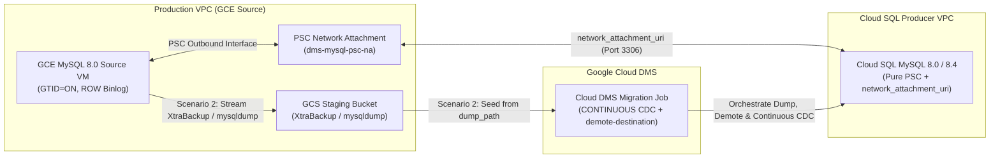

# GCE MySQL 8.0 to Cloud SQL for MySQL (8.0 / 8.4 LTS) — Cloud DMS Terraform Templates

Enterprise-grade, modular Terraform configurations for migrating self-managed **MySQL 8.0 on Google Compute Engine (GCE)** to **Cloud SQL for MySQL (`MYSQL_8_0` or `MYSQL_8_4` Enterprise Plus)** using **Google Cloud Database Migration Service (DMS)** with Continuous Change Data Capture (CDC) for near-zero downtime cutover.

---

## 1. Architectural Overview & Key Design Decisions

| Architectural Dimension | Design Decision | Engineering Rationale |
| :--- | :--- | :--- |
| **Target Database Version** | `MYSQL_8_4` (Default) or `MYSQL_8_0` | Cloud DMS and native MySQL binary log replication support homogeneous `8.0 -> 8.0` and adjacent LTS `8.0 -> 8.4` migrations. Skipping major versions directly (`8.0 -> 9.7`) during live CDC replication is unsupported by MySQL InnoDB/binlog internals. |
| **Network Connectivity** | **Private Service Connect (`PSC`)** by Default (Optional `PSA`) | Uses `google_compute_network_attachment` and Cloud SQL's `psc_config.network_attachment_uri` (PSC Outbound) together with `psc_enabled = true` (`EXISTING_CLOUDSQL` + `demote-destination`) to eliminate transitive VPC peering limits and CIDR exhaustion while keeping all dump and binlog traffic strictly internal. |
| **Target Edition & HA** | Cloud SQL **Enterprise Plus** (`REGIONAL` HA + Data Cache) | Delivers `< 60s` automatic regional failover SLA, NVMe read cache (`data_cache_enabled = true`), Point-in-Time Recovery (PITR), and up to 35 days of transaction log retention. |
| **Cutover Strategy** | Continuous Replication (`type = "CONTINUOUS"`) | Both templates stream continuous GTID row-based binary logs after the initial seed so DBAs can validate downstream replicas and promote during a brief (< 2 minute) maintenance window. |



---

## 2. Migration Scenarios

### Scenario 1: Live Migration from GCE MySQL 8.0 + Continuous CDC (`templates/01-live-migration-gce-cdc`)
- **Best For:** Databases up to ~500 GB–1 TB where the GCE MySQL 8.0 source VM (or a dedicated read replica) can sustain parallel logical dump threads (`dump_parallel_level = "MAX"`).
- **Workflow:**
  1. Cloud DMS connects privately to the GCE MySQL 8.0 instance over the PSC Network Attachment.
  2. DMS executes an automated, multi-threaded logical full dump (`dump_type = "LOGICAL"`) directly from the source into the target Cloud SQL (`MYSQL_8_4` or `MYSQL_8_0`) instance.
  3. Once the initial dump completes, DMS automatically transitions to the **CDC phase**, replaying GTID transactions continuously until promotion.

### Scenario 2: Migration from Backup in GCS + Continuous CDC (`templates/02-backup-migration-gcs-cdc`)
- **Best For:** Multi-terabyte production databases (1 TB–15+ TB) or latency-sensitive trading workloads where running a heavy live dump against the primary GCE VM is undesirable.
- **Supported Backup Formats (`dump_type`):**
  - **`PHYSICAL` (Default — Percona XtraBackup 8.0):** Streams a hot, non-blocking physical backup (`xtrabackup --backup --stream=xbstream --compress --parallel=4`) from the GCE VM directly to the regional GCS staging bucket (`gs://<bucket>/backups/...`). Fastest import performance for multi-TB datasets.
  - **`LOGICAL` (`mysqldump`):** Uses a pre-generated `mysqldump` SQL file (`--single-transaction --master-data=2 --set-gtid-purged=ON`) uploaded to GCS.
- **Terraform Provider Mutual Exclusivity Guardrail:** In `google_database_migration_service_migration_job`, `dump_path` and `dump_flags` are strictly mutually exclusive. When `dump_path` is provided (Scenario 2), our `modules/dms-migration-job` module automatically suppresses `dump_flags` and `performance_config`.

---

## 3. Repository Structure

```text
cloud-dms-templates/
├── .github/workflows/
│   └── terraform-ci.yml                  # Automated fmt & validate CI pipeline
├── .gitignore                            # Excludes state, .terraform, secrets, lockfiles
├── .pre-commit-config.yaml               # Pre-commit hooks (fmt, validate, tflint, checkov)
├── .tflint.hcl                           # TFLint Google ruleset configuration
├── Makefile                              # Day-1/Day-2 automation targets
├── README.md                             # Root architecture & usage documentation
├── docs/
│   ├── gce_mysql80_to_cloudsql_dms_migration_runbook.md
│   └── sme_audit_and_validation_report.md
├── modules/
│   ├── networking-psc/                   # PSC Network Attachment + DMS Private Connection (or PSA)
│   ├── gcs-migration-staging/            # Hardened GCS staging bucket + least-privilege IAM
│   ├── cloudsql-mysql-destination/       # Cloud SQL MySQL 8.0 / 8.4 Enterprise Plus target
│   ├── dms-connection-profiles/          # Source GCE & Destination Cloud SQL DMS profiles
│   └── dms-migration-job/                # Continuous DMS Migration Job (Live or GCS Backup-Seeded)
└── templates/
    ├── 01-live-migration-gce-cdc/        # Root Template 1: Live Dump + Continuous CDC
    └── 02-backup-migration-gcs-cdc/      # Root Template 2: GCS Backup (Physical/Logical) + CDC
        └── scripts/
            └── stream_xtrabackup_to_gcs.sh
```

---

## 4. Quick Start & Operational Commands

### Validate All Templates Locally
```bash
make fmt-check
make validate
```

### Deploy Scenario 1 (Live Migration + CDC)
```bash
cd templates/01-live-migration-gce-cdc
cp terraform.tfvars.example terraform.tfvars
# Edit terraform.tfvars with your project_id, VPC/subnet, GCE source IP, and passwords
terraform init
terraform plan
terraform apply
```

### Deploy Scenario 2 (GCS Backup-Seeded Migration + CDC)
```bash
# 1. Stream Percona XtraBackup from GCE MySQL 8.0 VM to GCS Staging Bucket
export BUCKET_NAME="prod-dms-mysql80-staging-sg"
export BACKUP_OBJECT_PATH="backups/mysql80-full.xbstream.zst"
./templates/02-backup-migration-gcs-cdc/scripts/stream_xtrabackup_to_gcs.sh

# 2. Provision Cloud SQL Target, Staging Bucket IAM, and Backup-Seeded DMS Job
cd templates/02-backup-migration-gcs-cdc
cp terraform.tfvars.example terraform.tfvars
terraform init
terraform plan
terraform apply
```

### Day-2 DMS Job Verification, Monitoring & Cutover Promotion
```bash
# Verify source/destination connectivity and GTID/binlog prerequisites
make verify-job PROJECT_ID=my-gcp-project-id REGION=asia-southeast1 JOB_ID=gce-mysql80-to-cloudsql-cdc

# Monitor migration job phase (FULL_DUMP -> CDC) and replication lag
make status-job PROJECT_ID=my-gcp-project-id REGION=asia-southeast1 JOB_ID=gce-mysql80-to-cloudsql-cdc

# Promote Cloud SQL destination during cutover window
make promote-job PROJECT_ID=my-gcp-project-id REGION=asia-southeast1 JOB_ID=gce-mysql80-to-cloudsql-cdc
```
