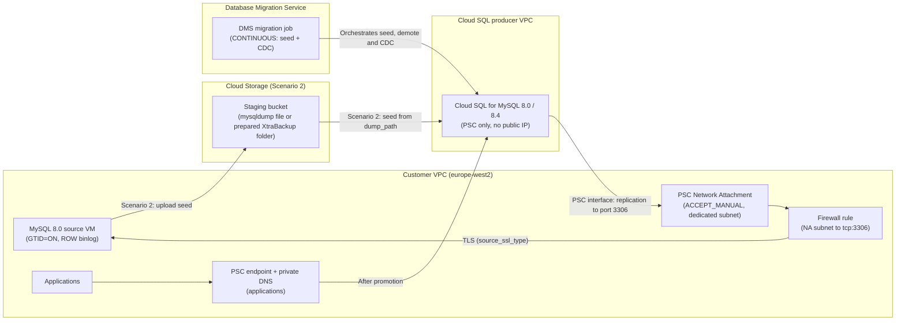

# MySQL 8.0 on Compute Engine to Cloud SQL for MySQL (8.0 / 8.4) — Database Migration Service Terraform Templates

**English** | [简体中文](README.zh-CN.md)

Modular Terraform configurations for migrating self-managed **MySQL 8.0 on Compute Engine** to **Cloud SQL for MySQL (`MYSQL_8_0` or `MYSQL_8_4`, Enterprise Plus)** with **Database Migration Service (DMS)** continuous migrations (initial seed + binlog CDC) and a short cutover window.

> [!NOTE]
> This is not an officially supported Google product. The templates are provided "as is", without warranty of any kind, under the [Apache 2.0 License](LICENSE). Test them in a non-production project and validate them against your own requirements before you use them in production. See [TESTING.md](TESTING.md) for what has been tested.

---

## 1. Architectural Overview & Key Design Decisions

| Architectural Dimension | Design Decision | Engineering Rationale |
| :--- | :--- | :--- |
| **Target Database Version** | `MYSQL_8_4` (Default) or `MYSQL_8_0` | DMS supports MySQL 8.0 sources to Cloud SQL 8.0 and 8.4 targets. A physical (XtraBackup) seed supports only a `MYSQL_8_0` target (see the support matrix in section 2). |
| **Network Connectivity** | **Private Service Connect (`PSC`)** by Default (Optional `PSA`) | The Cloud SQL instance is PSC-only (no public IP). For replication, a Compute Engine Network Attachment is attached to the instance (`psc_config.network_attachment_uri`, PSC interface) so that DMS reaches the source inside your VPC. For applications, the templates create a PSC consumer endpoint (internal IP + forwarding rule) and a private Cloud DNS record for the instance DNS name. |
| **Target Edition & HA** | Cloud SQL **Enterprise Plus** (`REGIONAL` HA + Data Cache) | Regional high availability, Data Cache (`data_cache_enabled = true`), point-in-time recovery through binary logging, and automated backups. |
| **Cutover Strategy** | Continuous Replication (`type = "CONTINUOUS"`) | Both templates replicate GTID-based binary log changes after the initial seed, so you can validate the destination and promote it during a short maintenance window. |
| **Network Security** | `ACCEPT_MANUAL` Network Attachment + source firewall rule | The Network Attachment accepts only the Cloud SQL tenant project, derived from the instance in the same apply (`ACCEPT_AUTOMATIC` is opt-in). A firewall rule (logging on) allows only the Network Attachment subnet to reach the source MySQL port. See [docs/security_hardening.md](docs/security_hardening.md). |
| **Encryption in Transit** | `source_ssl_type = "REQUIRED"`, `cloudsql_ssl_mode = "ENCRYPTED_ONLY"` | DMS replicates from the source over TLS, and Cloud SQL accepts only encrypted client connections. CMEK (`cloudsql_kms_key_name`, `staging_bucket_kms_key_name`) is optional. |
| **Lifecycle** | `migration_enabled = true` → `false` after cutover | Setting it to `false` retires the DMS job, profiles, Network Attachment and firewall rule, and keeps Cloud SQL, the PSC endpoint and DNS (runbook section 10.2). |



---

## 2. Migration Scenarios

To choose a scenario, use the decision matrix in [runbook section 1](docs/gce_mysql80_to_cloudsql_dms_migration_runbook.md#1-migration-decision-matrix-scenario-1-vs-scenario-2). For an 8.4 target, also read the 8.0 → 8.4 specifics in runbook section 1.2.

### Scenario 1: Live Migration from MySQL 8.0 on Compute Engine + Continuous CDC (`templates/01-live-migration-gce-cdc`)
- **Best For:** Databases where the source VM can sustain a DMS-managed parallel logical dump (`dump_parallel_level = "OPTIMAL"` by default).
- **Workflow:**
  1. DMS reaches the source MySQL 8.0 instance privately through the PSC interface (Network Attachment).
  2. DMS runs a parallel logical full dump (`dump_type = "LOGICAL"`) from the source into the Cloud SQL (`MYSQL_8_4` or `MYSQL_8_0`) instance.
  3. When the dump completes, DMS moves to the **CDC phase** and replays changes continuously until promotion.

### Scenario 2: Migration from a Backup in Cloud Storage + Continuous CDC (`templates/02-backup-migration-gcs-cdc`)
- **Best For:** Large databases or latency-sensitive production workloads where you want to control when and how the initial seed is taken.
- **Supported Seed Formats (`dump_type`):**
  - **`LOGICAL` (Default — `mysqldump`):** One compressed mysqldump file uploaded to the staging bucket. `dump_path` points at the file. Works for `MYSQL_8_0` and `MYSQL_8_4` targets.
  - **`PHYSICAL` (Percona XtraBackup):** A full backup that is **prepared** (`xtrabackup --backup`, then `--prepare`) and uploaded to a **dedicated folder** in the bucket. `dump_path` points at the folder. **`MYSQL_8_0` target only.** Use [`scripts/xtrabackup_to_gcs.sh`](templates/02-backup-migration-gcs-cdc/scripts/xtrabackup_to_gcs.sh).
- **Automatic bucket IAM:** Terraform grants `roles/storage.objectViewer` and `roles/storage.legacyBucketReader` on the bucket to the DMS service agent and to the Cloud SQL instance service account, and `roles/storage.objectCreator` + `roles/storage.objectViewer` to `backup_writer_members`. In `DMS_MANAGED_CLOUDSQL` mode, DMS creates the instance after apply, so grant its service account both reader roles yourself before `verify`: `gcloud storage buckets add-iam-policy-binding gs://BUCKET --member=serviceAccount:INSTANCE_SA --role=roles/storage.objectViewer` (repeat with `roles/storage.legacyBucketReader`).
- **Terraform Provider Mutual Exclusivity Guardrail:** In `google_database_migration_service_migration_job`, `dump_path` and `dump_flags` are mutually exclusive. When `dump_path` is set (Scenario 2), `modules/dms-migration-job` omits `performance_config` and rejects `dump_flags` and selective migration (`databases`).

### Several Databases or Instances (`examples/multi-database`)
- **Best For:** Several source databases or servers that go to several Cloud SQL instances (DMS runs one migration job per destination instance).
- **Workflow:** one `migrations` map entry per job. All entries share one Network Attachment (`ACCEPT_MANUAL` with the tenant projects of all instances), one firewall rule and one private DNS zone; each gets its own instance, PSC endpoint and DNS record. `databases` (selective migration) splits one source server across instances. See [examples/multi-database/README.md](examples/multi-database/README.md).

### Support Matrix

| Initial seed (`dump_type`) | Template | Target `MYSQL_8_0` | Target `MYSQL_8_4` | `dump_path` |
| :--- | :--- | :--- | :--- | :--- |
| DMS-managed logical dump (`LOGICAL`) | 01 | Supported | Supported | Not used |
| mysqldump file (`LOGICAL`, default) | 02 | Supported | Supported | One file: `gs://<bucket>/<path>.sql.gz` |
| Prepared Percona XtraBackup (`PHYSICAL`) | 02 | Supported | **Not supported by DMS** (rejected by Terraform validation) | Dedicated folder: `gs://<bucket>/<folder>` |

Sources: [Migrate by using a Percona XtraBackup physical file](https://cloud.google.com/database-migration/docs/mysql/migrate-with-physical-xtrabackup), [Known limitations](https://cloud.google.com/database-migration/docs/mysql/known-limitations).

---

## 3. Prerequisites

| Requirement | Details | Check |
| :--- | :--- | :--- |
| **Tools** | Terraform `>= 1.11` (write-only root password), Google Cloud CLI (`gcloud`), Bash. The `local-exec` steps (attach and detach the Network Attachment, demote) call `gcloud`. | `terraform version`, `gcloud version` |
| **Credentials** | Application Default Credentials for Terraform and an active `gcloud` account for the `local-exec` steps, both with the deployer roles below. To use one identity for both, set `impersonate_service_account` (the provider impersonates it and the `local-exec` steps get `CLOUDSDK_AUTH_IMPERSONATE_SERVICE_ACCOUNT`); the destroy-time detach step keeps the same setting. | `gcloud auth application-default login`, `gcloud auth list` |
| **APIs** | `datamigration`, `sqladmin`, `compute`, `servicenetworking`, `storage`, `dns`. | See commands below |
| **DMS service agent** | Must exist before the first apply (Scenario 2 grants it bucket access). | See commands below |
| **Deployer roles** | `roles/datamigration.admin`, `roles/cloudsql.admin`, `roles/compute.networkAdmin`, `roles/compute.securityAdmin` (source firewall rule), `roles/dns.admin`, `roles/storage.admin` (Scenario 2), and `roles/serviceusage.serviceUsageConsumer` on the project. Least-privilege details: [docs/security_hardening.md](docs/security_hardening.md). | `gcloud projects get-iam-policy PROJECT_ID` |
| **Network** | A dedicated small subnet for the Network Attachment (`network_attachment_subnet`, for example a `/28`), and the source VM's network tag or service account for the firewall rule (`source_target_tags` or `source_target_service_accounts`). | `gcloud compute networks subnets list` |
| **Org policies** | Check the constraints in the org-policy pre-flight table (`sql.restrictPublicIp`, `gcp.restrictNonCmekServices`, `gcp.resourceLocations`, PSC restrictions). | [docs/security_hardening.md](docs/security_hardening.md) |
| **State and secrets** | A remote GCS backend with versioning and CMEK (`backend.tf.example` in each template); passwords from Secret Manager through `TF_VAR_*`. | `gcloud secrets versions access latest --secret=...` |
| **Source database** | GTID and binlog settings and the migration accounts from [runbook section 2](docs/gce_mysql80_to_cloudsql_dms_migration_runbook.md#2-phase-1-source-mysql-80-pre-flight-verification), prepared with [`scripts/source-prep/`](scripts/source-prep/README.md). | `make preflight` (on the source VM) |

```bash
export PROJECT_ID="my-gcp-project-01"
gcloud config set project "${PROJECT_ID}"
gcloud auth application-default login

gcloud services enable datamigration.googleapis.com sqladmin.googleapis.com \
  compute.googleapis.com servicenetworking.googleapis.com \
  storage.googleapis.com dns.googleapis.com

# Create the DMS service agent (service-PROJECT_NUMBER@gcp-sa-datamigration.iam.gserviceaccount.com)
gcloud beta services identity create --service=datamigration.googleapis.com --project="${PROJECT_ID}"
```

---

## 4. Repository Structure

```text
cloud-dms-templates/
├── .github/
│   ├── CODEOWNERS
│   ├── ISSUE_TEMPLATE/                   # Bug report and feature request templates
│   ├── pull_request_template.md
│   └── workflows/
│       └── terraform-ci.yml              # Automated fmt & validate CI pipeline
├── .gitignore                            # Excludes state, .terraform, secrets
├── .pre-commit-config.yaml               # Pre-commit hooks (fmt, validate, tflint, checkov)
├── .tflint.hcl                           # TFLint Google ruleset configuration
├── CONTRIBUTING.md                       # Development gates, EN/zh-CN sync, customer-safe content
├── LICENSE                               # Apache License 2.0
├── SECURITY.md                           # Vulnerability reporting (GitHub private advisory)
├── Makefile                              # Day-1/Day-2 automation targets
├── README.md                             # Root architecture & usage documentation
├── README.zh-CN.md                       # Simplified Chinese (zh-CN) root documentation
├── TESTING.md                            # What has been tested, and known limitations
├── TESTING.zh-CN.md
├── docs/
│   ├── gce_mysql80_to_cloudsql_dms_migration_runbook.md
│   ├── gce_mysql80_to_cloudsql_dms_migration_runbook.zh-CN.md
│   ├── security_hardening.md             # Network, TLS, secrets, CMEK, org policy, IAM, audit logs
│   └── security_hardening.zh-CN.md
├── scripts/
│   └── source-prep/                      # Source MySQL 8.0 preparation (make preflight)
│       ├── 01_mysqld_dms_source.cnf      # my.cnf drop-in: server_id, ROW binlog, GTID, retention
│       ├── 02_enable_gtid_online.sql     # Step-by-step online GTID enablement
│       ├── 03_create_dms_user.sql        # DMS and XtraBackup accounts, per-scenario grants
│       ├── preflight_check.sh            # Read-only PASS/WARN/FAIL source check
│       ├── README.md
│       └── README.zh-CN.md
├── modules/
│   ├── networking-psc/                   # PSC Network Attachment (ACCEPT_MANUAL) + source firewall rule (or PSA peering)
│   ├── gcs-migration-staging/            # Staging bucket + reader/writer IAM
│   ├── cloudsql-mysql-destination/       # Cloud SQL MySQL 8.0 / 8.4 target (PSC, no public IP)
│   ├── cloudsql-psc-outbound/            # Attach/detach the Network Attachment (PSC interface) via gcloud
│   ├── cloudsql-psc-endpoint/            # PSC consumer endpoint + private DNS for applications
│   ├── dms-connection-profiles/          # Source and destination DMS connection profiles
│   └── dms-migration-job/                # Continuous DMS migration job + demote step
├── examples/
│   └── multi-database/                   # Several jobs/instances sharing one Network Attachment and DNS zone
├── scripts/ci/                           # CI helpers: zh-CN parity, generic customer-safety check
└── templates/
    ├── 01-live-migration-gce-cdc/        # Root Template 1: DMS-managed dump + CDC
    │   ├── .terraform.lock.hcl
    │   ├── backend.tf.example            # GCS remote state with versioning + CMEK
    │   ├── README.md
    │   └── README.zh-CN.md
    └── 02-backup-migration-gcs-cdc/      # Root Template 2: seed from Cloud Storage + CDC
        ├── .terraform.lock.hcl
        ├── backend.tf.example
        ├── README.md
        ├── README.zh-CN.md
        └── scripts/
            └── xtrabackup_to_gcs.sh
```

---

## 5. Quick Start & Operational Commands

Every scenario follows the same order: **preflight → apply → produce the seed and apply again (Scenario 2 only) → users, grants, DEFINERs and flags → verify → start → promote**. Don't run `terraform apply` between `start` and `promote` (runbook section 6).

### Validate All Templates Locally
```bash
make fmt-check
make validate   # templates and examples/multi-database
make test       # terraform test with a mock provider (no cloud calls)
make lint       # tflint, if installed
```

### Deploy Scenario 1 (Live Migration + CDC)
```bash
cd templates/01-live-migration-gce-cdc
cp terraform.tfvars.example terraform.tfvars
# Edit terraform.tfvars: project_id, network, subnets (incl. network_attachment_subnet),
# source IP and source_target_tags (firewall rule)
cp backend.tf.example backend.tf   # optional but recommended: remote state (edit bucket/key)
export TF_VAR_cloudsql_root_password="$(gcloud secrets versions access latest --secret=cloudsql-root-password)"
export TF_VAR_source_gce_mysql_password="$(gcloud secrets versions access latest --secret=dms-source-password)"
terraform init
terraform plan -out=tfplan
terraform apply tfplan
```

### Deploy Scenario 2 (Seed from Cloud Storage + CDC)
```bash
# 1. Phase 1: provision the bucket (with IAM), Cloud SQL, PSC endpoint and profiles.
#    DMS checks dump_path when the job is created, so the job comes in phase 2.
cd templates/02-backup-migration-gcs-cdc
cp terraform.tfvars.example terraform.tfvars
# Edit terraform.tfvars: dump_type and backup_gcs_path (see the support matrix)
export TF_VAR_cloudsql_root_password='REPLACE_ME'
export TF_VAR_source_gce_mysql_password='REPLACE_ME_MAX_32_CHARS'
terraform init
terraform plan -var create_migration_job=false -out=tfplan
terraform apply tfplan

# 2. The one seed location used everywhere
terraform output -raw configured_dump_path

# 3. On the source VM, write the seed to exactly that location:
#    LOGICAL  -> mysqldump ... | gzip | gcloud storage cp - "<configured_dump_path>"
#    PHYSICAL -> GCS_BACKUP_FOLDER="<configured_dump_path>" ./scripts/xtrabackup_to_gcs.sh
#    (full commands: runbook section 4, Option B)

# 4. Phase 2: create the migration job and demote the destination
terraform plan -out=tfplan
terraform apply tfplan
```

### Day-2 DMS Job Verification, Monitoring & Cutover Promotion
The DMS targets need `PROJECT_ID`. `JOB_ID` and `CLOUDSQL_INSTANCE` default to the Terraform outputs of `TF_DIR` (default `templates/01-live-migration-gce-cdc`); set them explicitly for `examples/multi-database`.
```bash
export PROJECT_ID=my-gcp-project-01
# Verify source/destination connectivity, GTID/binlog settings and (Scenario 2) bucket access
make verify-job PROJECT_ID=$PROJECT_ID                       # Scenario 1 (TF_DIR default)
make verify-job PROJECT_ID=$PROJECT_ID TF_DIR=templates/02-backup-migration-gcs-cdc

# Start, then watch state/phase (FULL_DUMP -> CDC) and replication lag (DMS metric
# max_replica_sec_lag, falling back to the destination's Cloud SQL replica_lag)
make start-job  PROJECT_ID=$PROJECT_ID
make status-job PROJECT_ID=$PROJECT_ID
make lag        PROJECT_ID=$PROJECT_ID LAG_MINUTES=30

# Pause and continue CDC, or start over (restart re-dumps the data)
make stop-job   PROJECT_ID=$PROJECT_ID
make resume-job PROJECT_ID=$PROJECT_ID

# Guarded promote: the job must be RUNNING in CDC with lag <= MAX_LAG_SECONDS (default 10),
# then you type the job ID to confirm (CONFIRM=yes skips the prompt in automation)
make promote-job PROJECT_ID=$PROJECT_ID MAX_LAG_SECONDS=5
```

`make demote-destination` is for manual recovery only; `terraform apply` already demotes the destination once.

Before you promote, complete the Go / No-Go checklist and the rollback decision in runbook section 8. After promotion, applications connect to `terraform output -raw psc_endpoint_dns_name` (the instance DNS name, resolved by the private zone to the PSC endpoint IP) over TLS; then run `terraform plan`/`apply` (runbook section 9.1). To retire the migration objects and keep Cloud SQL, set `migration_enabled = false` and apply (runbook section 10.2; detaching the Network Attachment restarts the instance).


### Upgrading from an Earlier Version

Review `terraform plan` before you apply a stack created with an earlier version of these templates:

- **Firewall rule:** `create_source_firewall_rule = true` is the default and needs `source_target_tags` or `source_target_service_accounts`; otherwise the plan fails a precondition. If you already manage an equivalent rule, set `create_source_firewall_rule = false`.
- **Network Attachment:** `psc_connection_preference` now defaults to `ACCEPT_MANUAL`, and `dms_tenant_project_id` is removed. The plan updates the existing attachment in place (accept list = the Cloud SQL tenant project); it doesn't replace it.
- **State addresses:** `moved` blocks map the DMS profiles and the job to their new `[0]` addresses, and the attach and demote steps are updated in place, so nothing is replaced or re-run.
- **Migration window:** Don't apply on a demoted destination before promotion (runbook section 6).

---

## 6. Testing, Support and License

- [TESTING.md](TESTING.md) lists the tested versions and scenarios, and the known limitations.
- [docs/security_hardening.md](docs/security_hardening.md) covers network controls, TLS, secrets and state, CMEK, org policies, deployer IAM and audit logs.
- Report vulnerabilities as described in [SECURITY.md](SECURITY.md). Contribution rules: [CONTRIBUTING.md](CONTRIBUTING.md).
- This is not an officially supported Google product. No support or SLA is provided.
- Licensed under the [Apache License 2.0](LICENSE).
