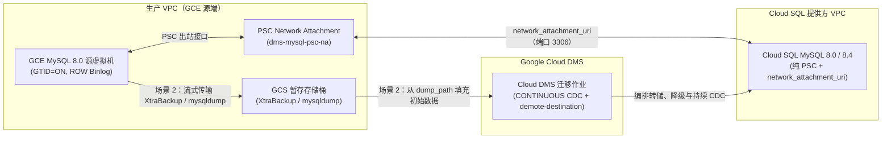

# GCE MySQL 8.0 迁移至 Cloud SQL for MySQL（8.0 / 8.4 LTS）— Cloud DMS Terraform 模板

[English](README.md) | **简体中文**

企业级、模块化的 Terraform 配置，用于借助 **Google Cloud Database Migration Service (DMS)** 及持续变更数据捕获（CDC），将自管理的 **Google Compute Engine (GCE) 上的 MySQL 8.0** 迁移至 **Cloud SQL for MySQL（`MYSQL_8_0` 或 `MYSQL_8_4` Enterprise Plus）**，实现近零停机切换。

---

## 1. 架构概览与关键设计决策

| 架构维度 | 设计决策 | 工程依据 |
| :--- | :--- | :--- |
| **目标数据库版本** | `MYSQL_8_4`（默认）或 `MYSQL_8_0` | Cloud DMS 与原生 MySQL 二进制日志复制支持同版本 `8.0 -> 8.0` 迁移以及相邻 LTS 版本 `8.0 -> 8.4` 迁移。在实时 CDC 复制过程中直接跨越主版本（`8.0 -> 9.7`）不受 MySQL InnoDB/binlog 内部机制支持。 |
| **网络连接** | 默认使用 **Private Service Connect (`PSC`)**（可选 `PSA`） | 使用 `google_compute_network_attachment` 与 Cloud SQL 的 `psc_config.network_attachment_uri`（PSC 出站），并配合 `psc_enabled = true`（`EXISTING_CLOUDSQL` + `demote-destination`），消除 VPC 对等互连的传递性限制和 CIDR 地址耗尽问题，同时确保所有转储与 binlog 流量严格保持在内网。 |
| **目标版本类型与高可用** | Cloud SQL **Enterprise Plus**（`REGIONAL` 高可用 + Data Cache） | 提供 `< 60s` 的区域级自动故障转移 SLA、NVMe 读缓存（`data_cache_enabled = true`）、时间点恢复（PITR），以及最长 35 天的事务日志保留期。 |
| **切换策略** | 持续复制（`type = "CONTINUOUS"`） | 两个模板在初始数据填充完成后均持续传输基于 GTID 的行格式二进制日志，便于 DBA 验证下游副本，并在短暂（< 2 分钟）的维护窗口内完成提升。 |



---

## 2. 迁移场景

### 场景 1：从 GCE MySQL 8.0 在线迁移 + 持续 CDC（`templates/01-live-migration-gce-cdc`）
- **适用场景：** 数据库规模约 500 GB–1 TB 以内，且 GCE MySQL 8.0 源虚拟机（或专用只读副本）能够承受并行逻辑转储线程（`dump_parallel_level = "MAX"`）。
- **工作流程：**
  1. Cloud DMS 通过 PSC Network Attachment 以私有方式连接到 GCE MySQL 8.0 实例。
  2. DMS 执行自动化的多线程逻辑全量转储（`dump_type = "LOGICAL"`），将数据直接从源端导入目标 Cloud SQL（`MYSQL_8_4` 或 `MYSQL_8_0`）实例。
  3. 初始转储完成后，DMS 自动进入 **CDC 阶段**，持续重放 GTID 事务，直至提升。

### 场景 2：基于 GCS 中的备份迁移 + 持续 CDC（`templates/02-backup-migration-gcs-cdc`）
- **适用场景：** 数 TB 级生产数据库（1 TB–15+ TB），或对延迟敏感的交易类工作负载，不宜在 GCE 主实例虚拟机上运行高负载的在线转储。
- **支持的备份格式（`dump_type`）：**
  - **`PHYSICAL`（默认 — Percona XtraBackup 8.0）：** 将非阻塞的热物理备份（`xtrabackup --backup --stream=xbstream --compress --parallel=4`）从 GCE 虚拟机直接流式传输到区域级 GCS 暂存存储桶（`gs://<bucket>/backups/...`）。对于数 TB 级数据集，导入性能最佳。
  - **`LOGICAL`（`mysqldump`）：** 使用预先生成并上传至 GCS 的 `mysqldump` SQL 文件（`--single-transaction --master-data=2 --set-gtid-purged=ON`）。
- **Terraform Provider 互斥防护：** 在 `google_database_migration_service_migration_job` 中，`dump_path` 与 `dump_flags` 严格互斥。当提供 `dump_path`（场景 2）时，`modules/dms-migration-job` 模块会自动禁用 `dump_flags` 和 `performance_config`。

---

## 3. 仓库结构

```text
cloud-dms-templates/
├── .github/workflows/
│   └── terraform-ci.yml                  # Automated fmt & validate CI pipeline
├── .gitignore                            # Excludes state, .terraform, secrets, lockfiles
├── .pre-commit-config.yaml               # Pre-commit hooks (fmt, validate, tflint, checkov)
├── .tflint.hcl                           # TFLint Google ruleset configuration
├── Makefile                              # Day-1/Day-2 automation targets
├── README.md                             # Root architecture & usage documentation
├── README.zh-CN.md                       # Simplified Chinese (zh-CN) root documentation
├── docs/
│   ├── gce_mysql80_to_cloudsql_dms_migration_runbook.md
│   ├── gce_mysql80_to_cloudsql_dms_migration_runbook.zh-CN.md
│   ├── sme_audit_and_validation_report.md
│   └── sme_audit_and_validation_report.zh-CN.md
├── modules/
│   ├── networking-psc/                   # PSC Network Attachment + DMS Private Connection (or PSA)
│   ├── gcs-migration-staging/            # Hardened GCS staging bucket + least-privilege IAM
│   ├── cloudsql-mysql-destination/       # Cloud SQL MySQL 8.0 / 8.4 Enterprise Plus target
│   ├── dms-connection-profiles/          # Source GCE & Destination Cloud SQL DMS profiles
│   └── dms-migration-job/                # Continuous DMS Migration Job (Live or GCS Backup-Seeded)
└── templates/
    ├── 01-live-migration-gce-cdc/        # Root Template 1: Live Dump + Continuous CDC
    │   ├── README.md
    │   └── README.zh-CN.md
    └── 02-backup-migration-gcs-cdc/      # Root Template 2: GCS Backup (Physical/Logical) + CDC
        ├── README.md
        ├── README.zh-CN.md
        └── scripts/
            └── stream_xtrabackup_to_gcs.sh
```

---

## 4. 快速入门与运维命令

### 在本地验证所有模板
```bash
make fmt-check
make validate
```

### 部署场景 1（在线迁移 + CDC）
```bash
cd templates/01-live-migration-gce-cdc
cp terraform.tfvars.example terraform.tfvars
# Edit terraform.tfvars with your project_id, VPC/subnet, GCE source IP, and passwords
terraform init
terraform plan
terraform apply
```

### 部署场景 2（基于 GCS 备份填充的迁移 + CDC）
```bash
# 1. Stream Percona XtraBackup from GCE MySQL 8.0 VM to GCS Staging Bucket
export BUCKET_NAME="prod-dms-mysql80-staging-sg"
export BACKUP_OBJECT_PATH="backups/mysql80-full.xbstream.zst"
./templates/02-backup-migration-gcs-cdc/scripts/stream_xtrabackup_to_gcs.sh

# 2. Provision Cloud SQL Target, Staging Bucket IAM, and Backup-Seeded DMS Job
cd templates/02-backup-migration-gcs-cdc
cp terraform.tfvars.example terraform.tfvars
terraform init
terraform plan
terraform apply
```

### Day-2 DMS 作业验证、监控与切换提升
```bash
# Verify source/destination connectivity and GTID/binlog prerequisites
make verify-job PROJECT_ID=my-gcp-project-id REGION=asia-southeast1 JOB_ID=gce-mysql80-to-cloudsql-cdc

# Monitor migration job phase (FULL_DUMP -> CDC) and replication lag
make status-job PROJECT_ID=my-gcp-project-id REGION=asia-southeast1 JOB_ID=gce-mysql80-to-cloudsql-cdc

# Promote Cloud SQL destination during cutover window
make promote-job PROJECT_ID=my-gcp-project-id REGION=asia-southeast1 JOB_ID=gce-mysql80-to-cloudsql-cdc
```
