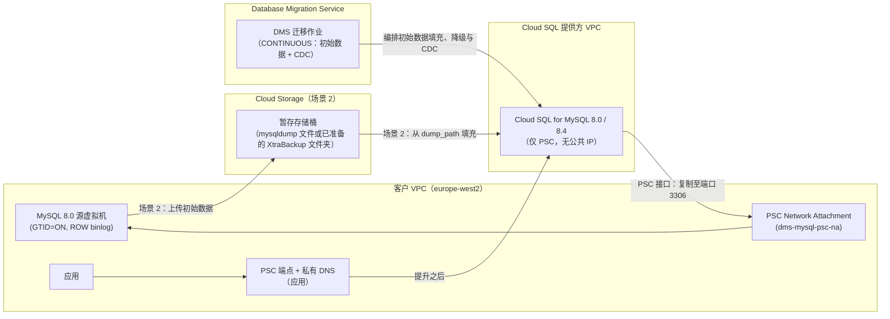

# Compute Engine 上的 MySQL 8.0 迁移至 Cloud SQL for MySQL（8.0 / 8.4）— Database Migration Service Terraform 模板

[English](README.md) | **简体中文**

模块化的 Terraform 配置，借助 **Database Migration Service (DMS)** 持续迁移（初始数据填充 + binlog CDC），将自管理的 **Compute Engine 上的 MySQL 8.0** 迁移至 **Cloud SQL for MySQL（`MYSQL_8_0` 或 `MYSQL_8_4`，Enterprise Plus）**，并在较短的切换窗口内完成切换。

> [!NOTE]
> 本项目不是 Google 官方支持的产品。模板依据 [Apache 2.0 许可证](LICENSE)按“原样”提供，不附带任何形式的保证。在生产环境中使用之前，请先在非生产项目中测试，并根据您自己的要求进行验证。已测试的内容请参阅 [TESTING.zh-CN.md](TESTING.zh-CN.md)。

---

## 1. 架构概览与关键设计决策

| 架构维度 | 设计决策 | 工程依据 |
| :--- | :--- | :--- |
| **目标数据库版本** | `MYSQL_8_4`（默认）或 `MYSQL_8_0` | DMS 支持将 MySQL 8.0 源迁移至 Cloud SQL 8.0 和 8.4 目标实例。物理（XtraBackup）初始数据仅支持 `MYSQL_8_0` 目标（请参阅第 2 节中的支持矩阵）。 |
| **网络连接** | 默认使用 **Private Service Connect (`PSC`)**（可选 `PSA`） | Cloud SQL 实例仅使用 PSC（无公共 IP）。复制方面，会将 Compute Engine Network Attachment 挂接到实例（`psc_config.network_attachment_uri`，PSC 接口），使 DMS 能够访问您 VPC 中的源端。应用方面，模板会创建 PSC 使用方端点（内部 IP + 转发规则），并为实例 DNS 名称创建私有 Cloud DNS 记录。 |
| **目标版本类型与高可用** | Cloud SQL **Enterprise Plus**（`REGIONAL` 高可用 + Data Cache） | 区域级高可用、Data Cache（`data_cache_enabled = true`）、基于二进制日志的时间点恢复以及自动备份。 |
| **切换策略** | 持续复制（`type = "CONTINUOUS"`） | 两个模板在初始数据填充完成后均持续复制基于 GTID 的二进制日志变更，便于您验证目标实例，并在较短的维护窗口内完成提升。 |



---

## 2. 迁移场景

### 场景 1：从 Compute Engine 上的 MySQL 8.0 在线迁移 + 持续 CDC（`templates/01-live-migration-gce-cdc`）
- **适用场景：** 源虚拟机能够承受由 DMS 管理的并行逻辑转储（默认 `dump_parallel_level = "OPTIMAL"`）的数据库。
- **工作流程：**
  1. DMS 通过 PSC 接口（Network Attachment）以私有方式访问源 MySQL 8.0 实例。
  2. DMS 从源端执行并行逻辑全量转储（`dump_type = "LOGICAL"`），将数据导入 Cloud SQL（`MYSQL_8_4` 或 `MYSQL_8_0`）实例。
  3. 转储完成后，DMS 进入 **CDC 阶段**，持续重放变更，直至提升。

### 场景 2：基于 Cloud Storage 中的备份迁移 + 持续 CDC（`templates/02-backup-migration-gcs-cdc`）
- **适用场景：** 大型数据库，或对延迟敏感的生产工作负载，希望自行控制初始数据的生成时间与方式。
- **支持的初始数据格式（`dump_type`）：**
  - **`LOGICAL`（默认 — `mysqldump`）：** 上传到暂存存储桶的单个压缩 mysqldump 文件。`dump_path` 指向该文件。适用于 `MYSQL_8_0` 和 `MYSQL_8_4` 目标。
  - **`PHYSICAL`（Percona XtraBackup）：** 经过**准备**（先 `xtrabackup --backup`，再 `--prepare`）并上传到存储桶中**专用文件夹**的完整备份。`dump_path` 指向该文件夹。**仅支持 `MYSQL_8_0` 目标。** 请使用 [`scripts/xtrabackup_to_gcs.sh`](templates/02-backup-migration-gcs-cdc/scripts/xtrabackup_to_gcs.sh)。
- **自动配置存储桶 IAM：** Terraform 会在存储桶上为 DMS 服务代理和 Cloud SQL 实例服务账号授予 `roles/storage.objectViewer` 与 `roles/storage.legacyBucketReader`，并为 `backup_writer_members` 授予 `roles/storage.objectCreator`。 在 `DMS_MANAGED_CLOUDSQL` 模式下，实例由 DMS 在 apply 之后创建，因此请在 `verify` 之前自行为其服务账号授予这两个读取角色：`gcloud storage buckets add-iam-policy-binding gs://BUCKET --member=serviceAccount:INSTANCE_SA --role=roles/storage.objectViewer`（再使用 `roles/storage.legacyBucketReader` 重复执行一次）。
- **Terraform Provider 互斥防护：** 在 `google_database_migration_service_migration_job` 中，`dump_path` 与 `dump_flags` 互斥。设置 `dump_path`（场景 2）时，`modules/dms-migration-job` 会省略 `dump_flags` 和 `performance_config`。

### 支持矩阵

| 初始数据（`dump_type`） | 模板 | 目标 `MYSQL_8_0` | 目标 `MYSQL_8_4` | `dump_path` |
| :--- | :--- | :--- | :--- | :--- |
| 由 DMS 管理的逻辑转储（`LOGICAL`） | 01 | 支持 | 支持 | 不使用 |
| mysqldump 文件（`LOGICAL`，默认） | 02 | 支持 | 支持 | 单个文件：`gs://<bucket>/<path>.sql.gz` |
| 已准备的 Percona XtraBackup（`PHYSICAL`） | 02 | 支持 | **DMS 不支持**（Terraform 验证会拒绝） | 专用文件夹：`gs://<bucket>/<folder>` |

参考资料：[使用 Percona XtraBackup 物理文件迁移](https://cloud.google.com/database-migration/docs/mysql/migrate-with-physical-xtrabackup)、[已知限制](https://cloud.google.com/database-migration/docs/mysql/known-limitations)。

---

## 3. 前提条件

| 要求 | 详细信息 | 检查方式 |
| :--- | :--- | :--- |
| **工具** | Terraform `>= 1.11`（只写 root 密码）、Google Cloud CLI（`gcloud`）、Bash。`local-exec` 步骤（挂接 Network Attachment、降级）会调用 `gcloud`。 | `terraform version`、`gcloud version` |
| **凭据** | 供 Terraform 使用的应用默认凭据（ADC），以及供 `local-exec` 步骤使用的有效 `gcloud` 账号，两者都需要具备下方的部署者角色。 | `gcloud auth application-default login`、`gcloud auth list` |
| **API** | `datamigration`、`sqladmin`、`compute`、`servicenetworking`、`storage`、`dns`。 | 请参阅下方命令 |
| **DMS 服务代理** | 必须在首次 apply 之前存在（场景 2 会为其授予存储桶访问权限）。 | 请参阅下方命令 |
| **部署者角色** | 项目级的 `roles/datamigration.admin`、`roles/cloudsql.admin`、`roles/compute.networkAdmin`、`roles/dns.admin`、`roles/storage.admin`（场景 2）以及 `roles/serviceusage.serviceUsageConsumer`。 | `gcloud projects get-iam-policy PROJECT_ID` |
| **源数据库** | [运维手册第 2 节](docs/gce_mysql80_to_cloudsql_dms_migration_runbook.zh-CN.md)中的 GTID 与 binlog 设置以及迁移账号。 | 运维手册 |

```bash
export PROJECT_ID="my-gcp-project-01"
gcloud config set project "${PROJECT_ID}"
gcloud auth application-default login

gcloud services enable datamigration.googleapis.com sqladmin.googleapis.com \
  compute.googleapis.com servicenetworking.googleapis.com \
  storage.googleapis.com dns.googleapis.com

# Create the DMS service agent (service-PROJECT_NUMBER@gcp-sa-datamigration.iam.gserviceaccount.com)
gcloud beta services identity create --service=datamigration.googleapis.com --project="${PROJECT_ID}"
```

---

## 4. 代码库结构

```text
cloud-dms-templates/
├── .github/workflows/
│   └── terraform-ci.yml                  # Automated fmt & validate CI pipeline
├── .gitignore                            # Excludes state, .terraform, secrets
├── .pre-commit-config.yaml               # Pre-commit hooks (fmt, validate, tflint, checkov)
├── .tflint.hcl                           # TFLint Google ruleset configuration
├── LICENSE                               # Apache License 2.0
├── Makefile                              # Day-1/Day-2 automation targets
├── README.md                             # Root architecture & usage documentation
├── README.zh-CN.md                       # Simplified Chinese (zh-CN) root documentation
├── TESTING.md                            # What has been tested, and known limitations
├── TESTING.zh-CN.md
├── docs/
│   ├── gce_mysql80_to_cloudsql_dms_migration_runbook.md
│   └── gce_mysql80_to_cloudsql_dms_migration_runbook.zh-CN.md
├── modules/
│   ├── networking-psc/                   # PSC Network Attachment (or PSA peering)
│   ├── gcs-migration-staging/            # Staging bucket + reader/writer IAM
│   ├── cloudsql-mysql-destination/       # Cloud SQL MySQL 8.0 / 8.4 target + PSC interface
│   ├── cloudsql-psc-endpoint/            # PSC consumer endpoint + private DNS for applications
│   ├── dms-connection-profiles/          # Source and destination DMS connection profiles
│   └── dms-migration-job/                # Continuous DMS migration job + demote step
└── templates/
    ├── 01-live-migration-gce-cdc/        # Root Template 1: DMS-managed dump + CDC
    │   ├── .terraform.lock.hcl
    │   ├── README.md
    │   └── README.zh-CN.md
    └── 02-backup-migration-gcs-cdc/      # Root Template 2: seed from Cloud Storage + CDC
        ├── .terraform.lock.hcl
        ├── README.md
        ├── README.zh-CN.md
        └── scripts/
            └── xtrabackup_to_gcs.sh
```

---

## 5. 快速入门与运维命令

所有场景都遵循相同的顺序：**apply → 生成初始数据（仅场景 2）→ verify → start → promote**。

### 在本地验证所有模板
```bash
make fmt-check
make validate
```

### 部署场景 1（在线迁移 + CDC）
```bash
cd templates/01-live-migration-gce-cdc
cp terraform.tfvars.example terraform.tfvars
# Edit terraform.tfvars: project_id, network, subnets, source IP
export TF_VAR_cloudsql_root_password='REPLACE_ME'
export TF_VAR_source_gce_mysql_password='REPLACE_ME_MAX_32_CHARS'
terraform init
terraform plan -out=tfplan
terraform apply tfplan
```

### 部署场景 2（从 Cloud Storage 填充初始数据 + CDC）
```bash
# 1. Provision the bucket (with IAM), Cloud SQL, PSC endpoint, profiles and the job
cd templates/02-backup-migration-gcs-cdc
cp terraform.tfvars.example terraform.tfvars
# Edit terraform.tfvars: dump_type and backup_gcs_path (see the support matrix)
export TF_VAR_cloudsql_root_password='REPLACE_ME'
export TF_VAR_source_gce_mysql_password='REPLACE_ME_MAX_32_CHARS'
terraform init
terraform plan -out=tfplan
terraform apply tfplan

# 2. The one seed location used everywhere
terraform output -raw configured_dump_path

# 3. On the source VM, write the seed to exactly that location:
#    LOGICAL  -> mysqldump ... | gzip | gcloud storage cp - "<configured_dump_path>"
#    PHYSICAL -> GCS_BACKUP_FOLDER="<configured_dump_path>" ./scripts/xtrabackup_to_gcs.sh
#    (full commands: runbook section 4, Option B)
```

### 第 2 天：DMS 作业验证、监控与切换提升
```bash
# Scenario 1 job ID: gce-live-mysql80-cdc. Scenario 2 job ID: gcs-bkp-mysql80-cdc.
# Verify source/destination connectivity, GTID/binlog settings and (Scenario 2) bucket access
make verify-job PROJECT_ID=my-gcp-project-01 REGION=europe-west2 JOB_ID=gce-live-mysql80-cdc

# Start the migration job
make start-job PROJECT_ID=my-gcp-project-01 REGION=europe-west2 JOB_ID=gce-live-mysql80-cdc

# Monitor the job state and phase (FULL_DUMP -> CDC). Replication lag is in Cloud Monitoring:
# datamigration.googleapis.com/migration_job/max_replica_sec_lag and max_replica_bytes_lag
make status-job PROJECT_ID=my-gcp-project-01 REGION=europe-west2 JOB_ID=gce-live-mysql80-cdc

# Promote the Cloud SQL destination during the cutover window
make promote-job PROJECT_ID=my-gcp-project-01 REGION=europe-west2 JOB_ID=gce-live-mysql80-cdc
```

提升之后，应用连接到 `terraform output -raw psc_endpoint_dns_name`（即实例 DNS 名称，由私有区域解析为 PSC 端点 IP）。

---

## 6. 测试、支持与许可

- [TESTING.zh-CN.md](TESTING.zh-CN.md) 列出了已测试的版本和场景以及已知限制。
- 本项目不是 Google 官方支持的产品，不提供支持或 SLA。
- 依据 [Apache License 2.0](LICENSE) 授权。
