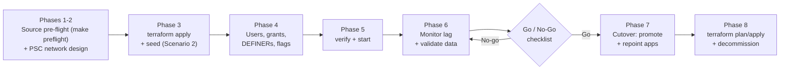
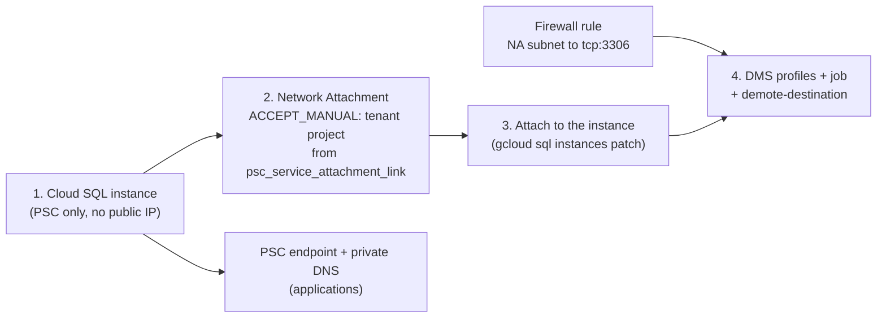
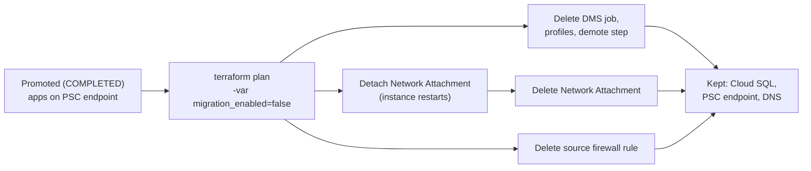

# Operational Runbook: Self-Managed MySQL 8.0 on Compute Engine to Cloud SQL (8.0 / 8.4) Migration via Database Migration Service

**English** | [简体中文](gce_mysql80_to_cloudsql_dms_migration_runbook.zh-CN.md)

> [!IMPORTANT]
> **Target MySQL Version Policy (`MYSQL_8_0` & `MYSQL_8_4` LTS)**
> These templates migrate a **MySQL 8.0** source to **Cloud SQL for MySQL 8.0 (`MYSQL_8_0`)** or **Cloud SQL for MySQL 8.4 LTS (`MYSQL_8_4`)** with Database Migration Service (DMS). MySQL doesn't support skipping major versions, so an 8.0 source can't go directly to a later major version. For the versions that Cloud SQL currently offers, see [Database versions and version policies](https://cloud.google.com/sql/docs/mysql/db-versions). Any later major version change is a separate in-place upgrade after promotion (section 9.2). See [Upgrade the database major version in-place](https://cloud.google.com/sql/docs/mysql/upgrade-major-db-version-inplace).



---

## 1. Migration Decision Matrix: Scenario 1 vs. Scenario 2

This matrix is the single source of the scenario guidance; the [README](../README.md) links here. DMS documents no database-size threshold for choosing between the two scenarios, so decide on the factors below and rehearse with production-sized data.

| Criteria | Scenario 1: Live Migration + Continuous CDC (`01-live-migration-gce-cdc`) | Scenario 2: Backup in GCS + Continuous CDC (`02-backup-migration-gcs-cdc`) |
| :--- | :--- | :--- |
| **Database Size & Dump Window** | The DMS-managed dump of the whole database finishes well inside the binlog retention window | The database is too large, or the source too busy, for a DMS-managed dump inside an acceptable window |
| **Initial Seed Mechanism** | DMS-managed parallel logical dump (`dump_type = "LOGICAL"`, `dump_parallel_level = "OPTIMAL"`) directly from the source MySQL 8.0 | mysqldump file (`dump_type = "LOGICAL"`, default) or prepared Percona XtraBackup folder (`dump_type = "PHYSICAL"`, `MYSQL_8_0` target only) in GCS via `dump_path` |
| **Impact on Source Primary** | Read I/O & CPU during the parallel dump; the source needs headroom for it | No DMS dump load; you run mysqldump or XtraBackup on your own schedule |
| **Binlog Retention** | Longer than the full DMS dump and load, plus a buffer | Longer than dump + upload + DMS restore, plus a buffer |
| **Ongoing Replication** | Continuous GTID Binlog CDC (`type = "CONTINUOUS"`) | Continuous GTID Binlog CDC (`type = "CONTINUOUS"`) automatically resumed from backup GTID coordinates |
| **Cutover Downtime** | Writes stop from source read-only until applications reconnect to the promoted instance; measure it in a rehearsal | Same as Scenario 1 |

> [!NOTE]
> Point DMS at the source **primary**. When you migrate from a self-managed MySQL read replica, DMS doesn't support GTID and requires binary log file and position replication, which these templates don't configure. Sources: [Known limitations](https://cloud.google.com/database-migration/docs/mysql/known-limitations), [Configure your source database](https://cloud.google.com/database-migration/docs/mysql/configure-source-database-continuous).

### 1.1 Seed Support Matrix

| Initial seed (`dump_type`) | Template | Target `MYSQL_8_0` | Target `MYSQL_8_4` | `dump_path` |
| :--- | :--- | :--- | :--- | :--- |
| DMS-managed logical dump (`LOGICAL`) | 01 | Supported | Supported | Not used |
| mysqldump file (`LOGICAL`, default) | 02 | Supported | Supported | One file: `gs://<bucket>/<path>.sql.gz` |
| Prepared Percona XtraBackup (`PHYSICAL`) | 02 | Supported | **Not supported by DMS** (rejected by Terraform validation) | Dedicated folder: `gs://<bucket>/<folder>` |

> [!WARNING]
> DMS doesn't support physical (XtraBackup) migrations to MySQL 8.4. Template 02 rejects `dump_type = "PHYSICAL"` unless `target_database_version = "MYSQL_8_0"`. The physical backup must be **prepared** and uploaded to a **dedicated folder** that contains no other files, and no single backup file can exceed 5 TB. See [Migrate by using a Percona XtraBackup physical file](https://cloud.google.com/database-migration/docs/mysql/migrate-with-physical-xtrabackup).

### 1.2 8.0 → 8.4 Specifics

| Factor | Target `MYSQL_8_0` | Target `MYSQL_8_4` |
| :--- | :--- | :--- |
| **Migration type** | Same major version | Cross-version (8.0 → 8.4) |
| **Seed options** | DMS dump, mysqldump, XtraBackup (`PHYSICAL`) | DMS dump, mysqldump (no `PHYSICAL`) |
| **Destination flags** | No extra flag | `local_infile=on` is required; the Cloud SQL module adds it automatically |
| **Authentication** | Cloud SQL `default_authentication_plugin` flag is available | `caching_sha2_password` is the default; `mysql_native_password` is disabled by default; the `default_authentication_plugin` flag isn't supported |
| **Upgrade checker on the source** | Optional | Required: `util.checkForServerUpgrade` (below) |
| **Fallback to the source after promotion** | Possible: configure the source as an external replica of Cloud SQL (section 8.2) | Not supported: forward-only (section 8.2) |
| **Later upgrade to 8.4** | In-place major version upgrade with downtime (section 9.2) | Not needed |

1. **`local_infile` (automatic):** DMS requires `local_infile=ON` on the destination for MySQL 8.0 → 8.4 migrations. When `target_database_version = "MYSQL_8_4"`, the `cloudsql-mysql-destination` module adds `local_infile=on` to the instance flags; you don't set it yourself. The same page says the DMS migration account can't have `BACKUP_ADMIN`. See [Known limitations](https://cloud.google.com/database-migration/docs/mysql/known-limitations).
2. **Upgrade checker:** run the MySQL Shell upgrade checker against the source before you choose `MYSQL_8_4`, and fix every error it reports. Use MySQL Shell 8.4: the short form `8.4` checks against the Shell's own 8.4 release. The account needs `PROCESS` and `SELECT`; the utility prompts for the password. See [Upgrade Checker Utility](https://dev.mysql.com/doc/mysql-shell/8.4/en/mysql-shell-utilities-upgrade.html).
   ```bash
   # On the source VM (configPath must be a local file), with MySQL Shell 8.4.x
   mysqlsh --js -e "util.checkForServerUpgrade('admin@127.0.0.1:3306', {targetVersion: '8.4', configPath: '/etc/mysql/my.cnf'})"
   ```
3. **Authentication plugins:** in MySQL 8.4, `caching_sha2_password` is the default authentication plugin, and `mysql_native_password` is disabled by default (it's removed in MySQL 9.0). On Cloud SQL, the `default_authentication_plugin` flag is supported in MySQL 8.0 only. Before cutover, recreate application accounts with `caching_sha2_password` (section 5) and confirm that every client driver and connector supports it. Sources: [caching_sha2_password](https://dev.mysql.com/doc/refman/8.4/en/caching-sha2-pluggable-authentication.html), [Native Pluggable Authentication](https://dev.mysql.com/doc/refman/8.4/en/native-pluggable-authentication.html), [Configure database flags](https://cloud.google.com/sql/docs/mysql/flags).

---

## 2. Phase 1: Source MySQL 8.0 Pre-Flight Verification

Before starting either Scenario 1 or Scenario 2, prepare and verify the self-managed source MySQL 8.0 instance (`/etc/mysql/mysql.conf.d/mysqld.cnf` or `/etc/my.cnf`). The files in [`scripts/source-prep/`](../scripts/source-prep/README.md) implement this phase:

| File | Purpose |
| :--- | :--- |
| `01_mysqld_dms_source.cnf` | `my.cnf` drop-in with the settings in section 2.1 |
| `02_enable_gtid_online.sql` | Step-by-step online GTID enablement (section 2.2) |
| `03_create_dms_user.sql` | Migration accounts and per-scenario grants (section 2.3) |
| `preflight_check.sh` | Read-only PASS/WARN/FAIL report, also run by `make preflight` (section 2.4) |

### 2.1 Mandatory `my.cnf` Parameters for GTID & Binlog CDC

```ini
[mysqld]
server_id                  = 1001
log_bin                    = mysql-bin
binlog_format              = ROW
binlog_row_image           = FULL
gtid_mode                  = ON
enforce_gtid_consistency   = ON
binlog_expire_logs_seconds = 604800   # Retain binlogs for at least 7 days (604,800s) during initial seeding
```

Verify active runtime values on the source MySQL 8.0 instance:

```sql
SHOW GLOBAL VARIABLES WHERE Variable_name IN (
  'server_id',
  'log_bin',
  'binlog_format',
  'binlog_row_image',
  'gtid_mode',
  'enforce_gtid_consistency',
  'binlog_expire_logs_seconds'
);
```

**Network listener:** DMS connects to the source over the network, so `mysqld` must listen on the VM's private IP. Ubuntu's default MySQL configuration sets `bind-address = 127.0.0.1`; change it to the private IP (or `0.0.0.0`, restricted by firewall rules to the Network Attachment subnet) and restart `mysqld`. `make preflight` warns when `bind_address` is a loopback address.

**Binlog retention sizing:** DMS needs every binlog event after the seed's GTID position when CDC starts. If those binlogs are purged first, the job fails and you must take a new seed. Size `binlog_expire_logs_seconds` as **total seed time (dump + upload + DMS restore) + buffer**, and never below 7 days (604800 s). DMS says a week is generally sufficient. Check that the source has free disk space for the extra binlogs. See [Configure your source database](https://cloud.google.com/database-migration/docs/mysql/configure-source-database-continuous).

### 2.2 Enable GTIDs Online (No Restart)

If the source already writes binlogs but runs with `gtid_mode = OFF` and you can't restart it, follow `scripts/source-prep/02_enable_gtid_online.sql` **step by step** in an interactive session. Don't pipe the whole file into `mysql`. The order is: `enforce_gtid_consistency = WARN` (watch the error log under normal load), then `ON`, then `gtid_mode = OFF_PERMISSIVE`, then `ON_PERMISSIVE`, then wait until `Ongoing_anonymous_transaction_count` is `0`, then `gtid_mode = ON`. The script uses `SET PERSIST`. DMS accepts only `gtid_mode` `ON` or `OFF`; the permissive states fail `verify`. Sources: [Enabling GTID Transactions Online](https://dev.mysql.com/doc/refman/8.0/en/replication-mode-change-online-enable-gtids.html), [Configure your source database](https://cloud.google.com/database-migration/docs/mysql/configure-source-database-continuous).

### 2.3 Create the Migration Accounts

Use two separate accounts (`scripts/source-prep/03_create_dms_user.sql` creates both):

| Account | Used by | Host | Privileges |
| :--- | :--- | :--- | :--- |
| `dms_migration` | DMS source connection profile (Terraform `source_gce_mysql_username`) | `'%'` (required by DMS) | Scenario 1: `REPLICATION SLAVE`, `REPLICATION CLIENT`, `EXECUTE`, `SELECT`, `SHOW VIEW`, `TRIGGER`, `RELOAD`; recommended extra (events / parallel dump): `EVENT`, `LOCK TABLES`. Scenario 2 (CDC only): `REPLICATION SLAVE`, `REPLICATION CLIENT`, `EXECUTE`. **Never** `BACKUP_ADMIN`. |
| `xtrabackup` | `xtrabackup_to_gcs.sh` on the source VM (Scenario 2 `PHYSICAL` only) | `'localhost'` | `BACKUP_ADMIN`, `PROCESS`, `RELOAD`, `LOCK TABLES`, `REPLICATION CLIENT`, plus `SELECT` on `performance_schema.log_status` and `performance_schema.keyring_component_status` |

Connect to the source MySQL 8.0 instance as an administrative user and run:

```sql
-- 1) DMS migration user. DMS requires host '%' and a password of 32 characters or fewer.
CREATE USER IF NOT EXISTS 'dms_migration'@'%' IDENTIFIED BY 'REPLACE_ME_MAX_32_CHARS';

-- Scenario 1 (DMS-managed dump). Required by DMS: REPLICATION SLAVE, REPLICATION CLIENT,
-- EXECUTE, SELECT, SHOW VIEW, TRIGGER, RELOAD. Recommended extra: EVENT (events),
-- LOCK TABLES (parallel dump); make preflight WARNs, not FAILs, when they are missing.
GRANT REPLICATION SLAVE, REPLICATION CLIENT, EXECUTE, SELECT, SHOW VIEW, TRIGGER, EVENT, RELOAD, LOCK TABLES
  ON *.* TO 'dms_migration'@'%';

-- Scenario 2 (you provide the seed): CDC privileges only.
-- GRANT REPLICATION SLAVE, REPLICATION CLIENT, EXECUTE ON *.* TO 'dms_migration'@'%';

-- Do NOT grant BACKUP_ADMIN to dms_migration: DMS rejects a migration account
-- with BACKUP_ADMIN on MySQL 8.0 and later.

-- 2) XtraBackup user (Scenario 2 PHYSICAL only), local connections only.
CREATE USER IF NOT EXISTS 'xtrabackup'@'localhost' IDENTIFIED BY 'REPLACE_WITH_SECURE_PASSWORD';
GRANT BACKUP_ADMIN, PROCESS, RELOAD, LOCK TABLES, REPLICATION CLIENT ON *.* TO 'xtrabackup'@'localhost';
GRANT SELECT ON performance_schema.log_status TO 'xtrabackup'@'localhost';
GRANT SELECT ON performance_schema.keyring_component_status TO 'xtrabackup'@'localhost';
```

> [!NOTE]
> For the Scenario 2 `LOGICAL` seed, run `mysqldump` with an existing administrative account that can read every migrated database (it needs `SELECT`, `SHOW VIEW`, `TRIGGER`, `EVENT`, `LOCK TABLES` and `RELOAD`). Pass credentials through a `0600` option file (`--defaults-extra-file`), never with `--password=` on the command line. References: [Configure your source database](https://cloud.google.com/database-migration/docs/mysql/configure-source-database-continuous), [Percona XtraBackup privileges](https://docs.percona.com/percona-xtrabackup/8.0/privileges.html).

> [!TIP]
> **TLS for the migration account.** Terraform connects with `source_ssl_type = "REQUIRED"` by default, so the source must offer TLS (MySQL 8.0 creates a self-signed certificate at first start; `make preflight` reports `have_ssl` and WARNs when TLS isn't available or isn't enforced). Enforce it with `SET PERSIST require_secure_transport = ON;` (all accounts) or `ALTER USER 'dms_migration'@'%' REQUIRE SSL;` (the commented option in `03_create_dms_user.sql`). Keep the host `'%'` as the DMS doc requires, and restrict the network path with the firewall rule from the Network Attachment subnet (section 3). To verify the server certificate, use `source_ssl_type = "SERVER_ONLY"` with the CA certificate (`SHOW VARIABLES LIKE 'ssl_ca';`, by default `ca.pem` in the data directory). See [security_hardening.md](security_hardening.md).

### 2.4 Run the Pre-Flight Check

Run the read-only check on the source VM, fix every FAIL, and run it again until it reports no FAIL. It exits `0` when there is no FAIL, `1` when at least one check fails, and `2` on a usage or connection error. Besides the settings above, it checks the grants of the DMS user (including no `BACKUP_ADMIN`), binlog retention against `SEED_HOURS`, non-InnoDB tables, tables without a primary key or a unique `NOT NULL` key, DEFINERs, references to system schemas, `lower_case_table_names`, character set and collation, `sql_mode`, time zone, `innodb_page_size` and database size.

```bash
# ~/.my-dms.cnf (chmod 600) contains: [client] user=... password=...
make preflight MYSQL_DEFAULTS_FILE=~/.my-dms.cnf SCENARIO=1 DMS_USER=dms_migration SEED_HOURS=24

# Same check without make (optional: --backup-gtid '<set>', --host/--port or --socket)
MYSQL_DEFAULTS_FILE=~/.my-dms.cnf ./scripts/source-prep/preflight_check.sh \
  --scenario 1 --dms-user dms_migration --seed-hours 24
```

---

## 3. Phase 2: Private Service Connect (PSC) & Outbound Network Attachment Architecture

Both templates default to **Private Service Connect (`connectivity_type = "PSC"`, `destination_mode = "EXISTING_CLOUDSQL"`)** to avoid transitive VPC peering limitations. One `terraform apply` creates the resources in this order:



1. **Cloud SQL Pure PSC + Outbound Network Attachment (`network_attachment_uri`)**:
   - The `cloudsql-mysql-destination` module configures `psc_enabled = true` (with `ipv4_enabled = false`) and `allowed_consumer_projects` (`project_id`, which hosts the PSC endpoint, plus `allowed_psc_consumer_projects`). After the Network Attachment exists, it runs `gcloud sql instances patch --psc-network-attachment-uri=... --async`, waits for the operation (`gcloud sql operations wait`, default timeout 1800 s) and re-reads the instance; the apply fails if the attachment is not set. The destination Cloud SQL instance then opens private outbound replication connections into the Network Attachment subnet.
   - `psc_config` is in `ignore_changes`. It is a set, so `ignore_changes` can't be narrowed to `network_attachment_uri`, and the attachment can't be set when the instance is created, because the Network Attachment needs the instance first (step 2). Later changes to `allowed_consumer_projects` are therefore not applied by Terraform: run `gcloud sql instances patch INSTANCE --allowed-psc-projects=PROJECT_1,PROJECT_2`.
2. **Compute Engine Network Attachment (`ACCEPT_MANUAL`)**:
   - The `networking-psc` module creates `google_compute_network_attachment` in `network_attachment_subnet` (defaults to `subnet`). Use a **dedicated small subnet** (for example a `/28`; each PSC interface takes one IP address), separate from the source subnet.
   - `psc_connection_preference = "ACCEPT_MANUAL"` (default) accepts only the Cloud SQL **tenant project**. Terraform derives it from the project segment of the instance's `psc_service_attachment_link` (`projects/<tenant-project>/regions/...`) in the same apply, so you don't need to look it up. In testing, the accept list with the tenant **project ID** was accepted; the Network Attachment then lists the connection with the tenant **project number** (`connectionEndpoints[].projectIdOrNum`) and `status: ACCEPTED`. Check it with:
     ```bash
     gcloud compute network-attachments describe dms-mysql-psc-na --region=europe-west2 \
       --format="yaml(connectionPreference,producerAcceptLists,connectionEndpoints)"
     ```
   - If the accept list doesn't contain the tenant project, the attach step fails with `[ERROR_NETWORK_ATTACHMENT_POLICY_FORBIDDEN] The Network Attachment connection policy is not allowing connection.` and no connection endpoint is created. Fix `psc_producer_accept_list` (or leave it empty to derive the tenant project) and apply again: the Network Attachment is updated in place and the attach step runs again.
   - `ACCEPT_AUTOMATIC` (opt-in) accepts a PSC interface from any project that knows the attachment URI.
3. **Firewall Rule (`create_source_firewall_rule = true`)**:
   - The module creates an INGRESS rule (`<network_attachment_name>-to-source`, logging on) that allows `tcp:source_gce_mysql_port` from the Network Attachment subnet CIDR to the source VM, selected by `source_target_tags` or `source_target_service_accounts` (one of the two). Without a rule like this, a default-deny VPC fails `verify` (section 6). Set `create_source_firewall_rule = false` only if you manage an equivalent rule yourself.
4. **TLS to the Source and to Cloud SQL**:
   - The source connection profile uses `source_ssl_type = "REQUIRED"` by default (encrypted, server certificate not verified). `SERVER_ONLY` verifies the server certificate against `source_ssl_ca_certificate`; `SERVER_CLIENT` also sends `source_ssl_client_certificate` and `source_ssl_client_key`. Enforce TLS on the source with `SET PERSIST require_secure_transport = ON;` or `ALTER USER 'dms_migration'@'%' REQUIRE SSL;` (`make preflight` reports both).
   - `cloudsql_ssl_mode = "ENCRYPTED_ONLY"` (default) makes Cloud SQL reject unencrypted client connections. It doesn't affect DMS replication, which is an outbound connection from Cloud SQL to the source.
   - Details, CMEK, org policies and deployer IAM: [security_hardening.md](security_hardening.md).
5. **Native DMS Connection Profiles & Migration Job**:
   - The source and destination connection profiles and the migration job are native Terraform resources. The source password is sent to the DMS API by the provider and never appears on a command line. The DMS connection profile has no write-only password field, so the password is still stored (marked sensitive) in Terraform state: use a protected remote backend (`backend.tf.example`).
6. **Automated Destination Demotion (`demote-destination`)**:
   - When `destination_mode = "EXISTING_CLOUDSQL"`, the `dms-migration-job` module runs `gcloud database-migration migration-jobs demote-destination` once after the job is created, waits for the operation (default timeout 3600 s) and fails the apply if the operation reports an error.
7. **PSC Consumer Endpoint & Private DNS (Application Access)**:
   - The `cloudsql-psc-endpoint` module (`create_psc_endpoint = true` by default) reserves an internal IP in `psc_endpoint_subnet`, creates a forwarding rule to the instance's service attachment, and adds an A record for the instance DNS name in a private Cloud DNS zone for `<region>.sql.goog.` bound to `network`. If your VPC already has that zone, set `psc_existing_dns_zone_name`.
8. **Credentials of the `local-exec` Steps**:
   - The attach, detach and demote steps call `gcloud` with the active `gcloud` credentials. Set `impersonate_service_account` to make the provider and these steps use the same deployer service account (exported as `CLOUDSDK_AUTH_IMPERSONATE_SERVICE_ACCOUNT`). The destroy-time detach step reads the same setting from its own state.

---

## 4. Phase 3: Deploy and Seed

Complete the [Prerequisites](../README.md#3-prerequisites) and Phase 1 first. The order is: Scenario 1 **apply → users, grants, DEFINERs and flags (section 5) → verify → start (section 6)**; Scenario 2 **apply with `create_migration_job = false` → produce the seed → apply (creates the job) → section 5 → verify → start**.

> [!IMPORTANT]
> Decide `cloudsql_lower_case_table_names` **before the first apply**. Cloud SQL for MySQL 8.0 and later accepts `lower_case_table_names` only when the instance is created; the API rejects later changes, so set it at creation. Set it to the source value (`SELECT @@lower_case_table_names;`, also reported by `make preflight`); leave it `null` to keep the Cloud SQL default (`0`). See [Configure database flags](https://cloud.google.com/sql/docs/mysql/flags).

### Option A: Scenario 1 — Live Migration + Continuous CDC (`templates/01-live-migration-gce-cdc`)

1. **Deploy Terraform Infrastructure**:
   ```bash
   cd templates/01-live-migration-gce-cdc
   cp terraform.tfvars.example terraform.tfvars
   # Edit terraform.tfvars with your project_id, network, subnets and source IP
   export TF_VAR_cloudsql_root_password='REPLACE_ME'
   export TF_VAR_source_gce_mysql_password='REPLACE_ME_MAX_32_CHARS'
   terraform init
   terraform validate
   terraform apply
   ```
2. **Continue with section 5**, then verify and start the job in section 6 (job ID `gce-live-mysql80-cdc`).

---

### Option B: Scenario 2 — Backup in GCS + Continuous CDC (`templates/02-backup-migration-gcs-cdc`)

1. **Deploy Terraform Infrastructure, Phase 1 (GCS Staging Bucket + IAM + Cloud SQL + PSC Endpoint + Connection Profiles)**. Scenario 2 is a two-phase apply: DMS rejects job creation with "The supplied dump file doesn't exist" until the seed is at `dump_path`, so the first apply sets `create_migration_job = false`. Terraform grants `backup_writer_members` `roles/storage.objectCreator` and `roles/storage.objectViewer` on the bucket; `gcloud storage cp` needs both (`storage.objects.get`).
   ```bash
   cd templates/02-backup-migration-gcs-cdc
   cp terraform.tfvars.example terraform.tfvars
   # Edit terraform.tfvars: dump_type ("LOGICAL" default, or "PHYSICAL" with MYSQL_8_0) and backup_gcs_path
   export TF_VAR_cloudsql_root_password='REPLACE_ME'
   export TF_VAR_source_gce_mysql_password='REPLACE_ME_MAX_32_CHARS'
   terraform init
   terraform validate
   # Phase 1: everything except the migration job (DMS checks dump_path when the job is created)
   terraform apply -var create_migration_job=false

   # The single seed location used by the migration job
   terraform output -raw configured_dump_path
   ```
2. **Produce the Seed on the Source VM at `configured_dump_path`**:
   - **Logical seed (`dump_type = "LOGICAL"`, default)**:
     ```bash
     export DUMP_PATH="gs://my-dms-staging-bucket/mysqldump/mysql80-dump.sql.gz"   # = configured_dump_path
     # ~/.mysqldump.cnf (chmod 600) contains: [client] user=... password=...
     mysqldump --defaults-extra-file="${HOME}/.mysqldump.cnf" \
       --host=127.0.0.1 \
       --databases app_db1 app_db2 \
       --hex-blob \
       --no-autocommit \
       --default-character-set=utf8mb4 \
       --single-transaction \
       --routines \
       --triggers \
       --events \
       --set-gtid-purged=ON \
       | gzip -c \
       | gcloud storage cp - "${DUMP_PATH}"
     ```
     List only application databases in `--databases` (not `mysql`, `sys`, `performance_schema` or `information_schema`), don't use `--master-data`/`--source-data` when GTID is on, and don't run DDL while the dump runs. See [Exporting a MySQL database using mysqldump](https://cloud.google.com/database-migration/docs/mysql/mysql-dump).
   - **Physical seed (`dump_type = "PHYSICAL"`, `MYSQL_8_0` target only — Percona XtraBackup 8.0)**:
     Copy [`scripts/xtrabackup_to_gcs.sh`](../templates/02-backup-migration-gcs-cdc/scripts/xtrabackup_to_gcs.sh) to the source VM and run it. It checks `innodb_page_size`, the XtraBackup and server versions, free disk and that the folder is empty, then runs `--backup`, `--prepare` and `gcloud storage rsync --recursive` into the folder. Prefer an XtraBackup release equal to or later than the server. If XtraBackup is older than the server but is 8.0.34 or later, the script warns and adds `--lock-ddl=ON`, which Percona supports for backing up newer servers; older XtraBackup releases are rejected. See [Server version and backup version comparison](https://docs.percona.com/percona-xtrabackup/8.0/server-backup-version-comparison.html).
     ```bash
     export GCS_BACKUP_FOLDER="gs://my-dms-staging-bucket/xtrabackup/mysql80-full"   # = configured_dump_path
     export XTRABACKUP_USER="xtrabackup"   # the script prompts for the password
     sudo -E ./xtrabackup_to_gcs.sh
     ```
3. **Create the Migration Job (Phase 2)** after the seed is complete at `configured_dump_path`. This apply creates the job and demotes the destination:
   ```bash
   terraform apply   # create_migration_job = true (default)
   ```
4. **Continue with section 5**, then verify and start the job in section 6 (job ID `gcs-bkp-mysql80-cdc`).

---

## 5. Phase 4: Users, Grants, DEFINERs and Flags

DMS doesn't migrate user accounts, logins or the `mysql` system database, and it doesn't migrate non-default flag settings. Objects whose `DEFINER` references an account that doesn't exist on the destination fail when they are invoked. Complete this phase after `apply` and **before `start`**. Sources: [Migration fidelity](https://cloud.google.com/database-migration/docs/mysql/migration-fidelity), [DEFINER clause](https://cloud.google.com/database-migration/docs/mysql/mysql-definer).

1. **Export accounts and grants from the source**:
   ```sql
   -- Application accounts (exclude system accounts and the migration accounts)
   SELECT user, host, plugin FROM mysql.user
   WHERE user NOT IN ('root', 'mysql.sys', 'mysql.session', 'mysql.infoschema', 'dms_migration', 'xtrabackup');

   -- For each account in the result:
   SHOW CREATE USER 'app_user'@'%';
   SHOW GRANTS FOR 'app_user'@'%';
   ```
2. **Audit DEFINERs on the source**. Every definer must exist on the destination before `start`. If `'root'@'localhost'` is a definer, the migration fails: change the definer to another account, or to `SQL SECURITY INVOKER`, first.
   ```sql
   SELECT DISTINCT DEFINER FROM INFORMATION_SCHEMA.EVENTS   WHERE EVENT_SCHEMA   NOT IN ('mysql', 'sys');
   SELECT DISTINCT DEFINER FROM INFORMATION_SCHEMA.ROUTINES WHERE ROUTINE_SCHEMA NOT IN ('mysql', 'sys');
   SELECT DISTINCT DEFINER FROM INFORMATION_SCHEMA.TRIGGERS WHERE TRIGGER_SCHEMA NOT IN ('mysql', 'sys');
   SELECT DISTINCT DEFINER FROM INFORMATION_SCHEMA.VIEWS    WHERE TABLE_SCHEMA   NOT IN ('mysql', 'sys');
   ```
3. **Create the accounts on the destination before `start`**. The destination is a DMS read replica at this point, so create users through the Cloud SQL Admin API (console **Users** tab or `gcloud sql users create`, which works on the demoted replica), not with `CREATE USER` in a mysql session. The module recreates `root@'%'` with the write-only root password before demotion, so you can log in as `root` for validation; you can also create a separate validation login the same way. `gcloud sql users create --password` puts the password on the command line: use it for DEFINER-only accounts with a throwaway password, and set real application passwords in the console or after promotion. Cloud SQL grants users created this way the `cloudsqlsuperuser` role. Sources: [DEFINER clause](https://cloud.google.com/database-migration/docs/mysql/mysql-definer), [About MySQL users](https://cloud.google.com/sql/docs/mysql/users).
   ```bash
   INSTANCE="$(terraform output -raw cloudsql_instance_name)"
   # DEFINER-only account: throwaway password, reset after promotion
   gcloud sql users create app_definer --host='%' --instance="${INSTANCE}" \
     --password="$(openssl rand -base64 24)"
   gcloud sql users list --instance="${INSTANCE}"
   ```
   After promotion (section 8), apply the exported `GRANT` statements, `REVOKE` privileges that each account shouldn't have (including `cloudsqlsuperuser`), and reset passwords with `ALTER USER`. On a `MYSQL_8_4` target, use `IDENTIFIED WITH caching_sha2_password` (section 1.2). Cloud SQL doesn't grant `SUPER` or `FILE`; drop those from the exported grants.
4. **Compare flags**. Run `SHOW VARIABLES` on the source and on the destination, and set the differences that matter on Cloud SQL. Not every MySQL flag is allowed on Cloud SQL. The root templates expose `cloudsql_lower_case_table_names` (create time only, section 4) and add `local_infile` for `MYSQL_8_4`. For other flags, pass the module's `database_flags` input from your root module after promotion; `gcloud sql instances patch --database-flags` replaces the whole flag list. See [Configure database flags](https://cloud.google.com/sql/docs/mysql/flags).
   ```bash
   mysql --defaults-extra-file="${HOME}/.my-dms.cnf" --host=127.0.0.1 -N -e "SHOW GLOBAL VARIABLES" | sort > source_vars.txt
   mysql --defaults-extra-file="${HOME}/.my-dst.cnf" --host="<psc_endpoint_dns_name>" -N -e "SHOW GLOBAL VARIABLES" | sort > dest_vars.txt
   diff source_vars.txt dest_vars.txt \
     | grep -E 'sql_mode|time_zone|character_set_server|collation_server|lower_case_table_names|max_allowed_packet|group_concat_max_len'
   ```

---

## 6. Phase 5: Verify and Start the Migration Job

> [!WARNING]
> Don't run a full `terraform apply` between the demotion (the end of the apply that creates the job) and `promote`. DMS modifies the backup and recovery settings (backups, point-in-time recovery) of the destination instance, so the instance differs from the Terraform configuration: in testing, `terraform plan` after demotion wanted to re-enable automated backups, and `terraform apply` then failed on the instance with `Invalid flag for instance role: Backups cannot be enabled for read replica instance` (the API rejects the change; nothing else is modified). `-target=module.networking` doesn't avoid it, because the Network Attachment depends on the instance. To change only the source firewall rule in this window, target the rule itself: `terraform apply -target='module.networking.google_compute_firewall.na_to_source[0]'`. Run `terraform plan` and `terraform apply` after promotion (section 9.1). See [Known limitations](https://cloud.google.com/database-migration/docs/mysql/known-limitations).

1. **Run DMS Verification** (connectivity, GTID/binlog settings and, for Scenario 2, bucket access):
   ```bash
   gcloud database-migration migration-jobs verify gce-live-mysql80-cdc \
     --region=europe-west2
   ```
2. **Start the Job** (Scenario 1: live dump + continuous CDC):
   ```bash
   gcloud database-migration migration-jobs start gce-live-mysql80-cdc \
     --region=europe-west2
   ```
3. **Scenario 2** uses the same two commands with its job ID:
   ```bash
   gcloud database-migration migration-jobs verify gcs-bkp-mysql80-cdc \
     --region=europe-west2

   gcloud database-migration migration-jobs start gcs-bkp-mysql80-cdc \
     --region=europe-west2
   ```

### 6.1 Troubleshooting `verify` and the Network Attachment

| Symptom | Likely cause | Fix |
| :--- | :--- | :--- |
| `verify` fails: `Failure connecting to the source database. Make sure the connectivity information on the connection profile is correct and the source database is reachable.` | No firewall rule allows the Network Attachment subnet to reach `tcp:3306` on the source VM (reproduced in testing by setting `create_source_firewall_rule = false`). Also: wrong `source_gce_mysql_host`, `bind_address` on loopback, or MySQL not listening. | Keep `create_source_firewall_rule = true` with the right `source_target_tags` or `source_target_service_accounts`, or add an equivalent rule. Check `make preflight` (`bind_address`). |
| `terraform apply` fails in the attach step: `[ERROR_NETWORK_ATTACHMENT_POLICY_FORBIDDEN] The Network Attachment connection policy is not allowing connection.` | `ACCEPT_MANUAL` accept list doesn't contain the Cloud SQL tenant project (for example a wrong `psc_producer_accept_list`). | Leave `psc_producer_accept_list` empty (derived from the instance) or fix it, then apply again. |
| `verify` fails on TLS, or `make preflight` WARNs on `tls` | The source doesn't offer TLS (`have_ssl` not `YES`) while `source_ssl_type = "REQUIRED"`, or `SERVER_ONLY` with the wrong CA. | Configure TLS on the source, or provide the CA that signed the server certificate. Use `source_ssl_type = "NONE"` only as a last resort. |
| Full `terraform apply` fails between demotion and promotion: `Backups cannot be enabled for read replica instance` | Drift that DMS introduced on the demoted destination (see the warning above). | Don't apply the instance until promotion; target only the firewall rule if you must. |

---

## 7. Phase 6: Monitoring CDC Replication Lag & Data Verification

1. **Check Migration Job Phase & State**:
   ```bash
   gcloud database-migration migration-jobs describe gce-live-mysql80-cdc \
     --region=europe-west2 \
     --format="table(name, state, phase, duration)"
   ```
   - Wait for `phase` to transition from `FULL_DUMP` to `CDC`.
2. **Monitor Replication Lag**:
   - `make lag` reads `datamigration.googleapis.com/migration_job/max_replica_sec_lag` for the job from the Cloud Monitoring API (last `LAG_MINUTES` minutes). In testing, the DMS job metrics returned no data for jobs that had been in CDC for a few minutes, so when `CLOUDSQL_INSTANCE` is set, `make lag` falls back to the destination's `cloudsql.googleapis.com/database/replication/replica_lag` and prints which metric it used. Metrics can take several minutes to appear. Wait until the lag stabilizes near `0`. See [Migration job metrics](https://cloud.google.com/database-migration/docs/mysql/migration-job-metrics) and [Replication lag](https://cloud.google.com/sql/docs/mysql/replication/replication-lag).
   ```bash
   make lag PROJECT_ID=my-gcp-project-01 REGION=europe-west2 JOB_ID=gce-live-mysql80-cdc LAG_MINUTES=30 \
     CLOUDSQL_INSTANCE="$(terraform -chdir=templates/01-live-migration-gce-cdc output -raw cloudsql_instance_name)"
   ```
3. **Verify GTID Convergence**:
   - On the source MySQL 8.0, read the executed GTID set:
     ```sql
     SELECT @@GLOBAL.gtid_executed;
     ```
   - On the destination Cloud SQL replica (read-only during CDC), connect through the PSC endpoint DNS name (`psc_endpoint_dns_name` Terraform output) and check that the source set is contained in the destination set. Don't compare the two strings: the destination set can contain other GTIDs. See [GTID functions](https://dev.mysql.com/doc/refman/8.4/en/gtid-functions.html).
     ```sql
     -- Paste the source value. 1 = every source transaction has been applied.
     SELECT GTID_SUBSET('<source gtid_executed>', @@GLOBAL.gtid_executed) AS caught_up;
     ```
4. **Validate Data with the Data Validation Tool (optional)**:
   - The [Data Validation Tool (DVT)](https://github.com/GoogleCloudPlatform/professional-services-data-validator) compares row counts (and optionally aggregates, rows and schemas) between source and destination. Install it on a host that reaches both databases, create the two connections once, then run count validation with `make validate-data`. With `--secret-manager-type GCP`, only `--password` is a Secret Manager secret name; host, port and user are literal values (DVT uses the literal value when no secret of that name exists). Run the final comparison after the source is read-only (section 8).
   ```bash
   pip install google-pso-data-validator

   data-validation connections add \
     --secret-manager-type GCP --secret-manager-project-id my-gcp-project-01 \
     --connection-name dms_src MySQL \
     --host 10.10.0.10 --port 3306 --user dvt_reader --password dvt-src-password-secret --database app_db1
   data-validation connections add \
     --secret-manager-type GCP --secret-manager-project-id my-gcp-project-01 \
     --connection-name dms_tgt MySQL \
     --host "<psc_endpoint_dns_name>" --port 3306 --user dvt_reader --password dvt-tgt-password-secret --database app_db1

   make validate-data DVT_SOURCE_CONN=dms_src DVT_TARGET_CONN=dms_tgt DVT_TABLES='app_db1.orders,app_db1.customers'
   ```

---

## 8. Phase 7: Cutover (Promotion)

### 8.1 Go / No-Go Checklist

Promote only when every item is checked and recorded:

| Check | How | Go when |
| :--- | :--- | :--- |
| Replication lag | `make lag` (section 7) | `max_replica_sec_lag` (or `replica_lag`) ≈ `0` and stable |
| GTID convergence | `GTID_SUBSET('<source gtid_executed>', @@GLOBAL.gtid_executed)` on the destination, after the source is read-only | Returns `1` |
| Data validation | DVT count validation, `make validate-data` (optional) | No mismatches |
| Users, grants and DEFINERs | `gcloud sql users list`; the section 5 audit | Every application account and definer exists |
| Application connectivity | From an application host, connect to the `psc_endpoint_dns_name` output | Login succeeds |
| Rollback decision | Section 8.2 | Recorded and signed off |

### 8.2 Rollback Decision

- **`MYSQL_8_4` target is forward-only.** MySQL supports replication from an older source to a newer replica; replication from newer sources to older replicas is generally not supported. After promotion, you can't replicate the 8.4 instance back into the 8.0 source. See [Replication Compatibility Between MySQL Versions](https://dev.mysql.com/doc/refman/8.4/en/replication-compatibility.html).
- **When fallback is mandatory**, migrate to `MYSQL_8_0` instead. After promotion, configure the old source as an external replica of the Cloud SQL instance, so it stays current and can take traffic back. Upgrade Cloud SQL to 8.4 in place later (section 9.2), when you no longer need the fallback. The old source must reach the instance over the network (with these templates, through the PSC endpoint), and the external replica guide describes IP-based access, so rehearse this setup before you rely on it. See [Configure external replicas](https://cloud.google.com/sql/docs/mysql/replication/configure-external-replica).

### 8.3 Cutover Steps

Perform the following sequence during the scheduled cutover window:

1. **Drain Application Traffic & Set the Source MySQL 8.0 to Read-Only**:
   ```sql
   SET GLOBAL super_read_only = ON;
   SET GLOBAL read_only = ON;
   ```
2. **Confirm Zero Replication Lag**:
   Run the `GTID_SUBSET` check from section 7 against the final source `gtid_executed`; it must return `1`. Complete the Go / No-Go checklist (section 8.1).
3. **Promote the Cloud DMS Migration Job**:
   ```bash
   gcloud database-migration migration-jobs promote gce-live-mysql80-cdc \
     --region=europe-west2
   ```
   - Cloud DMS disconnects replication from the source MySQL 8.0 and promotes the Cloud SQL for MySQL (`MYSQL_8_4` or `MYSQL_8_0`) instance to a standalone writable primary (`state = COMPLETED`).
4. **Apply Grants and Passwords**: run the section 5 post-promotion steps (`GRANT`, `REVOKE`, `ALTER USER`).
5. **Repoint Application Endpoints**:
   - Point your connection strings to the PSC endpoint DNS name (`psc_endpoint_dns_name` Terraform output). The private zone created by Terraform resolves it to the PSC endpoint IP (`psc_endpoint_ip_address`) inside `network`. Test from an application host:
     ```bash
     mysql --host="<psc_endpoint_dns_name>" --ssl-mode=REQUIRED --user="<app_user>" -p -e "SELECT @@hostname, @@version;"
     ```

---

## 9. Phase 8: Post-Promotion

### 9.1 Reconcile Terraform

DMS changed the destination's backup and recovery settings during the migration (section 6). In testing, `terraform plan` after demotion showed automated backups `enabled false -> true`, and after promotion it showed `retained_backups 7 -> 30` and removal of the `goog-dms-instance` label. After promotion, review the drift and re-apply your configuration; the next `terraform plan` should report no changes:

```bash
terraform plan -out=tfplan   # Review: expect backup/PITR settings to be restored, nothing replaced
terraform apply tfplan
```

Don't apply a plan that replaces or destroys `module.cloudsql_destination`. To keep Cloud SQL and retire the migration objects, follow section 10.2 instead.

This is also the apply in which to turn on `cloudsql_password_validation_policy` (for example `{ min_length = 14 }`): when it is set at creation, the API rejects the instance (`Root user's password is not policy compliant`), because the root password is applied afterwards by the write-only `google_sql_user`. Enabling it on the promoted instance worked in testing, and the next plan reported no changes. Client connections must use TLS (`cloudsql_ssl_mode = "ENCRYPTED_ONLY"`): in testing, `mysql --ssl-mode=DISABLED` through the PSC endpoint was rejected with `ERROR 1045 (28000): Access denied`.

### 9.2 Major Version Upgrade Path

- If you migrated to **`MYSQL_8_0`** (for example, to keep the section 8.2 fallback), you can upgrade in place to **`MYSQL_8_4`** by setting `target_database_version = "MYSQL_8_4"` and running `terraform apply`, or with `gcloud sql instances patch --database-version`. On a stack that still contains the migration objects, retire them first (section 10.2), so the upgrade plan touches only the instance. In template 02, the `dump_type = "PHYSICAL"` validation rejects `target_database_version = "MYSQL_8_4"`: set `dump_type = "LOGICAL"`, or remove the stack's DMS objects, before you change the version.
- Upgrades go one major version at a time; MySQL doesn't support skipping major versions. Later major versions follow the same path: check which versions Cloud SQL offers in [Database versions and version policies](https://cloud.google.com/sql/docs/mysql/db-versions).
- A major version upgrade **makes the instance unavailable for a period of time**. Plan a maintenance window, run the upgrade precheck (Preview), and do a dry run on a clone first. See [Upgrade the database major version in-place](https://cloud.google.com/sql/docs/mysql/upgrade-major-db-version-inplace).

---

## 10. Teardown and Decommission

> [!CAUTION]
> `gcloud database-migration migration-jobs delete` always deletes the destination connection profile with the job, and with `--force` it also deletes the destination Cloud SQL replica database. Never use `--force` on a production migration. Terraform never sets `--force`. Check with `gcloud database-migration migration-jobs delete --help`.

> [!WARNING]
> **Deleting a job before promotion abandons the migration.** In testing, DMS accepted the delete of a `RUNNING` job in the CDC phase (state `DELETING`, then gone, together with the destination connection profile). The destination instance stayed a read replica of the external source (`instanceType: READ_REPLICA_INSTANCE`). Promote it with `gcloud sql instances promote-replica INSTANCE` or delete it. `terraform destroy` behaves the same way. DMS also leaves the source representation instance `<instance>-master` (type `ON_PREMISES_INSTANCE`) behind after an abandoned migration, even when Terraform deletes the replica; delete it with `gcloud sql instances delete <instance>-master`. After a normal promotion it was removed automatically in testing.

### 10.1 Test Environment

1. **Turn off deletion protection**: set `cloudsql_deletion_protection = false` in `terraform.tfvars`, then run `terraform apply` (after promotion; on a demoted replica, see section 6).
2. **Destroy the stack**. Terraform deletes the job (also while it is running) and the profiles, detaches the Network Attachment from the instance (this restarts the instance; about 5 minutes in testing), and then deletes the Network Attachment, the firewall rule, the PSC endpoint and the instance:
   ```bash
   terraform destroy
   ```
3. **Delete the staging bucket last** (Scenario 2). It is versioned; unless `staging_bucket_force_destroy = true`, `terraform destroy` can't delete it while it still holds objects. Delete the objects, then run `terraform destroy` again:
   ```bash
   gcloud storage rm --recursive --all-versions "gs://my-dms-staging-bucket/**"
   terraform destroy
   ```

### 10.2 Production After Cutover

Keep the Cloud SQL instance, the PSC endpoint and the DNS record, and retire only the migration objects with **`migration_enabled = false`**. Use it only after promotion (job state `COMPLETED`): before promotion, a full apply fails on the demoted replica (section 6).



1. **Schedule a maintenance window.** Detaching the Network Attachment **restarts the instance**. The Cloud SQL documentation gives about 8 minutes for the operation and about 3 minutes of downtime when PSC outbound connectivity is enabled or changed ([Configure Private Service Connect](https://cloud.google.com/sql/docs/mysql/configure-private-service-connect)); plan for those figures. Observed in testing: the detach took about 5 minutes, and a client probe through the PSC endpoint failed for about 20 seconds.
2. **Review the plan.** It must destroy only the DMS job, the connection profiles, the demote step, the attach step, the Network Attachment and the source firewall rule, and must not touch the Cloud SQL instance, the root user, the PSC endpoint or the DNS record:
   ```bash
   terraform plan -var migration_enabled=false -out=tfplan
   ```
3. **Apply it**, then set `migration_enabled = false` in `terraform.tfvars` so that later applies keep it:
   ```bash
   terraform apply tfplan
   ```
   Terraform runs `gcloud sql instances patch --clear-psc-network-attachment-uri` before it deletes the Network Attachment, waits for the operation and checks that `networkAttachmentUri` is empty.
4. **Check the result**:
   ```bash
   gcloud sql instances describe "$(terraform output -raw cloudsql_instance_name)" \
     --format="value(state,settings.ipConfiguration.pscConfig.networkAttachmentUri)"   # RUNNABLE, empty
   mysql --host="$(terraform output -raw psc_endpoint_dns_name)" --ssl-mode=REQUIRED --user="<app_user>" -p -e "SELECT 1;"
   ```
5. **Scenario 2:** delete the seed (`gcloud storage rm`, add `--recursive` for a `PHYSICAL` folder). The noncurrent version is deleted after `staging_bucket_noncurrent_version_retention_days`. Remove the bucket when you no longer need it.
6. **Optional: move the instance to a long-lived stack.** Back up the state, remove the instance and the PSC endpoint from the migration stack, and import them into a stack that keeps `deletion_protection` on (`import` blocks):
   ```bash
   (umask 077; terraform state pull > pre-decommission.tfstate)   # contains secrets: mode 0600
   terraform state rm module.cloudsql_destination module.cloudsql_psc_endpoint
   # After the import into the long-lived stack succeeds:
   shred -u pre-decommission.tfstate
   ```
