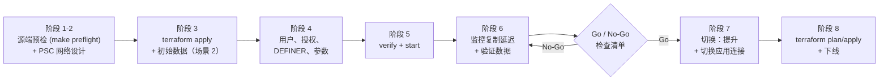
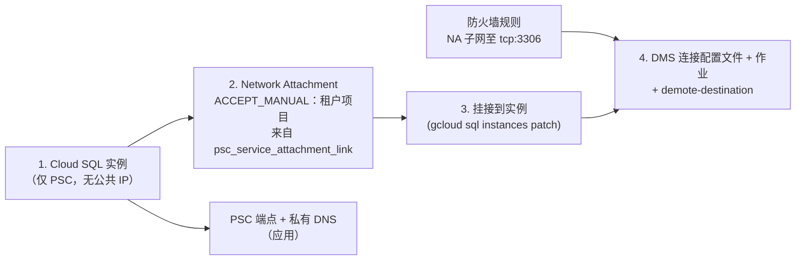
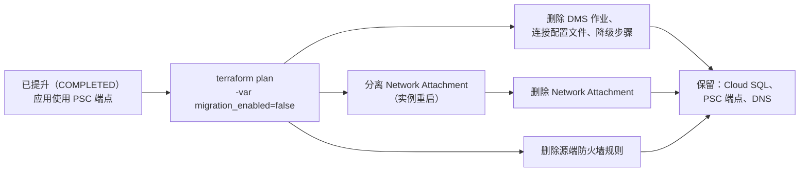

# 运维手册：通过 Database Migration Service 将 Compute Engine 上的自管理 MySQL 8.0 迁移至 Cloud SQL（8.0 / 8.4）

[English](gce_mysql80_to_cloudsql_dms_migration_runbook.md) | **简体中文**

> [!IMPORTANT]
> **目标 MySQL 版本策略（`MYSQL_8_0` 与 `MYSQL_8_4` LTS）**
> 这些模板借助 Database Migration Service (DMS)，将 **MySQL 8.0** 源迁移至 **Cloud SQL for MySQL 8.0 (`MYSQL_8_0`)** 或 **Cloud SQL for MySQL 8.4 LTS (`MYSQL_8_4`)**。MySQL 不支持跨越主版本，因此 8.0 源无法直接迁移到更高的主版本。如需了解 Cloud SQL 当前提供的版本，请参阅[数据库版本和版本政策](https://cloud.google.com/sql/docs/mysql/db-versions)。之后的任何主版本变更都是提升后单独进行的就地升级（第 9.2 节）。请参阅[就地升级数据库主版本](https://cloud.google.com/sql/docs/mysql/upgrade-major-db-version-inplace)。



---

## 1. 迁移决策矩阵：场景 1 与场景 2

本矩阵是场景选择指导的唯一来源；[README](../README.zh-CN.md) 会链接到此处。DMS 没有规定用于在两种场景之间进行选择的数据库规模阈值，因此请依据以下因素做出决定，并使用与生产规模相当的数据进行演练。

| 评估标准 | 场景 1：在线迁移 + 持续 CDC（`01-live-migration-gce-cdc`） | 场景 2：GCS 中的备份 + 持续 CDC（`02-backup-migration-gcs-cdc`） |
| :--- | :--- | :--- |
| **数据库规模与转储时间窗口** | 由 DMS 管理的整库转储能够在 binlog 保留期内从容完成 | 数据库过大或源端过于繁忙，无法在可接受的时间窗口内完成由 DMS 管理的转储 |
| **初始数据填充机制** | 由 DMS 管理、直接从源 MySQL 8.0 执行的并行逻辑转储（`dump_type = "LOGICAL"`，`dump_parallel_level = "OPTIMAL"`） | 通过 `dump_path` 使用 GCS 中的 mysqldump 文件（`dump_type = "LOGICAL"`，默认）或已准备的 Percona XtraBackup 文件夹（`dump_type = "PHYSICAL"`，仅限 `MYSQL_8_0` 目标） |
| **对源主实例的影响** | 并行转储期间存在读 I/O 与 CPU 开销；源端需要为此预留余量 | 无 DMS 转储负载；由您按自己的时间安排运行 mysqldump 或 XtraBackup |
| **Binlog 保留期** | 长于完整的 DMS 转储与加载时间，并留有余量 | 长于转储 + 上传 + DMS 恢复的总时间，并留有余量 |
| **持续复制** | 基于 GTID 的持续 Binlog CDC（`type = "CONTINUOUS"`） | 基于 GTID 的持续 Binlog CDC（`type = "CONTINUOUS"`），自动从备份的 GTID 坐标处恢复 |
| **切换停机时间** | 从源端设为只读开始，直到应用重新连接到已提升的实例为止，期间无法写入；请在演练中实际测量 | 与场景 1 相同 |

> [!NOTE]
> 请将 DMS 指向源端**主实例**。从自管理的 MySQL 只读副本迁移时，DMS 不支持 GTID，必须使用基于 binlog 文件和位置的复制，而这些模板并未配置该方式。来源：[已知限制](https://cloud.google.com/database-migration/docs/mysql/known-limitations)、[配置源数据库](https://cloud.google.com/database-migration/docs/mysql/configure-source-database-continuous)。

### 1.1 初始数据支持矩阵

| 初始数据（`dump_type`） | 模板 | 目标 `MYSQL_8_0` | 目标 `MYSQL_8_4` | `dump_path` |
| :--- | :--- | :--- | :--- | :--- |
| 由 DMS 管理的逻辑转储（`LOGICAL`） | 01 | 支持 | 支持 | 不使用 |
| mysqldump 文件（`LOGICAL`，默认） | 02 | 支持 | 支持 | 单个文件：`gs://<bucket>/<path>.sql.gz` |
| 已准备的 Percona XtraBackup（`PHYSICAL`） | 02 | 支持 | **DMS 不支持**（Terraform 验证会拒绝） | 专用文件夹：`gs://<bucket>/<folder>` |

> [!WARNING]
> DMS 不支持以物理（XtraBackup）方式迁移至 MySQL 8.4。除非 `target_database_version = "MYSQL_8_0"`，否则模板 02 会拒绝 `dump_type = "PHYSICAL"`。物理备份必须经过**准备（prepare）**，并上传到不包含任何其他文件的**专用文件夹**，且单个备份文件不得超过 5 TB。请参阅[使用 Percona XtraBackup 物理文件迁移](https://cloud.google.com/database-migration/docs/mysql/migrate-with-physical-xtrabackup)。

### 1.2 8.0 → 8.4 注意事项

| 因素 | 目标 `MYSQL_8_0` | 目标 `MYSQL_8_4` |
| :--- | :--- | :--- |
| **迁移类型** | 相同主版本 | 跨版本（8.0 → 8.4） |
| **初始数据选项** | DMS 转储、mysqldump、XtraBackup（`PHYSICAL`） | DMS 转储、mysqldump（不支持 `PHYSICAL`） |
| **目标实例参数** | 无需额外参数 | 必须设置 `local_infile=on`；Cloud SQL 模块会自动添加 |
| **身份验证** | 可使用 Cloud SQL 的 `default_authentication_plugin` 参数 | 默认使用 `caching_sha2_password`；`mysql_native_password` 默认处于禁用状态；不支持 `default_authentication_plugin` 参数 |
| **在源端运行升级检查器** | 可选 | 必需：`util.checkForServerUpgrade`（见下文） |
| **提升后回退到源端** | 可行：将源端配置为 Cloud SQL 的外部副本（第 8.2 节） | 不支持：只能向前（第 8.2 节） |
| **之后升级到 8.4** | 需停机的就地主版本升级（第 9.2 节） | 无需 |

1. **`local_infile`（自动设置）：** 对于 MySQL 8.0 → 8.4 迁移，DMS 要求目标实例设置 `local_infile=ON`。当 `target_database_version = "MYSQL_8_4"` 时，`cloudsql-mysql-destination` 模块会将 `local_infile=on` 添加到实例参数中，您无需自行设置。同一页面还指出，DMS 迁移账号不能拥有 `BACKUP_ADMIN`。请参阅[已知限制](https://cloud.google.com/database-migration/docs/mysql/known-limitations)。
2. **升级检查器：** 在选择 `MYSQL_8_4` 之前，请针对源端运行 MySQL Shell 升级检查器，并修复其报告的所有错误。请使用 MySQL Shell 8.4：简写形式 `8.4` 会以该 Shell 自身的 8.4 版本作为检查目标。所用账号需要 `PROCESS` 和 `SELECT` 权限；该工具会提示输入密码。请参阅[升级检查器工具](https://dev.mysql.com/doc/mysql-shell/8.4/en/mysql-shell-utilities-upgrade.html)。
   ```bash
   # On the source VM (configPath must be a local file), with MySQL Shell 8.4.x
   mysqlsh --js -e "util.checkForServerUpgrade('admin@127.0.0.1:3306', {targetVersion: '8.4', configPath: '/etc/mysql/my.cnf'})"
   ```
3. **身份验证插件：** 在 MySQL 8.4 中，`caching_sha2_password` 是默认身份验证插件，`mysql_native_password` 默认处于禁用状态（并已在 MySQL 9.0 中移除）。在 Cloud SQL 上，`default_authentication_plugin` 参数仅在 MySQL 8.0 中受支持。切换前，请使用 `caching_sha2_password` 重新创建应用账号（第 5 节），并确认所有客户端驱动和连接器均支持该插件。来源：[caching_sha2_password](https://dev.mysql.com/doc/refman/8.4/en/caching-sha2-pluggable-authentication.html)、[原生可插拔身份验证](https://dev.mysql.com/doc/refman/8.4/en/native-pluggable-authentication.html)、[配置数据库参数](https://cloud.google.com/sql/docs/mysql/flags)。

---

## 2. 阶段 1：源 MySQL 8.0 预检验证

在启动场景 1 或场景 2 之前，请准备并验证自管理的源 MySQL 8.0 实例（`/etc/mysql/mysql.conf.d/mysqld.cnf` 或 `/etc/my.cnf`）。[`scripts/source-prep/`](../scripts/source-prep/README.zh-CN.md) 中的文件实现了本阶段的操作：

| 文件 | 用途 |
| :--- | :--- |
| `01_mysqld_dms_source.cnf` | 包含第 2.1 节所列设置的 `my.cnf` 附加配置文件 |
| `02_enable_gtid_online.sql` | 分步在线启用 GTID（第 2.2 节） |
| `03_create_dms_user.sql` | 迁移账号及各场景的授权（第 2.3 节） |
| `preflight_check.sh` | 只读的 PASS/WARN/FAIL 报告，也可通过 `make preflight` 运行（第 2.4 节） |

### 2.1 GTID 与 Binlog CDC 必需的 `my.cnf` 参数

```ini
[mysqld]
server_id                  = 1001
log_bin                    = mysql-bin
binlog_format              = ROW
binlog_row_image           = FULL
gtid_mode                  = ON
enforce_gtid_consistency   = ON
binlog_expire_logs_seconds = 604800   # Retain binlogs for at least 7 days (604,800s) during initial seeding
```

在源 MySQL 8.0 实例上验证当前运行时的参数值：

```sql
SHOW GLOBAL VARIABLES WHERE Variable_name IN (
  'server_id',
  'log_bin',
  'binlog_format',
  'binlog_row_image',
  'gtid_mode',
  'enforce_gtid_consistency',
  'binlog_expire_logs_seconds'
);
```

**网络监听地址：** DMS 通过网络连接源端，因此 `mysqld` 必须监听虚拟机的私有 IP。Ubuntu 的默认 MySQL 配置为 `bind-address = 127.0.0.1`；请将其改为私有 IP（或 `0.0.0.0`，并通过防火墙规则仅允许 Network Attachment 子网访问），然后重启 `mysqld`。当 `bind_address` 为环回地址时，`make preflight` 会发出警告。

**Binlog 保留期估算：** CDC 启动时，DMS 需要初始数据 GTID 位置之后的全部 binlog 事件。如果这些 binlog 先被清除，作业会失败，您必须重新生成初始数据。请按 **初始数据总耗时（转储 + 上传 + DMS 恢复）+ 余量** 设置 `binlog_expire_logs_seconds`，且不得少于 7 天（604800 秒）。DMS 表示通常一周就足够。请确认源端有足够的可用磁盘空间存放额外的 binlog。请参阅[配置源数据库](https://cloud.google.com/database-migration/docs/mysql/configure-source-database-continuous)。

### 2.2 在线启用 GTID（无需重启）

如果源端已在写入 binlog，但 `gtid_mode = OFF` 且无法重启，请在交互式会话中**逐步**执行 `scripts/source-prep/02_enable_gtid_online.sql`。不要将整个文件通过管道传给 `mysql`。顺序为：`enforce_gtid_consistency = WARN`（在正常负载下观察错误日志），然后 `ON`，然后 `gtid_mode = OFF_PERMISSIVE`，然后 `ON_PERMISSIVE`，然后等待 `Ongoing_anonymous_transaction_count` 变为 `0`，最后 `gtid_mode = ON`。该脚本使用 `SET PERSIST`。DMS 仅接受 `gtid_mode` 为 `ON` 或 `OFF`；处于 permissive 状态时 `verify` 会失败。来源：[在线启用 GTID 事务](https://dev.mysql.com/doc/refman/8.0/en/replication-mode-change-online-enable-gtids.html)、[配置源数据库](https://cloud.google.com/database-migration/docs/mysql/configure-source-database-continuous)。

### 2.3 创建迁移账号

使用两个独立的账号（`scripts/source-prep/03_create_dms_user.sql` 会同时创建这两个账号）：

| 账号 | 使用方 | 主机 | 权限 |
| :--- | :--- | :--- | :--- |
| `dms_migration` | DMS 源连接配置文件（Terraform `source_gce_mysql_username`） | `'%'`（DMS 要求） | 场景 1：`REPLICATION SLAVE`、`REPLICATION CLIENT`、`EXECUTE`、`SELECT`、`SHOW VIEW`、`TRIGGER`、`RELOAD`；建议额外授予（用于事件 / 并行转储）：`EVENT`、`LOCK TABLES`。场景 2（仅 CDC）：`REPLICATION SLAVE`、`REPLICATION CLIENT`、`EXECUTE`。**切勿**授予 `BACKUP_ADMIN`。 |
| `xtrabackup` | 源虚拟机上的 `xtrabackup_to_gcs.sh`（仅场景 2 `PHYSICAL`） | `'localhost'` | `BACKUP_ADMIN`、`PROCESS`、`RELOAD`、`LOCK TABLES`、`REPLICATION CLIENT`，以及 `performance_schema.log_status` 和 `performance_schema.keyring_component_status` 上的 `SELECT` |

以管理员用户身份连接到源 MySQL 8.0 实例并运行：

```sql
-- 1) DMS migration user. DMS requires host '%' and a password of 32 characters or fewer.
CREATE USER IF NOT EXISTS 'dms_migration'@'%' IDENTIFIED BY 'REPLACE_ME_MAX_32_CHARS';

-- Scenario 1 (DMS-managed dump). Required by DMS: REPLICATION SLAVE, REPLICATION CLIENT,
-- EXECUTE, SELECT, SHOW VIEW, TRIGGER, RELOAD. Recommended extra: EVENT (events),
-- LOCK TABLES (parallel dump); make preflight WARNs, not FAILs, when they are missing.
GRANT REPLICATION SLAVE, REPLICATION CLIENT, EXECUTE, SELECT, SHOW VIEW, TRIGGER, EVENT, RELOAD, LOCK TABLES
  ON *.* TO 'dms_migration'@'%';

-- Scenario 2 (you provide the seed): CDC privileges only.
-- GRANT REPLICATION SLAVE, REPLICATION CLIENT, EXECUTE ON *.* TO 'dms_migration'@'%';

-- Do NOT grant BACKUP_ADMIN to dms_migration: DMS rejects a migration account
-- with BACKUP_ADMIN on MySQL 8.0 and later.

-- 2) XtraBackup user (Scenario 2 PHYSICAL only), local connections only.
CREATE USER IF NOT EXISTS 'xtrabackup'@'localhost' IDENTIFIED BY 'REPLACE_WITH_SECURE_PASSWORD';
GRANT BACKUP_ADMIN, PROCESS, RELOAD, LOCK TABLES, REPLICATION CLIENT ON *.* TO 'xtrabackup'@'localhost';
GRANT SELECT ON performance_schema.log_status TO 'xtrabackup'@'localhost';
GRANT SELECT ON performance_schema.keyring_component_status TO 'xtrabackup'@'localhost';
```

> [!NOTE]
> 对于场景 2 的 `LOGICAL` 初始数据，请使用可读取所有待迁移数据库的现有管理员账号运行 `mysqldump`（需要 `SELECT`、`SHOW VIEW`、`TRIGGER`、`EVENT`、`LOCK TABLES` 和 `RELOAD`）。请通过权限为 `0600` 的选项文件（`--defaults-extra-file`）传递凭据，切勿在命令行中使用 `--password=`。参考资料：[配置源数据库](https://cloud.google.com/database-migration/docs/mysql/configure-source-database-continuous)、[Percona XtraBackup 权限](https://docs.percona.com/percona-xtrabackup/8.0/privileges.html)。

> [!TIP]
> **迁移账号的 TLS。** Terraform 默认使用 `source_ssl_type = "REQUIRED"` 进行连接，因此源端必须提供 TLS（MySQL 8.0 会在首次启动时创建自签名证书；`make preflight` 会报告 `have_ssl`，并在 TLS 不可用或未强制启用时给出 WARN）。可使用 `SET PERSIST require_secure_transport = ON;`（所有账号）或 `ALTER USER 'dms_migration'@'%' REQUIRE SSL;`（`03_create_dms_user.sql` 中被注释掉的选项）强制启用 TLS。按照 DMS 文档的要求保持主机部分为 `'%'`，并通过来自 Network Attachment 子网的防火墙规则限制网络路径（第 3 节）。如需验证服务器证书，请将 `source_ssl_type = "SERVER_ONLY"` 与 CA 证书配合使用（`SHOW VARIABLES LIKE 'ssl_ca';`，默认是数据目录中的 `ca.pem`）。请参阅 [security_hardening.zh-CN.md](security_hardening.zh-CN.md)。

### 2.4 运行预检

在源虚拟机上运行这项只读检查，修复所有 FAIL 项，然后重新运行，直到不再报告 FAIL。没有 FAIL 时退出码为 `0`，至少一项检查失败时为 `1`，用法或连接错误时为 `2`。除上述设置外，它还会检查 DMS 用户的授权（包括不得拥有 `BACKUP_ADMIN`）、binlog 保留期是否满足 `SEED_HOURS`、非 InnoDB 表、没有主键或唯一 `NOT NULL` 键的表、DEFINER、对系统库的引用、`lower_case_table_names`、字符集与排序规则、`sql_mode`、时区、`innodb_page_size` 以及数据库大小。

```bash
# ~/.my-dms.cnf (chmod 600) contains: [client] user=... password=...
make preflight MYSQL_DEFAULTS_FILE=~/.my-dms.cnf SCENARIO=1 DMS_USER=dms_migration SEED_HOURS=24

# Same check without make (optional: --backup-gtid '<set>', --host/--port or --socket)
MYSQL_DEFAULTS_FILE=~/.my-dms.cnf ./scripts/source-prep/preflight_check.sh \
  --scenario 1 --dms-user dms_migration --seed-hours 24
```

---

## 3. 阶段 2：Private Service Connect (PSC) 与出站 Network Attachment 架构

两个模板均默认使用 **Private Service Connect（`connectivity_type = "PSC"`，`destination_mode = "EXISTING_CLOUDSQL"`）**，以规避 VPC 对等互连的传递性限制。一次 `terraform apply` 会按以下顺序创建资源：



1. **Cloud SQL 纯 PSC + 出站 Network Attachment（`network_attachment_uri`）**：
   - `cloudsql-mysql-destination` 模块会配置 `psc_enabled = true`（同时 `ipv4_enabled = false`）和 `allowed_consumer_projects`（托管 PSC 端点的 `project_id`，以及 `allowed_psc_consumer_projects`）。Network Attachment 创建后，模块会运行 `gcloud sql instances patch --psc-network-attachment-uri=... --async`，等待该操作完成（`gcloud sql operations wait`，默认超时 1800 秒）并重新读取实例；如果挂接未生效，apply 会失败。之后，目标 Cloud SQL 实例即可与 Network Attachment 子网建立私有出站复制连接。
   - `psc_config` 位于 `ignore_changes` 中。它是一个集合，因此无法将 `ignore_changes` 缩小到 `network_attachment_uri`；而且由于 Network Attachment 需要先有实例（步骤 2），创建实例时也无法设置挂接。因此，Terraform 不会应用之后对 `allowed_consumer_projects` 的更改：请运行 `gcloud sql instances patch INSTANCE --allowed-psc-projects=PROJECT_1,PROJECT_2`。
2. **Compute Engine Network Attachment（`ACCEPT_MANUAL`）**：
   - `networking-psc` 模块会在 `network_attachment_subnet`（默认为 `subnet`）中创建 `google_compute_network_attachment`。请使用与源端子网分开的**专用小子网**（例如 `/28`；每个 PSC 接口占用一个 IP 地址）。
   - `psc_connection_preference = "ACCEPT_MANUAL"`（默认）仅接受 Cloud SQL **租户项目**。Terraform 会在同一次 apply 中根据实例 `psc_service_attachment_link`（`projects/<tenant-project>/regions/...`）的项目段推导出该项目，因此您无需自行查找。在测试中，填写租户**项目 ID** 的接受列表被接受；随后 Network Attachment 会以租户**项目编号**（`connectionEndpoints[].projectIdOrNum`）和 `status: ACCEPTED` 列出该连接。使用以下命令检查：
     ```bash
     gcloud compute network-attachments describe dms-mysql-psc-na --region=europe-west2 \
       --format="yaml(connectionPreference,producerAcceptLists,connectionEndpoints)"
     ```
   - 如果接受列表中不包含租户项目，挂接步骤会失败并报错 `[ERROR_NETWORK_ATTACHMENT_POLICY_FORBIDDEN] The Network Attachment connection policy is not allowing connection.`，且不会创建连接端点。修正 `psc_producer_accept_list`（或将其留空以推导租户项目）后再次 apply：Network Attachment 会被原地更新，挂接步骤会重新运行。
   - `ACCEPT_AUTOMATIC`（可选项）会接受来自任何知道该挂接 URI 的项目的 PSC 接口。
3. **防火墙规则（`create_source_firewall_rule = true`）**：
   - 模块会创建一条 INGRESS 规则（`<network_attachment_name>-to-source`，已开启日志），允许来自 Network Attachment 子网 CIDR 的 `tcp:source_gce_mysql_port` 流量访问由 `source_target_tags` 或 `source_target_service_accounts`（二者选其一）选定的源虚拟机。如果没有此类规则，默认拒绝的 VPC 会导致 `verify` 失败（第 6 节）。仅当您自行管理等效规则时，才设置 `create_source_firewall_rule = false`。
4. **到源端和到 Cloud SQL 的 TLS**：
   - 源连接配置文件默认使用 `source_ssl_type = "REQUIRED"`（加密，不验证服务器证书）。`SERVER_ONLY` 会使用 `source_ssl_ca_certificate` 验证服务器证书；`SERVER_CLIENT` 还会发送 `source_ssl_client_certificate` 和 `source_ssl_client_key`。可在源端使用 `SET PERSIST require_secure_transport = ON;` 或 `ALTER USER 'dms_migration'@'%' REQUIRE SSL;` 强制启用 TLS（`make preflight` 会报告这两项）。
   - `cloudsql_ssl_mode = "ENCRYPTED_ONLY"`（默认）使 Cloud SQL 拒绝未加密的客户端连接。它不影响 DMS 复制，因为复制是从 Cloud SQL 到源端的出站连接。
   - 详细信息、CMEK、组织政策和部署者 IAM：[security_hardening.zh-CN.md](security_hardening.zh-CN.md)。
5. **原生 DMS 连接配置文件与迁移作业**：
   - 源连接配置文件、目标连接配置文件和迁移作业均为原生 Terraform 资源。源端密码由 provider 发送到 DMS API，不会出现在命令行中。DMS 连接配置文件没有只写密码字段，因此密码仍会（以敏感值形式）存储在 Terraform 状态中：请使用受保护的远程后端（`backend.tf.example`）。
6. **自动降级目标实例（`demote-destination`）**：
   - 当 `destination_mode = "EXISTING_CLOUDSQL"` 时，`dms-migration-job` 模块会在作业创建后运行一次 `gcloud database-migration migration-jobs demote-destination`，等待该操作完成（默认超时 3600 秒）；如果操作报告错误，apply 会失败。
7. **PSC 使用方端点与私有 DNS（应用访问）**：
   - `cloudsql-psc-endpoint` 模块（默认 `create_psc_endpoint = true`）会在 `psc_endpoint_subnet` 中预留内部 IP，创建指向实例服务连接的转发规则，并在绑定到 `network` 的 `<region>.sql.goog.` 私有 Cloud DNS 区域中为实例 DNS 名称添加 A 记录。如果您的 VPC 中已存在该区域，请设置 `psc_existing_dns_zone_name`。
8. **`local-exec` 步骤的凭据**：
   - 挂接、分离和降级步骤会使用当前活跃的 `gcloud` 凭据调用 `gcloud`。设置 `impersonate_service_account` 可让提供程序和这些步骤使用同一个部署者服务账号（导出为 `CLOUDSDK_AUTH_IMPERSONATE_SERVICE_ACCOUNT`）。销毁时的分离步骤会从自身状态中读取同一设置。

---

## 4. 阶段 3：部署与生成初始数据

请先完成[前提条件](../README.zh-CN.md#3-前提条件)和阶段 1。顺序为：场景 1 **apply → 用户、授权、DEFINER 与参数（第 5 节）→ verify → start（第 6 节）**；场景 2 **使用 `create_migration_job = false` 执行 apply → 生成初始数据 → apply（创建作业）→ 第 5 节 → verify → start**。

> [!IMPORTANT]
> 请在**首次 apply 之前**确定 `cloudsql_lower_case_table_names`。Cloud SQL for MySQL 8.0 及更高版本只在创建实例时接受 `lower_case_table_names`；之后 API 会拒绝任何更改，因此请在创建时设置。请将其设置为源端的值（`SELECT @@lower_case_table_names;`，`make preflight` 也会报告该值）；保留为 `null` 则使用 Cloud SQL 默认值（`0`）。请参阅[配置数据库参数](https://cloud.google.com/sql/docs/mysql/flags)。

### 方案 A：场景 1 — 在线迁移 + 持续 CDC（`templates/01-live-migration-gce-cdc`）

1. **部署 Terraform 基础设施**：
   ```bash
   cd templates/01-live-migration-gce-cdc
   cp terraform.tfvars.example terraform.tfvars
   # Edit terraform.tfvars with your project_id, network, subnets and source IP
   export TF_VAR_cloudsql_root_password='REPLACE_ME'
   export TF_VAR_source_gce_mysql_password='REPLACE_ME_MAX_32_CHARS'
   terraform init
   terraform validate
   terraform apply
   ```
2. **继续执行第 5 节**，然后在第 6 节中验证并启动作业（作业 ID 为 `gce-live-mysql80-cdc`）。

---

### 方案 B：场景 2 — GCS 中的备份 + 持续 CDC（`templates/02-backup-migration-gcs-cdc`）

1. **部署 Terraform 基础设施，第一阶段（GCS 暂存存储桶 + IAM + Cloud SQL + PSC 端点 + 连接配置文件）**。场景 2 需要分两个阶段 apply：在初始数据写入 `dump_path` 之前，DMS 会以 "The supplied dump file doesn't exist" 拒绝创建作业，因此第一次 apply 需设置 `create_migration_job = false`。Terraform 会在存储桶上为 `backup_writer_members` 授予 `roles/storage.objectCreator` 和 `roles/storage.objectViewer`；`gcloud storage cp` 需要这两个角色（`storage.objects.get`）。
   ```bash
   cd templates/02-backup-migration-gcs-cdc
   cp terraform.tfvars.example terraform.tfvars
   # Edit terraform.tfvars: dump_type ("LOGICAL" default, or "PHYSICAL" with MYSQL_8_0) and backup_gcs_path
   export TF_VAR_cloudsql_root_password='REPLACE_ME'
   export TF_VAR_source_gce_mysql_password='REPLACE_ME_MAX_32_CHARS'
   terraform init
   terraform validate
   # Phase 1: everything except the migration job (DMS checks dump_path when the job is created)
   terraform apply -var create_migration_job=false

   # The single seed location used by the migration job
   terraform output -raw configured_dump_path
   ```
2. **在源虚拟机上将初始数据生成到 `configured_dump_path`**：
   - **逻辑初始数据（`dump_type = "LOGICAL"`，默认）**：
     ```bash
     export DUMP_PATH="gs://my-dms-staging-bucket/mysqldump/mysql80-dump.sql.gz"   # = configured_dump_path
     # ~/.mysqldump.cnf (chmod 600) contains: [client] user=... password=...
     mysqldump --defaults-extra-file="${HOME}/.mysqldump.cnf" \
       --host=127.0.0.1 \
       --databases app_db1 app_db2 \
       --hex-blob \
       --no-autocommit \
       --default-character-set=utf8mb4 \
       --single-transaction \
       --routines \
       --triggers \
       --events \
       --set-gtid-purged=ON \
       | gzip -c \
       | gcloud storage cp - "${DUMP_PATH}"
     ```
     `--databases` 中只列出应用数据库（不包括 `mysql`、`sys`、`performance_schema` 或 `information_schema`）；启用 GTID 时不要使用 `--master-data`/`--source-data`；转储运行期间不要执行 DDL。请参阅[使用 mysqldump 导出 MySQL 数据库](https://cloud.google.com/database-migration/docs/mysql/mysql-dump)。
   - **物理初始数据（`dump_type = "PHYSICAL"`，仅限 `MYSQL_8_0` 目标 — Percona XtraBackup 8.0）**：
     将 [`scripts/xtrabackup_to_gcs.sh`](../templates/02-backup-migration-gcs-cdc/scripts/xtrabackup_to_gcs.sh) 复制到源虚拟机并运行。该脚本会检查 `innodb_page_size`、XtraBackup 与服务器版本、可用磁盘空间以及目标文件夹是否为空，然后依次运行 `--backup`、`--prepare`，并通过 `gcloud storage rsync --recursive` 上传到该文件夹。建议使用与服务器版本相同或更高的 XtraBackup 版本。如果 XtraBackup 版本低于服务器版本但不低于 8.0.34，脚本会发出警告并添加 `--lock-ddl=ON`（Percona 支持以此方式备份更高版本的服务器）；更早的 XtraBackup 版本会被拒绝。请参阅[服务器版本与备份版本比较](https://docs.percona.com/percona-xtrabackup/8.0/server-backup-version-comparison.html)。
     ```bash
     export GCS_BACKUP_FOLDER="gs://my-dms-staging-bucket/xtrabackup/mysql80-full"   # = configured_dump_path
     export XTRABACKUP_USER="xtrabackup"   # the script prompts for the password
     sudo -E ./xtrabackup_to_gcs.sh
     ```
3. **创建迁移作业（第二阶段）**：在初始数据已完整写入 `configured_dump_path` 之后执行。此次 apply 会创建作业并降级目标实例：
   ```bash
   terraform apply   # create_migration_job = true (default)
   ```
4. **继续执行第 5 节**，然后在第 6 节中验证并启动作业（作业 ID 为 `gcs-bkp-mysql80-cdc`）。

---

## 5. 阶段 4：用户、授权、DEFINER 与参数

DMS 不会迁移用户账号、登录信息或 `mysql` 系统数据库，也不会迁移非默认的参数设置。如果对象的 `DEFINER` 引用了目标实例上不存在的账号，调用这些对象时会失败。请在 `apply` 之后、**`start` 之前**完成本阶段。来源：[迁移保真度](https://cloud.google.com/database-migration/docs/mysql/migration-fidelity)、[DEFINER 子句](https://cloud.google.com/database-migration/docs/mysql/mysql-definer)。

1. **从源端导出账号和授权**：
   ```sql
   -- Application accounts (exclude system accounts and the migration accounts)
   SELECT user, host, plugin FROM mysql.user
   WHERE user NOT IN ('root', 'mysql.sys', 'mysql.session', 'mysql.infoschema', 'dms_migration', 'xtrabackup');

   -- For each account in the result:
   SHOW CREATE USER 'app_user'@'%';
   SHOW GRANTS FOR 'app_user'@'%';
   ```
2. **审核源端的 DEFINER**。在 `start` 之前，每个 definer 都必须已存在于目标实例上。如果 `'root'@'localhost'` 是 definer，迁移会失败：请先将 definer 改为其他账号，或改为 `SQL SECURITY INVOKER`。
   ```sql
   SELECT DISTINCT DEFINER FROM INFORMATION_SCHEMA.EVENTS   WHERE EVENT_SCHEMA   NOT IN ('mysql', 'sys');
   SELECT DISTINCT DEFINER FROM INFORMATION_SCHEMA.ROUTINES WHERE ROUTINE_SCHEMA NOT IN ('mysql', 'sys');
   SELECT DISTINCT DEFINER FROM INFORMATION_SCHEMA.TRIGGERS WHERE TRIGGER_SCHEMA NOT IN ('mysql', 'sys');
   SELECT DISTINCT DEFINER FROM INFORMATION_SCHEMA.VIEWS    WHERE TABLE_SCHEMA   NOT IN ('mysql', 'sys');
   ```
3. **在 `start` 之前于目标实例上创建账号**。此时目标实例是 DMS 只读副本，因此请通过 Cloud SQL Admin API（控制台的**用户**标签页或 `gcloud sql users create`，该命令可在已降级的副本上使用）创建用户，而不是在 mysql 会话中执行 `CREATE USER`。模块会在降级前使用只写 root 密码重新创建 `root@'%'`，因此您可以使用 `root` 登录进行验证；也可以用同样的方式另行创建一个专用于验证的登录账号。`gcloud sql users create --password` 会将密码暴露在命令行中：仅对只用作 DEFINER 的账号使用该方式并设置一次性密码；应用账号的真实密码请在控制台中设置，或在提升后设置。通过这种方式创建的用户会被 Cloud SQL 授予 `cloudsqlsuperuser` 角色。来源：[DEFINER 子句](https://cloud.google.com/database-migration/docs/mysql/mysql-definer)、[关于 MySQL 用户](https://cloud.google.com/sql/docs/mysql/users)。
   ```bash
   INSTANCE="$(terraform output -raw cloudsql_instance_name)"
   # DEFINER-only account: throwaway password, reset after promotion
   gcloud sql users create app_definer --host='%' --instance="${INSTANCE}" \
     --password="$(openssl rand -base64 24)"
   gcloud sql users list --instance="${INSTANCE}"
   ```
   提升后（第 8 节），请执行导出的 `GRANT` 语句，通过 `REVOKE` 收回各账号不应拥有的权限（包括 `cloudsqlsuperuser`），并使用 `ALTER USER` 重置密码。对于 `MYSQL_8_4` 目标，请使用 `IDENTIFIED WITH caching_sha2_password`（第 1.2 节）。Cloud SQL 不授予 `SUPER` 或 `FILE`；请从导出的授权中删除这两项。
4. **比较参数**。分别在源端和目标实例上运行 `SHOW VARIABLES`，并在 Cloud SQL 上设置有影响的差异项。并非所有 MySQL 参数都可在 Cloud SQL 上使用。根模板提供了 `cloudsql_lower_case_table_names`（仅限创建时设置，见第 4 节），并会为 `MYSQL_8_4` 添加 `local_infile`。对于其他参数，请在提升后从您的根模块传入该模块的 `database_flags` 输入；`gcloud sql instances patch --database-flags` 会替换整个参数列表。请参阅[配置数据库参数](https://cloud.google.com/sql/docs/mysql/flags)。
   ```bash
   mysql --defaults-extra-file="${HOME}/.my-dms.cnf" --host=127.0.0.1 -N -e "SHOW GLOBAL VARIABLES" | sort > source_vars.txt
   mysql --defaults-extra-file="${HOME}/.my-dst.cnf" --host="<psc_endpoint_dns_name>" -N -e "SHOW GLOBAL VARIABLES" | sort > dest_vars.txt
   diff source_vars.txt dest_vars.txt \
     | grep -E 'sql_mode|time_zone|character_set_server|collation_server|lower_case_table_names|max_allowed_packet|group_concat_max_len'
   ```

---

## 6. 阶段 5：验证并启动迁移作业

> [!WARNING]
> 在降级（创建作业的那次 apply 结束时）与 `promote` 之间，不要运行完整的 `terraform apply`。DMS 会修改目标实例的备份与恢复设置（备份、时间点恢复），使实例与 Terraform 配置不一致：在测试中，降级后的 `terraform plan` 试图重新启用自动备份，随后 `terraform apply` 在实例上失败并报错 `Invalid flag for instance role: Backups cannot be enabled for read replica instance`（API 拒绝该更改；其他资源不会被修改）。`-target=module.networking` 无法避免该问题，因为 Network Attachment 依赖于实例。如需在此期间仅更改源端防火墙规则，请直接指定该规则：`terraform apply -target='module.networking.google_compute_firewall.na_to_source[0]'`。请在提升后运行 `terraform plan` 和 `terraform apply`（第 9.1 节）。请参阅[已知限制](https://cloud.google.com/database-migration/docs/mysql/known-limitations)。

1. **运行 DMS 验证**（连接性、GTID/binlog 设置，以及场景 2 的存储桶访问权限）：
   ```bash
   gcloud database-migration migration-jobs verify gce-live-mysql80-cdc \
     --region=europe-west2
   ```
2. **启动作业**（场景 1：在线转储 + 持续 CDC）：
   ```bash
   gcloud database-migration migration-jobs start gce-live-mysql80-cdc \
     --region=europe-west2
   ```
3. **场景 2** 使用相同的两条命令，只需替换为其作业 ID：
   ```bash
   gcloud database-migration migration-jobs verify gcs-bkp-mysql80-cdc \
     --region=europe-west2

   gcloud database-migration migration-jobs start gcs-bkp-mysql80-cdc \
     --region=europe-west2
   ```

### 6.1 排查 `verify` 与 Network Attachment 问题

| 现象 | 可能原因 | 解决方法 |
| :--- | :--- | :--- |
| `verify` 失败：`Failure connecting to the source database. Make sure the connectivity information on the connection profile is correct and the source database is reachable.` | 没有防火墙规则允许 Network Attachment 子网访问源虚拟机上的 `tcp:3306`（测试中通过设置 `create_source_firewall_rule = false` 复现）。其他原因：`source_gce_mysql_host` 错误、`bind_address` 绑定在环回地址上，或 MySQL 未在监听。 | 保持 `create_source_firewall_rule = true` 并设置正确的 `source_target_tags` 或 `source_target_service_accounts`，或添加等效规则。检查 `make preflight`（`bind_address`）。 |
| `terraform apply` 在挂接步骤失败：`[ERROR_NETWORK_ATTACHMENT_POLICY_FORBIDDEN] The Network Attachment connection policy is not allowing connection.` | `ACCEPT_MANUAL` 接受列表中不包含 Cloud SQL 租户项目（例如 `psc_producer_accept_list` 填写错误）。 | 将 `psc_producer_accept_list` 留空（从实例推导）或修正它，然后再次 apply。 |
| `verify` 因 TLS 失败，或 `make preflight` 对 `tls` 给出 WARN | 源端未提供 TLS（`have_ssl` 不是 `YES`），而 `source_ssl_type = "REQUIRED"`；或使用 `SERVER_ONLY` 时 CA 不正确。 | 在源端配置 TLS，或提供签发服务器证书的 CA。仅在万不得已时使用 `source_ssl_type = "NONE"`。 |
| 降级与提升之间完整的 `terraform apply` 失败：`Backups cannot be enabled for read replica instance` | DMS 在已降级的目标实例上引入的配置偏差（请参阅上方警告）。 | 提升之前不要对实例执行 apply；如确有必要，仅指定防火墙规则。 |

---

## 7. 阶段 6：监控 CDC 复制延迟与数据验证

1. **检查迁移作业阶段与状态**：
   ```bash
   gcloud database-migration migration-jobs describe gce-live-mysql80-cdc \
     --region=europe-west2 \
     --format="table(name, state, phase, duration)"
   ```
   - 等待 `phase` 从 `FULL_DUMP` 转换为 `CDC`。
2. **监控复制延迟**：
   - `make lag` 会通过 Cloud Monitoring API 读取该作业最近 `LAG_MINUTES` 分钟的 `datamigration.googleapis.com/migration_job/max_replica_sec_lag`。在测试中，对于已进入 CDC 数分钟的作业，DMS 作业指标没有返回任何数据；因此在设置了 `CLOUDSQL_INSTANCE` 时，`make lag` 会回退到目标实例的 `cloudsql.googleapis.com/database/replication/replica_lag`，并输出所使用的指标。指标可能需要几分钟才会出现。请等待复制延迟稳定在接近 `0` 的水平。请参阅[迁移作业指标](https://cloud.google.com/database-migration/docs/mysql/migration-job-metrics)和[复制延迟](https://cloud.google.com/sql/docs/mysql/replication/replication-lag)。
   ```bash
   make lag PROJECT_ID=my-gcp-project-01 REGION=europe-west2 JOB_ID=gce-live-mysql80-cdc LAG_MINUTES=30 \
     CLOUDSQL_INSTANCE="$(terraform -chdir=templates/01-live-migration-gce-cdc output -raw cloudsql_instance_name)"
   ```
3. **验证 GTID 收敛**：
   - 在源 MySQL 8.0 上读取已执行的 GTID 集合：
     ```sql
     SELECT @@GLOBAL.gtid_executed;
     ```
   - 在目标 Cloud SQL 副本上（CDC 期间为只读），通过 PSC 端点 DNS 名称（Terraform 输出 `psc_endpoint_dns_name`）连接，并检查源端集合是否包含在目标集合中。不要直接比较两个字符串：目标集合可能包含其他 GTID。请参阅 [GTID 函数](https://dev.mysql.com/doc/refman/8.4/en/gtid-functions.html)。
     ```sql
     -- Paste the source value. 1 = every source transaction has been applied.
     SELECT GTID_SUBSET('<source gtid_executed>', @@GLOBAL.gtid_executed) AS caught_up;
     ```
4. **使用 Data Validation Tool 验证数据（可选）**：
   - [Data Validation Tool (DVT)](https://github.com/GoogleCloudPlatform/professional-services-data-validator) 可比较源端与目标实例之间的行数（以及可选的聚合值、行和架构）。请在能够同时访问两个数据库的主机上安装该工具，一次性创建两个连接，然后使用 `make validate-data` 运行行数验证。使用 `--secret-manager-type GCP` 时，只有 `--password` 是 Secret Manager 密文名称；host、port 和 user 均为字面值（如果不存在同名密文，DVT 会使用字面值）。请在源端设为只读后执行最终比较（第 8 节）。
   ```bash
   pip install google-pso-data-validator

   data-validation connections add \
     --secret-manager-type GCP --secret-manager-project-id my-gcp-project-01 \
     --connection-name dms_src MySQL \
     --host 10.10.0.10 --port 3306 --user dvt_reader --password dvt-src-password-secret --database app_db1
   data-validation connections add \
     --secret-manager-type GCP --secret-manager-project-id my-gcp-project-01 \
     --connection-name dms_tgt MySQL \
     --host "<psc_endpoint_dns_name>" --port 3306 --user dvt_reader --password dvt-tgt-password-secret --database app_db1

   make validate-data DVT_SOURCE_CONN=dms_src DVT_TARGET_CONN=dms_tgt DVT_TABLES='app_db1.orders,app_db1.customers'
   ```

---

## 8. 阶段 7：切换（提升）

### 8.1 Go / No-Go 检查清单

只有在每一项都已检查并记录后才执行提升：

| 检查项 | 方法 | 通过条件 |
| :--- | :--- | :--- |
| 复制延迟 | `make lag`（第 7 节） | `max_replica_sec_lag`（或 `replica_lag`）≈ `0` 且保持稳定 |
| GTID 收敛 | 源端设为只读后，在目标实例上运行 `GTID_SUBSET('<source gtid_executed>', @@GLOBAL.gtid_executed)` | 返回 `1` |
| 数据验证 | DVT 行数验证，`make validate-data`（可选） | 无不一致 |
| 用户、授权与 DEFINER | `gcloud sql users list`；第 5 节的审核结果 | 所有应用账号和 definer 均已存在 |
| 应用连接性 | 从应用主机连接到 `psc_endpoint_dns_name` 输出 | 登录成功 |
| 回退决策 | 第 8.2 节 | 已记录并获批准 |

### 8.2 回退决策

- **`MYSQL_8_4` 目标只能向前。** MySQL 支持从旧版本源复制到新版本副本；从新版本源复制到旧版本副本通常不受支持。提升后，您无法将 8.4 实例复制回 8.0 源端。请参阅[MySQL 版本之间的复制兼容性](https://dev.mysql.com/doc/refman/8.4/en/replication-compatibility.html)。
- **如果必须保留回退能力**，请改为迁移到 `MYSQL_8_0`。提升后，将原源端配置为 Cloud SQL 实例的外部副本，使其保持最新并可重新承接流量。当不再需要回退能力时，再将 Cloud SQL 就地升级到 8.4（第 9.2 节）。原源端必须能够通过网络访问该实例（在这些模板中通过 PSC 端点），而外部副本指南描述的是基于 IP 的访问方式，因此请在依赖该方案之前先进行演练。请参阅[配置外部副本](https://cloud.google.com/sql/docs/mysql/replication/configure-external-replica)。

### 8.3 切换步骤

在计划的切换窗口内按以下顺序执行：

1. **排空应用流量，并将源 MySQL 8.0 设为只读**：
   ```sql
   SET GLOBAL super_read_only = ON;
   SET GLOBAL read_only = ON;
   ```
2. **确认复制延迟为零**：
   针对源端最终的 `gtid_executed` 运行第 7 节中的 `GTID_SUBSET` 检查，结果必须为 `1`。完成 Go / No-Go 检查清单（第 8.1 节）。
3. **提升 Cloud DMS 迁移作业**：
   ```bash
   gcloud database-migration migration-jobs promote gce-live-mysql80-cdc \
     --region=europe-west2
   ```
   - Cloud DMS 会断开与源 MySQL 8.0 的复制，并将 Cloud SQL for MySQL（`MYSQL_8_4` 或 `MYSQL_8_0`）实例提升为独立的可写主实例（`state = COMPLETED`）。
4. **应用授权与密码**：执行第 5 节中提升后的步骤（`GRANT`、`REVOKE`、`ALTER USER`）。
5. **切换应用连接端点**：
   - 将连接字符串指向 PSC 端点 DNS 名称（Terraform 输出 `psc_endpoint_dns_name`）。Terraform 创建的私有区域会在 `network` 内将其解析为 PSC 端点 IP（`psc_endpoint_ip_address`）。在应用主机上测试：
     ```bash
     mysql --host="<psc_endpoint_dns_name>" --ssl-mode=REQUIRED --user="<app_user>" -p -e "SELECT @@hostname, @@version;"
     ```

---

## 9. 阶段 8：提升后

### 9.1 使 Terraform 状态保持一致

迁移期间，DMS 更改了目标实例的备份与恢复设置（第 6 节）。在测试中，降级后的 `terraform plan` 显示自动备份 `enabled false -> true`，提升后则显示 `retained_backups 7 -> 30` 以及移除 `goog-dms-instance` 标签。提升后，请检查配置偏差并重新应用您的配置；之后再次运行 `terraform plan` 应显示没有更改：

```bash
terraform plan -out=tfplan   # Review: expect backup/PITR settings to be restored, nothing replaced
terraform apply tfplan
```

不要应用会替换或销毁 `module.cloudsql_destination` 的计划。如需保留 Cloud SQL 并下线迁移相关对象，请改为按照第 10.2 节操作。

这也是启用 `cloudsql_password_validation_policy`（例如 `{ min_length = 14 }`）的时机：如果在创建实例时设置该策略，API 会拒绝创建实例（`Root user's password is not policy compliant`），因为 root 密码是之后才由只写的 `google_sql_user` 设置的。在测试中，在已提升的实例上启用该策略可以成功，之后的 plan 显示没有更改。客户端连接必须使用 TLS（`cloudsql_ssl_mode = "ENCRYPTED_ONLY"`）：在测试中，通过 PSC 端点使用 `mysql --ssl-mode=DISABLED` 被拒绝，报错 `ERROR 1045 (28000): Access denied`。

### 9.2 主版本升级路径

- 如果您迁移到了 **`MYSQL_8_0`**（例如为了保留第 8.2 节中的回退能力），可以将 `target_database_version = "MYSQL_8_4"` 后运行 `terraform apply`，或使用 `gcloud sql instances patch --database-version`，将实例就地升级到 **`MYSQL_8_4`**。如果栈中仍包含迁移相关对象，请先将其下线（第 10.2 节），使升级计划只涉及实例本身。在模板 02 中，`dump_type = "PHYSICAL"` 的验证会拒绝 `target_database_version = "MYSQL_8_4"`：请在更改版本之前设置 `dump_type = "LOGICAL"`，或移除栈中的 DMS 对象。
- 升级每次只能跨一个主版本；MySQL 不支持跨越主版本。之后的主版本也遵循相同路径：请在[数据库版本和版本政策](https://cloud.google.com/sql/docs/mysql/db-versions)中查看 Cloud SQL 提供的版本。
- 主版本升级**会使实例在一段时间内不可用**。请规划维护窗口，运行升级预检（预览版），并先在克隆实例上进行演练。请参阅[就地升级数据库主版本](https://cloud.google.com/sql/docs/mysql/upgrade-major-db-version-inplace)。

---

## 10. 清理与下线

> [!CAUTION]
> `gcloud database-migration migration-jobs delete` 总是会连同作业一起删除目标连接配置文件；如果使用 `--force`，还会删除目标 Cloud SQL 副本数据库。切勿对生产迁移使用 `--force`。Terraform 从不设置 `--force`。请通过 `gcloud database-migration migration-jobs delete --help` 确认。

> [!WARNING]
> **在提升之前删除作业即放弃迁移。** 在测试中，DMS 接受了对处于 CDC 阶段的 `RUNNING` 作业的删除（状态变为 `DELETING`，随后与目标连接配置文件一起消失）。目标实例仍是外部源端的只读副本（`instanceType: READ_REPLICA_INSTANCE`）。请使用 `gcloud sql instances promote-replica INSTANCE` 将其提升，或将其删除。`terraform destroy` 的行为相同。迁移被放弃后，即使 Terraform 删除了副本，DMS 也会留下源表示实例 `<instance>-master`（类型为 `ON_PREMISES_INSTANCE`）；请使用 `gcloud sql instances delete <instance>-master` 将其删除。在测试中，正常提升后该实例会被自动移除。

### 10.1 测试环境

1. **关闭删除保护**：在 `terraform.tfvars` 中设置 `cloudsql_deletion_protection = false`，然后运行 `terraform apply`（在提升之后；对于已降级的副本，请参阅第 6 节）。
2. **销毁整个栈**。Terraform 会删除作业（即使作业仍在运行）和连接配置文件，将 Network Attachment 与实例分离（这会重启实例；测试中约 5 分钟），然后删除 Network Attachment、防火墙规则、PSC 端点和实例：
   ```bash
   terraform destroy
   ```
3. **最后删除暂存存储桶**（场景 2）。该存储桶启用了版本控制；除非设置了 `staging_bucket_force_destroy = true`，否则在存储桶仍有对象时 `terraform destroy` 无法删除它。请先删除对象，然后再次运行 `terraform destroy`：
   ```bash
   gcloud storage rm --recursive --all-versions "gs://my-dms-staging-bucket/**"
   terraform destroy
   ```

### 10.2 切换后的生产环境

保留 Cloud SQL 实例、PSC 端点和 DNS 记录，仅使用 **`migration_enabled = false`** 下线迁移相关对象。请仅在提升之后（作业状态为 `COMPLETED`）使用：在提升之前，完整的 apply 会在已降级的副本上失败（第 6 节）。



1. **安排维护窗口。** 分离 Network Attachment 会**重启实例**。Cloud SQL 文档给出的数据是：启用或更改 PSC 出站连接时，操作约需 8 分钟，停机约 3 分钟（[配置 Private Service Connect](https://cloud.google.com/sql/docs/mysql/configure-private-service-connect)）；请按这些数据规划。测试中的观察结果：分离约耗时 5 分钟，通过 PSC 端点进行的客户端探测失败了约 20 秒。
2. **检查计划。** 计划只能销毁 DMS 作业、连接配置文件、降级步骤、挂接步骤、Network Attachment 和源端防火墙规则，不得涉及 Cloud SQL 实例、root 用户、PSC 端点或 DNS 记录：
   ```bash
   terraform plan -var migration_enabled=false -out=tfplan
   ```
3. **应用该计划**，然后在 `terraform.tfvars` 中设置 `migration_enabled = false`，使之后的 apply 保持该设置：
   ```bash
   terraform apply tfplan
   ```
   Terraform 会在删除 Network Attachment 之前运行 `gcloud sql instances patch --clear-psc-network-attachment-uri`，等待操作完成，并检查 `networkAttachmentUri` 是否为空。
4. **检查结果**：
   ```bash
   gcloud sql instances describe "$(terraform output -raw cloudsql_instance_name)" \
     --format="value(state,settings.ipConfiguration.pscConfig.networkAttachmentUri)"   # RUNNABLE, empty
   mysql --host="$(terraform output -raw psc_endpoint_dns_name)" --ssl-mode=REQUIRED --user="<app_user>" -p -e "SELECT 1;"
   ```
5. **场景 2：** 删除初始数据（`gcloud storage rm`，对于 `PHYSICAL` 文件夹请添加 `--recursive`）。非当前版本会在 `staging_bucket_noncurrent_version_retention_days` 天后删除。不再需要该存储桶时将其移除。
6. **可选：将实例迁入长期栈。** 先备份状态，从迁移栈中移除实例和 PSC 端点，再将它们导入一个保持 `deletion_protection` 开启的栈（使用 `import` 块）：
   ```bash
   (umask 077; terraform state pull > pre-decommission.tfstate)   # contains secrets: mode 0600
   terraform state rm module.cloudsql_destination module.cloudsql_psc_endpoint
   # After the import into the long-lived stack succeeds:
   shred -u pre-decommission.tfstate 2>/dev/null || rm -P pre-decommission.tfstate   # Linux: shred; macOS: rm -P
   ```
