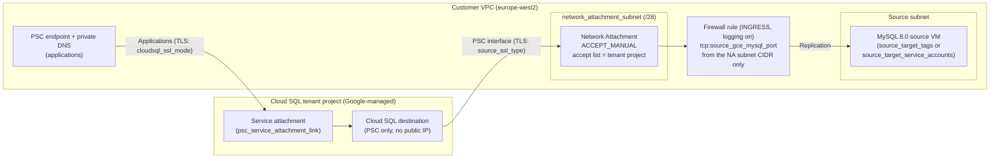

# Security Hardening Guide

**English** | [简体中文](security_hardening.zh-CN.md)

This guide explains the security controls that the templates apply by default, the options that you can turn on, and the checks to run before and after a migration. It covers both templates: [`templates/01-live-migration-gce-cdc`](../templates/01-live-migration-gce-cdc/README.md) (Scenario 1) and [`templates/02-backup-migration-gcs-cdc`](../templates/02-backup-migration-gcs-cdc/README.md) (Scenario 2).

> [!NOTE]
> These templates are not an official Google product. Review every control against your own security requirements and organization policies before you use them in production. To report a vulnerability, see [SECURITY.md](../SECURITY.md).

| Area | Default | What you can change |
| :--- | :--- | :--- |
| Network Attachment | `ACCEPT_MANUAL`, accepts only the Cloud SQL tenant project | `psc_producer_accept_list`, `psc_connection_preference` |
| Source firewall | Template-managed rule from the Network Attachment subnet to the source port, logging on | `create_source_firewall_rule`, `source_target_tags` or `source_target_service_accounts` |
| TLS to the source | `source_ssl_type = "REQUIRED"` (encrypted) | `SERVER_ONLY` or `SERVER_CLIENT` with certificates |
| TLS to Cloud SQL | `cloudsql_ssl_mode = "ENCRYPTED_ONLY"` | `TRUSTED_CLIENT_CERTIFICATE_REQUIRED` |
| Secrets | Root password write-only (not in state) | Remote GCS backend with CMEK, Secret Manager |
| Encryption at rest | Google-managed keys | `cloudsql_kms_key_name`, `staging_bucket_kms_key_name` |
| Deployer identity | Application Default Credentials and the active `gcloud` account | `impersonate_service_account` |

---

## 1. Network Controls

During replication, the destination Cloud SQL instance (in a Google-managed tenant project) opens a **Private Service Connect interface** into your VPC through a **Network Attachment**, and connects to the source MySQL from an IP address in the Network Attachment subnet. The templates lock this path down at three points:

1. **Who can connect to the Network Attachment.** The Network Attachment defaults to `psc_connection_preference = "ACCEPT_MANUAL"`. Its producer accept list is derived automatically from the Cloud SQL instance's `psc_service_attachment_link` (`projects/<tenant-project>/regions/<region>/serviceAttachments/<name>`): the project segment is the Cloud SQL tenant project, so only your instance's tenant project can create PSC interfaces in your subnet.
   - To set the list yourself, use `psc_producer_accept_list`.
   - `psc_connection_preference = "ACCEPT_AUTOMATIC"` accepts every producer project and is opt-in only. Don't use it in production.
2. **Where the PSC interfaces live.** Put the Network Attachment in a dedicated small subnet (`network_attachment_subnet`), separate from the source subnet. Each PSC interface uses one IP address from this subnet, so a `/28` is plenty for one destination instance. A dedicated subnet gives you one CIDR range that identifies replication traffic in firewall rules and logs.
3. **What the PSC interfaces can reach.** With `create_source_firewall_rule = true`, the template creates one `INGRESS` firewall rule: `tcp:<source_gce_mysql_port>` from the Network Attachment subnet CIDR only, to the source VMs selected by `source_target_tags` **or** `source_target_service_accounts` (exactly one of them), with firewall rule logging on. In a default-deny VPC, nothing else from the Network Attachment subnet reaches your workloads.



Check the Network Attachment and the firewall rule after `terraform apply`:

```bash
gcloud compute network-attachments describe dms-mysql-psc-na \
  --region=europe-west2 --project=my-gcp-project-01 \
  --format="yaml(connectionPreference,producerAcceptLists,subnetworks,connectionEndpoints)"

gcloud compute firewall-rules list --project=my-gcp-project-01 \
  --filter="name~dms-mysql-psc-na" \
  --format="table(name,direction,sourceRanges.list(),allowed[].map().firewall_rule().list(),targetTags.list(),targetServiceAccounts.list(),logConfig.enable)"
```

Verified in a live test:

- With `ACCEPT_MANUAL` and the tenant project **ID** (the project segment of `psc_service_attachment_link`) in the accept list, the connection is accepted. The Network Attachment then shows it under `connectionEndpoints[].projectIdOrNum` as the tenant project **number**, with `status: ACCEPTED`. The two values identify the same project.
- One `terraform apply` creates everything in order: Cloud SQL instance → Network Attachment → attachment to the instance (about 5 minutes) → connection profiles and migration job → demote.
- With a wrong accept list, the attach step fails fast with `[ERROR_NETWORK_ATTACHMENT_POLICY_FORBIDDEN] The Network Attachment connection policy is not allowing connection.`, and no endpoint is created. Fix `psc_producer_accept_list` (or clear it to use the derived value): the next apply updates the Network Attachment in place and attaches it.
- Two Cloud SQL instances in the same consumer project and region used the same tenant project.
- Without the firewall rule, `verify` fails with `Failure connecting to the source database. Make sure the connectivity information on the connection profile is correct and the source database is reachable.`

> [!TIP]
> Between demotion and promotion, a full `terraform apply` fails (`Backups cannot be enabled for read replica instance`), and `-target=module.networking` doesn't avoid it. To add or fix only the firewall rule in that window, target the resource: `terraform apply -target='module.networking.google_compute_firewall.na_to_source[0]'`.

Sources: [About network attachments](https://cloud.google.com/vpc/docs/about-network-attachments), [About Private Service Connect interfaces](https://cloud.google.com/vpc/docs/about-private-service-connect-interfaces), [Cloud SQL: About Private Service Connect](https://cloud.google.com/sql/docs/mysql/about-private-service-connect), [DMS networking methods](https://cloud.google.com/database-migration/docs/mysql/networking-methods), [Firewall rules logging](https://cloud.google.com/firewall/docs/firewall-rules-logging).

---

## 2. TLS to the Source and to Cloud SQL

### 2.1 Source Connection (`source_ssl_type`)

| `source_ssl_type` | What DMS does | Inputs |
| :--- | :--- | :--- |
| `REQUIRED` (default) | Encrypts the connection; doesn't verify the server certificate | None |
| `SERVER_ONLY` | Encrypts and verifies the source server certificate against your CA | `source_ssl_ca_certificate` |
| `SERVER_CLIENT` | Mutual TLS: verifies the server, and presents a client certificate | `source_ssl_ca_certificate`, `source_ssl_client_certificate`, `source_ssl_client_key` |
| `NONE` | No encryption | Not recommended |

Enforce TLS on the source as well, so that a misconfigured client can't fall back to clear text. Use either or both of these statements:

```sql
-- Every TCP client must use TLS (persists across restarts)
SET PERSIST require_secure_transport = ON;

-- Only the DMS migration user must use TLS
ALTER USER 'dms_migration'@'%' REQUIRE SSL;
```

To use `SERVER_ONLY` or `SERVER_CLIENT`, get the CA certificate that signed the source server certificate. MySQL 8.0 auto-generates a self-signed CA and server certificate (`ca.pem`, `server-cert.pem`) in the data directory when none is configured; find the files in use with `SHOW VARIABLES LIKE 'ssl_ca';` (and `ssl_cert`). If your organization issues server certificates from its own PKI, use that CA instead. The server certificate must be valid for the address in the source connection profile (`source_gce_mysql_host`). Pass the PEM content through an environment variable instead of `terraform.tfvars`:

```bash
export TF_VAR_source_ssl_type="SERVER_ONLY"
export TF_VAR_source_ssl_ca_certificate="$(cat ca.pem)"
terraform plan -out=tfplan
```

> [!IMPORTANT]
> The DMS migration user keeps the host `'%'` (`'dms_migration'@'%'`), as the DMS source configuration documentation specifies. The connection arrives from a PSC interface IP address in the Network Attachment subnet. Instead of a host restriction in MySQL, the network control is the firewall rule in section 1, which admits only the Network Attachment subnet CIDR to the source port. Keep the user's password strong and its grants to the minimum in [runbook section 2.3](gce_mysql80_to_cloudsql_dms_migration_runbook.md#23-create-the-migration-accounts).

### 2.2 Application Connections to Cloud SQL (`cloudsql_ssl_mode`)

| `cloudsql_ssl_mode` | Effect |
| :--- | :--- |
| `ALLOW_UNENCRYPTED_AND_ENCRYPTED` | Accepts clear-text and TLS connections. Not recommended. |
| `ENCRYPTED_ONLY` (default) | Accepts only TLS connections. |
| `TRUSTED_CLIENT_CERTIFICATE_REQUIRED` | Accepts only TLS connections with a valid client certificate (Cloud SQL Auth Proxy, Cloud SQL Language Connectors, or client certificates issued by the instance). |

Connect through the PSC endpoint DNS name:

```bash
mysql --ssl-mode=REQUIRED -h "$(terraform output -raw psc_endpoint_dns_name)" -u root -p

# Verify the server certificate as well (download the instance CA first)
gcloud sql instances describe "$(terraform output -raw cloudsql_instance_name)" \
  --project=my-gcp-project-01 --format="value(serverCaCert.cert)" > server-ca.pem
mysql --ssl-mode=VERIFY_IDENTITY --ssl-ca=server-ca.pem \
  -h "$(terraform output -raw psc_endpoint_dns_name)" -u root -p
```

Verified in a live test: `source_ssl_type = "REQUIRED"` against a source with `require_secure_transport = ON` passes `verify`, with both the tag-target and the service-account-target firewall rule. `cloudsql_ssl_mode` doesn't affect DMS replication: the replication connection goes outbound from Cloud SQL to the source, and `source_ssl_type` controls it.

Client connections, verified in a live test through the PSC endpoint and its DNS name: `--ssl-mode=REQUIRED` negotiated TLSv1.2 (`ECDHE-RSA-AES128-GCM-SHA256`), both on the demoted replica and after promotion. Under `ENCRYPTED_ONLY`, `--ssl-mode=DISABLED` was rejected with `ERROR 1045 (28000): Access denied`. DMS `verify` and CDC were unaffected.

Sources: [Configure your source MySQL database](https://cloud.google.com/database-migration/docs/mysql/configure-source-database), [Create a source connection profile](https://cloud.google.com/database-migration/docs/mysql/create-source-connection-profile), [Configure SSL/TLS certificates](https://cloud.google.com/sql/docs/mysql/configure-ssl-instance), [MySQL: Configuring encrypted connections](https://dev.mysql.com/doc/refman/8.0/en/using-encrypted-connections.html).

---

## 3. Secrets and Terraform State

| Secret | In Terraform state? | Why |
| :--- | :--- | :--- |
| Cloud SQL root password (`cloudsql_root_password`, `EXISTING_CLOUDSQL` mode) | **No** | Applied through the write-only `password_wo` argument. Increment `cloudsql_root_password_version` to rotate it. |
| Cloud SQL root password (`DMS_MANAGED_CLOUDSQL` mode) | **Yes** | DMS creates the instance from the destination connection profile, which stores the password. |
| DMS source password (`source_gce_mysql_password`) | **Yes** | The native DMS connection profile resource has no write-only password field. |
| Source client private key (`source_ssl_client_key`, `SERVER_CLIENT` only) | **Yes** | Stored in the source connection profile. |
| CA and client certificates | Yes (not secret) | Public certificates. |

Because state holds secrets:

- **Use a remote GCS backend with CMEK.** Copy [`backend.tf.example`](../templates/01-live-migration-gce-cdc/backend.tf.example) to `backend.tf` in the template directory (Scenario 2: [`backend.tf.example`](../templates/02-backup-migration-gcs-cdc/backend.tf.example)). The comments in the file create the state bucket with Object Versioning, uniform bucket-level access, public access prevention and a CMEK default key, and grant `roles/storage.objectAdmin` on that bucket only to the deployer group or service account. Then run `terraform init -migrate-state`.
- **Keep secrets in Secret Manager**, and read them into environment variables just before you run Terraform:

  ```bash
  export TF_VAR_source_gce_mysql_password="$(gcloud secrets versions access latest --secret=dms-source-password --project=my-gcp-project-01)"
  export TF_VAR_cloudsql_root_password="$(gcloud secrets versions access latest --secret=cloudsql-root-password --project=my-gcp-project-01)"
  ```

- **Never commit `terraform.tfvars`** (`.gitignore` excludes `*.tfvars`), state files or `.terraform/` directories.
- **Treat saved plan files as secrets.** A plan file (`terraform plan -out=tfplan`) contains the values of all input variables, including the passwords. Delete it after `terraform apply tfplan`, and don't upload it as a CI artifact.
- After the migration, rotate the DMS source password and drop the migration user on the source (section 8).

Sources: [Backend type: gcs](https://developer.hashicorp.com/terraform/language/backend/gcs), [Write-only arguments](https://developer.hashicorp.com/terraform/language/resources/ephemeral#write-only-arguments), [Access a secret version](https://cloud.google.com/secret-manager/docs/access-secret-version).

---

## 4. Customer-Managed Encryption Keys (CMEK)

| Variable | Resource | Notes |
| :--- | :--- | :--- |
| `cloudsql_kms_key_name` | Cloud SQL instance `encryption_key_name` | Set only when the instance is created; you can't add, remove or change it later. The key must be in the same region as the instance (`europe-west2`). In `DMS_MANAGED_CLOUDSQL` mode, DMS creates the instance; check that your DMS destination settings support CMEK. |
| `staging_bucket_kms_key_name` | Scenario 2 staging bucket default key | New seed objects are encrypted with the key. Use a key in the bucket location. |

Key format: `projects/my-gcp-project-01/locations/europe-west2/keyRings/KEY_RING/cryptoKeys/KEY_NAME`.

Before `terraform apply`, let the service agents use the key:

```bash
export PROJECT_ID="my-gcp-project-01"
export KEY="projects/my-gcp-project-01/locations/europe-west2/keyRings/KEY_RING/cryptoKeys/KEY_NAME"

# Cloud SQL service agent (service-PROJECT_NUMBER@gcp-sa-cloud-sql.iam.gserviceaccount.com)
gcloud beta services identity create --service=sqladmin.googleapis.com --project="${PROJECT_ID}"
gcloud kms keys add-iam-policy-binding "${KEY}" \
  --member="serviceAccount:service-PROJECT_NUMBER@gcp-sa-cloud-sql.iam.gserviceaccount.com" \
  --role=roles/cloudkms.cryptoKeyEncrypterDecrypter

# Cloud Storage service agent (Scenario 2 staging bucket):
# service-PROJECT_NUMBER@gs-project-accounts.iam.gserviceaccount.com
# (the command output has surrounding whitespace, so strip it)
GCS_AGENT="$(gcloud storage service-agent --project="${PROJECT_ID}" | tr -d '[:space:]')"
gcloud kms keys add-iam-policy-binding "${KEY}" \
  --member="serviceAccount:${GCS_AGENT}" \
  --role=roles/cloudkms.cryptoKeyEncrypterDecrypter
```

> [!WARNING]
> If you disable or destroy the key version that protects the instance, Cloud SQL can't read the data and the instance becomes unavailable; data protected by a destroyed key version can't be recovered. Rotation creates a new primary version for new data; keep earlier versions enabled. Don't remove the service agent's role on the key while the instance or bucket uses it.

Sources: [About customer-managed encryption keys (CMEK)](https://cloud.google.com/sql/docs/mysql/cmek), [Use customer-managed encryption keys (CMEK)](https://cloud.google.com/sql/docs/mysql/configure-cmek), [Use customer-managed encryption keys (Cloud Storage)](https://cloud.google.com/storage/docs/encryption/using-customer-managed-keys).

---

## 5. Organization Policy Pre-Flight

Before the first `terraform apply`, check the effective organization policies on the project:

```bash
gcloud org-policies describe CONSTRAINT --effective --project=PROJECT_ID
```

| Constraint | Impact on the templates | What to do |
| :--- | :--- | :--- |
| `constraints/sql.restrictPublicIp` | Compatible in `EXISTING_CLOUDSQL` mode: the instance is PSC-only, with no public IP. `DMS_MANAGED_CLOUDSQL` is incompatible when DMS needs a public IPv4 address on the instance. | Use `EXISTING_CLOUDSQL` (default). |
| `constraints/sql.restrictAuthorizedNetworks` | Compatible: the templates set no authorized networks. | None. |
| `constraints/gcp.restrictNonCmekServices` | Resource creation fails for listed services (for example `sqladmin.googleapis.com`, `storage.googleapis.com`) without a CMEK key. | Set `cloudsql_kms_key_name` and `staging_bucket_kms_key_name` (section 4). |
| `constraints/gcp.resourceLocations` | Every resource must be in an allowed location. | Choose a `region` that the policy allows, and keep the KMS key, bucket and instance in it. |
| `constraints/compute.requireShieldedVm` | Not applicable: the templates create no VMs. | None. |
| `constraints/compute.restrictPrivateServiceConnectProducer` | Consumer side: limits which producer service attachments your project can connect to. Can block the PSC endpoint to the Cloud SQL service attachment. | Allow the Cloud SQL producer, as described in the constraint documentation. |
| `constraints/compute.restrictPrivateServiceConnectConsumer` | Producer side: limits which consumers can connect to service attachments in your organization. The templates create no service attachments (the Cloud SQL service attachment is in the Google-managed tenant project). | Usually none. Check it if the policy also covers your Network Attachment. |

```bash
for c in sql.restrictPublicIp sql.restrictAuthorizedNetworks gcp.restrictNonCmekServices \
  gcp.resourceLocations compute.requireShieldedVm \
  compute.restrictPrivateServiceConnectProducer compute.restrictPrivateServiceConnectConsumer; do
  echo "== constraints/${c}"
  gcloud org-policies describe "constraints/${c}" --effective --project=my-gcp-project-01
done
```

Sources: [Organization policy constraints for Cloud SQL](https://cloud.google.com/sql/docs/mysql/org-policy/org-policy), [Organization policy constraints list](https://cloud.google.com/resource-manager/docs/organization-policy/org-policy-constraints), [Private Service Connect security](https://cloud.google.com/vpc/docs/private-service-connect-security).

---

## 6. Least-Privilege Deployer

Run Terraform with a dedicated deployer service account instead of a personal account with `roles/owner`.

| Role | Why |
| :--- | :--- |
| `roles/datamigration.admin` | Connection profiles, migration job, demote, verify, start, promote |
| `roles/cloudsql.admin` | Cloud SQL instance, root user, Network Attachment patch on the instance |
| `roles/compute.networkAdmin` | Network Attachment, PSC endpoint address and forwarding rule, subnet lookups |
| `roles/compute.securityAdmin` | Source firewall rule (`create_source_firewall_rule = true`) |
| `roles/dns.admin` | Private DNS zone and record for the PSC endpoint |
| `roles/storage.admin` (Scenario 2) | Staging bucket and its IAM. Creating the bucket needs `storage.buckets.create` on the project; after that you can narrow the grant to the staging bucket. |
| `roles/serviceusage.serviceUsageConsumer` | API usage |
| `roles/cloudkms.viewer` (CMEK only) | Read the KMS key that you pass in |

For a tighter set, create a custom role with only the permissions of the resources that you deploy (for example, without DNS permissions when `create_psc_dns_record = false`). Remove the deployer's roles after the migration.

The `local-exec` steps (attach the Network Attachment, demote, and the destroy-time detach) call `gcloud`, which uses the active `gcloud` credentials, not the provider's. Use the same identity for both:

- Set `impersonate_service_account = "tf-deployer@my-gcp-project-01.iam.gserviceaccount.com"`. The provider uses it, and the template exports it as `CLOUDSDK_AUTH_IMPERSONATE_SERVICE_ACCOUNT` to the `local-exec` steps.
- Or export `CLOUDSDK_AUTH_IMPERSONATE_SERVICE_ACCOUNT` in your shell yourself.

The destroy-time detach step reads `impersonate_service_account` from its own state, so `terraform destroy` and `migration_enabled = false` use the same identity.

The caller (you or your CI identity) needs `roles/iam.serviceAccountTokenCreator` on the deployer service account:

```bash
gcloud iam service-accounts add-iam-policy-binding \
  tf-deployer@my-gcp-project-01.iam.gserviceaccount.com \
  --member="group:dms-deployers@example.com" \
  --role=roles/iam.serviceAccountTokenCreator

export CLOUDSDK_AUTH_IMPERSONATE_SERVICE_ACCOUNT="tf-deployer@my-gcp-project-01.iam.gserviceaccount.com"
```

Sources: [Database Migration Service access control](https://cloud.google.com/database-migration/docs/mysql/access-control), [Cloud SQL IAM roles](https://cloud.google.com/sql/docs/mysql/iam-roles), [Service account impersonation](https://cloud.google.com/iam/docs/service-account-impersonation).

---

## 7. Data Access Audit Logs

Admin Activity audit logs are always on. Data Access audit logs are off by default for most services; turn them on for the services that handle migration data:

```yaml
auditConfigs:
- service: cloudsql.googleapis.com
  auditLogConfigs:
  - logType: ADMIN_READ
  - logType: DATA_READ
  - logType: DATA_WRITE
- service: storage.googleapis.com
  auditLogConfigs:
  - logType: ADMIN_READ
  - logType: DATA_READ
  - logType: DATA_WRITE
- service: datamigration.googleapis.com
  auditLogConfigs:
  - logType: ADMIN_READ
  - logType: DATA_READ
  - logType: DATA_WRITE
```

Merge the block into the project IAM policy (keep the `etag`, so that a concurrent change isn't overwritten):

```bash
gcloud projects get-iam-policy my-gcp-project-01 --format=yaml > policy.yaml
# Edit policy.yaml: add the auditConfigs block above, keep bindings and etag
gcloud projects set-iam-policy my-gcp-project-01 policy.yaml
```

Logs Explorer query for the migration services:

```text
logName="projects/my-gcp-project-01/logs/cloudaudit.googleapis.com%2Fdata_access"
protoPayload.serviceName=("cloudsql.googleapis.com" OR "storage.googleapis.com" OR "datamigration.googleapis.com")
```

> [!TIP]
> Data Access audit logs can be high-volume, and they are billed as Cloud Logging ingestion. `storage.googleapis.com` `DATA_READ` on a busy project is the biggest contributor. Limit the logs to the migration window, use exemptions (`exemptedMembers`) for high-volume service accounts, or route the logs to a bucket with a short retention period.

Sources: [Cloud Audit Logs overview](https://cloud.google.com/logging/docs/audit), [Configure Data Access audit logs](https://cloud.google.com/logging/docs/audit/configure-data-access), [Database Migration Service audit logging](https://cloud.google.com/database-migration/docs/audit-logging).

---

## 8. Post-Migration Hardening

`migration_enabled = false` is only for **after promotion**. Before promotion, the destination is a demoted read replica and a full apply fails (backup settings drift). To abandon a running migration, run `terraform destroy` (test environments) or delete the migration job, then promote the replica (`gcloud sql instances promote-replica`) or delete the instance. An abandoned migration also leaves the source representation instance `<instance>-master` (type `ON_PREMISES_INSTANCE`), which Terraform doesn't manage: delete it with `gcloud sql instances delete <instance>-master`. After a normal promotion, it was removed automatically in testing.

After promotion and a successful Go / No-Go review, retire the migration path. Set `migration_enabled = false` in `terraform.tfvars`, review the plan, and apply:

```bash
terraform plan -out=tfplan
terraform apply tfplan
rm -f tfplan
```

| Removed | Kept |
| :--- | :--- |
| DMS migration job and connection profiles | Cloud SQL instance |
| Demote step | PSC endpoint for applications |
| Network Attachment (cleared from the instance first) | Private DNS zone and record |
| Source firewall rule | Staging bucket (Scenario 2) |

> [!WARNING]
> Clearing the Network Attachment from the instance **restarts the Cloud SQL instance**. Apply `migration_enabled = false` in a maintenance window.

In a live test, `migration_enabled = false` removed 7 resources in about 6 minutes (the detach took about 5 minutes). A client probe through the PSC endpoint failed for about 20 seconds during the restart. The instance's allowed PSC consumer projects were unchanged after the detach, and the next `terraform plan` reported no changes.

Then remove the remaining migration data:

```bash
# Scenario 2: delete the seed (LOGICAL file; for a PHYSICAL folder add --recursive "gs://.../folder/**")
gcloud storage rm "$(terraform output -raw configured_dump_path)"

# On the source: drop the migration user once you no longer need rollback
mysql -e "DROP USER 'dms_migration'@'%';"
```

The staging bucket is versioned: `gcloud storage rm` makes the seed a noncurrent version, and the bucket lifecycle rule deletes noncurrent versions after `staging_bucket_noncurrent_version_retention_days`. To delete them immediately, add `--all-versions`. Also delete the Secret Manager secret of the DMS source password, and remove the deployer's roles.

For moving the instance into a long-lived stack and for the full decommission order, see [runbook section 10.2](gce_mysql80_to_cloudsql_dms_migration_runbook.md#102-production-after-cutover).

Sources: [Promote a migration](https://cloud.google.com/database-migration/docs/mysql/promote-migration), [Object Lifecycle Management](https://cloud.google.com/storage/docs/lifecycle).
