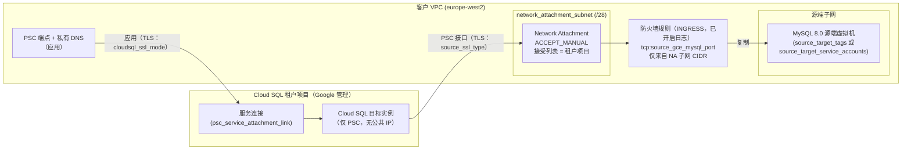

# 安全加固指南

[English](security_hardening.md) | **简体中文**

本指南说明模板默认启用的安全控制、可按需开启的选项，以及迁移前后应执行的检查。内容适用于两个模板：[`templates/01-live-migration-gce-cdc`](../templates/01-live-migration-gce-cdc/README.zh-CN.md)（场景 1）和 [`templates/02-backup-migration-gcs-cdc`](../templates/02-backup-migration-gcs-cdc/README.zh-CN.md)（场景 2）。

> [!NOTE]
> 这些模板不是 Google 官方产品。在生产环境中使用前，请根据您自身的安全要求和组织政策逐项审核每一项控制。如需报告安全漏洞，请参阅 [SECURITY.md](../SECURITY.md)。

| 领域 | 默认值 | 可调整项 |
| :--- | :--- | :--- |
| Network Attachment | `ACCEPT_MANUAL`，仅接受 Cloud SQL 租户项目 | `psc_producer_accept_list`、`psc_connection_preference` |
| 源端防火墙 | 由模板管理的规则：从 Network Attachment 子网到源端端口，已开启日志 | `create_source_firewall_rule`、`source_target_tags` 或 `source_target_service_accounts` |
| 到源端的 TLS | `source_ssl_type = "REQUIRED"`（加密） | 配合证书使用 `SERVER_ONLY` 或 `SERVER_CLIENT` |
| 到 Cloud SQL 的 TLS | `cloudsql_ssl_mode = "ENCRYPTED_ONLY"` | `TRUSTED_CLIENT_CERTIFICATE_REQUIRED` |
| 密钥与凭据 | root 密码为只写（不进入状态文件） | 使用 CMEK 加密的远程 GCS 后端、Secret Manager |
| 静态加密 | Google 管理的密钥 | `cloudsql_kms_key_name`、`staging_bucket_kms_key_name` |
| 部署者身份 | 应用默认凭据（ADC）和当前活跃的 `gcloud` 账号 | `impersonate_service_account` |

---

## 1. 网络控制

复制期间，目标 Cloud SQL 实例（位于 Google 管理的租户项目中）通过 **Network Attachment** 在您的 VPC 中打开一个 **Private Service Connect 接口**，并从 Network Attachment 子网中的 IP 地址连接源端 MySQL。模板在以下三个位置收紧这条路径：

1. **谁可以连接 Network Attachment。** Network Attachment 默认使用 `psc_connection_preference = "ACCEPT_MANUAL"`。其提供方接受列表会根据 Cloud SQL 实例的 `psc_service_attachment_link`（`projects/<tenant-project>/regions/<region>/serviceAttachments/<name>`）自动推导：其中的项目段即 Cloud SQL 租户项目，因此只有您的实例所在的租户项目才能在您的子网中创建 PSC 接口。
   - 如需自行设置该列表，请使用 `psc_producer_accept_list`。
   - `psc_connection_preference = "ACCEPT_AUTOMATIC"` 会接受所有提供方项目，仅作为可选项（opt-in）。请勿在生产环境中使用。
2. **PSC 接口位于何处。** 请将 Network Attachment 放在一个专用的小子网中（`network_attachment_subnet`），与源端子网分开。每个 PSC 接口占用该子网中的一个 IP 地址，因此对于一个目标实例，`/28` 已绰绰有余。专用子网让您可以用一个 CIDR 范围在防火墙规则和日志中识别复制流量。
3. **PSC 接口可以访问什么。** 设置 `create_source_firewall_rule = true` 后，模板会创建一条 `INGRESS` 防火墙规则：仅允许来自 Network Attachment 子网 CIDR 的 `tcp:<source_gce_mysql_port>` 流量，访问由 `source_target_tags` **或** `source_target_service_accounts`（二者只能选其一）选定的源端虚拟机，并开启防火墙规则日志。在默认拒绝的 VPC 中，Network Attachment 子网中的其他流量都无法到达您的工作负载。



`terraform apply` 之后，检查 Network Attachment 和防火墙规则：

```bash
gcloud compute network-attachments describe dms-mysql-psc-na \
  --region=europe-west2 --project=my-gcp-project-01 \
  --format="yaml(connectionPreference,producerAcceptLists,subnetworks,connectionEndpoints)"

gcloud compute firewall-rules list --project=my-gcp-project-01 \
  --filter="name~dms-mysql-psc-na" \
  --format="table(name,direction,sourceRanges.list(),allowed[].map().firewall_rule().list(),targetTags.list(),targetServiceAccounts.list(),logConfig.enable)"
```

在线测试中已验证：

- 使用 `ACCEPT_MANUAL`，并在接受列表中填写租户项目 **ID**（`psc_service_attachment_link` 的项目段）时，连接会被接受。随后 Network Attachment 会在 `connectionEndpoints[].projectIdOrNum` 下以租户项目**编号**显示该连接，状态为 `status: ACCEPTED`。这两个值标识的是同一个项目。
- 一次 `terraform apply` 会按顺序创建所有资源：Cloud SQL 实例 → Network Attachment → 挂接到实例（约 5 分钟）→ 连接配置文件和迁移作业 → 降级。
- 如果接受列表错误，挂接步骤会快速失败并报错 `[ERROR_NETWORK_ATTACHMENT_POLICY_FORBIDDEN] The Network Attachment connection policy is not allowing connection.`，且不会创建端点。修正 `psc_producer_accept_list`（或将其清空以使用推导值）后，下一次 apply 会原地更新 Network Attachment 并完成挂接。
- 同一使用方项目和区域中的两个 Cloud SQL 实例使用了同一个租户项目。
- 如果没有防火墙规则，`verify` 会失败并报错 `Failure connecting to the source database. Make sure the connectivity information on the connection profile is correct and the source database is reachable.`

> [!TIP]
> 在降级之后、提升之前，完整的 `terraform apply` 会失败（`Backups cannot be enabled for read replica instance`），使用 `-target=module.networking` 也无法避免。如需在此期间仅添加或修正防火墙规则，请指定该资源：`terraform apply -target='module.networking.google_compute_firewall.na_to_source[0]'`。

来源：[网络连接概览](https://cloud.google.com/vpc/docs/about-network-attachments)、[Private Service Connect 接口概览](https://cloud.google.com/vpc/docs/about-private-service-connect-interfaces)、[Cloud SQL：Private Service Connect 概览](https://cloud.google.com/sql/docs/mysql/about-private-service-connect)、[DMS 网络连接方法](https://cloud.google.com/database-migration/docs/mysql/networking-methods)、[防火墙规则日志记录](https://cloud.google.com/firewall/docs/firewall-rules-logging)。

---

## 2. 到源端和到 Cloud SQL 的 TLS

### 2.1 源端连接（`source_ssl_type`）

| `source_ssl_type` | DMS 的行为 | 输入 |
| :--- | :--- | :--- |
| `REQUIRED`（默认） | 加密连接；不验证服务器证书 | 无 |
| `SERVER_ONLY` | 加密连接，并使用您的 CA 验证源端服务器证书 | `source_ssl_ca_certificate` |
| `SERVER_CLIENT` | 双向 TLS：验证服务器，并出示客户端证书 | `source_ssl_ca_certificate`、`source_ssl_client_certificate`、`source_ssl_client_key` |
| `NONE` | 不加密 | 不推荐 |

同时在源端强制使用 TLS，避免配置错误的客户端退回到明文连接。可使用以下任一或全部语句：

```sql
-- Every TCP client must use TLS (persists across restarts)
SET PERSIST require_secure_transport = ON;

-- Only the DMS migration user must use TLS
ALTER USER 'dms_migration'@'%' REQUIRE SSL;
```

如需使用 `SERVER_ONLY` 或 `SERVER_CLIENT`，请获取签发源端服务器证书的 CA 证书。如果未配置证书，MySQL 8.0 会在数据目录中自动生成自签名 CA 和服务器证书（`ca.pem`、`server-cert.pem`）；可使用 `SHOW VARIABLES LIKE 'ssl_ca';`（以及 `ssl_cert`）查看实际使用的文件。如果您的组织通过自有 PKI 签发服务器证书，请改用该 CA。服务器证书必须对源端连接配置文件中的地址（`source_gce_mysql_host`）有效。请通过环境变量传入 PEM 内容，而不是写入 `terraform.tfvars`：

```bash
export TF_VAR_source_ssl_type="SERVER_ONLY"
export TF_VAR_source_ssl_ca_certificate="$(cat ca.pem)"
terraform plan -out=tfplan
```

> [!IMPORTANT]
> 按照 DMS 源端配置文档的要求，DMS 迁移用户的主机部分保持为 `'%'`（`'dms_migration'@'%'`）。连接来自 Network Attachment 子网中的 PSC 接口 IP 地址。网络层面的控制不是 MySQL 中的主机限制，而是第 1 节中的防火墙规则：它只允许 Network Attachment 子网 CIDR 访问源端端口。请为该用户设置强密码，并将其权限限制为 [运维手册第 2.3 节](gce_mysql80_to_cloudsql_dms_migration_runbook.zh-CN.md#23-创建迁移账号)中的最小权限。

### 2.2 应用到 Cloud SQL 的连接（`cloudsql_ssl_mode`）

| `cloudsql_ssl_mode` | 效果 |
| :--- | :--- |
| `ALLOW_UNENCRYPTED_AND_ENCRYPTED` | 同时接受明文连接和 TLS 连接。不推荐。 |
| `ENCRYPTED_ONLY`（默认） | 仅接受 TLS 连接。 |
| `TRUSTED_CLIENT_CERTIFICATE_REQUIRED` | 仅接受带有效客户端证书的 TLS 连接（Cloud SQL Auth Proxy、Cloud SQL 语言连接器，或由实例签发的客户端证书）。 |

通过 PSC 端点 DNS 名称连接：

```bash
mysql --ssl-mode=REQUIRED -h "$(terraform output -raw psc_endpoint_dns_name)" -u root -p

# Verify the server certificate as well (download the instance CA first)
gcloud sql instances describe "$(terraform output -raw cloudsql_instance_name)" \
  --project=my-gcp-project-01 --format="value(serverCaCert.cert)" > server-ca.pem
mysql --ssl-mode=VERIFY_IDENTITY --ssl-ca=server-ca.pem \
  -h "$(terraform output -raw psc_endpoint_dns_name)" -u root -p
```

在线测试中已验证：针对启用了 `require_secure_transport = ON` 的源端，`source_ssl_type = "REQUIRED"` 可以通过 `verify`，防火墙规则使用网络标记目标或服务账号目标时均可通过。`cloudsql_ssl_mode` 不影响 DMS 复制：复制连接是从 Cloud SQL 出站到源端的，由 `source_ssl_type` 控制。

客户端连接（已在在线测试中通过 PSC 端点及其 DNS 名称验证）：`--ssl-mode=REQUIRED` 协商为 TLSv1.2（`ECDHE-RSA-AES128-GCM-SHA256`），在已降级的副本上和提升之后均如此。在 `ENCRYPTED_ONLY` 下，`--ssl-mode=DISABLED` 被拒绝，报错 `ERROR 1045 (28000): Access denied`。DMS 的 `verify` 和 CDC 不受影响。

来源：[配置源数据库](https://cloud.google.com/database-migration/docs/mysql/configure-source-database)、[创建源端连接配置文件](https://cloud.google.com/database-migration/docs/mysql/create-source-connection-profile)、[配置 SSL/TLS 证书](https://cloud.google.com/sql/docs/mysql/configure-ssl-instance)、[MySQL：配置加密连接](https://dev.mysql.com/doc/refman/8.0/en/using-encrypted-connections.html)。

---

## 3. 密钥凭据与 Terraform 状态

| 密钥凭据 | 是否在 Terraform 状态中？ | 原因 |
| :--- | :--- | :--- |
| Cloud SQL root 密码（`cloudsql_root_password`，`EXISTING_CLOUDSQL` 模式） | **否** | 通过只写参数 `password_wo` 设置。递增 `cloudsql_root_password_version` 即可轮换。 |
| Cloud SQL root 密码（`DMS_MANAGED_CLOUDSQL` 模式） | **是** | DMS 根据目标连接配置文件创建实例，而该配置文件会保存密码。 |
| DMS 源端密码（`source_gce_mysql_password`） | **是** | 原生 DMS 连接配置文件资源没有只写密码字段。 |
| 源端客户端私钥（`source_ssl_client_key`，仅 `SERVER_CLIENT`） | **是** | 保存在源端连接配置文件中。 |
| CA 证书和客户端证书 | 是（非机密） | 公开证书。 |

由于状态文件包含机密信息：

- **使用带 CMEK 的远程 GCS 后端。** 在模板目录中将 [`backend.tf.example`](../templates/01-live-migration-gce-cdc/backend.tf.example) 复制为 `backend.tf`（场景 2：[`backend.tf.example`](../templates/02-backup-migration-gcs-cdc/backend.tf.example)）。文件中的注释说明了如何创建启用对象版本控制、统一存储桶级访问权限、禁止公开访问并以 CMEK 为默认密钥的状态存储桶，以及如何仅在该存储桶上向部署者群组或服务账号授予 `roles/storage.objectAdmin`。然后运行 `terraform init -migrate-state`。
- **将密钥凭据保存在 Secret Manager 中**，并在运行 Terraform 之前再读取到环境变量中：

  ```bash
  export TF_VAR_source_gce_mysql_password="$(gcloud secrets versions access latest --secret=dms-source-password --project=my-gcp-project-01)"
  export TF_VAR_cloudsql_root_password="$(gcloud secrets versions access latest --secret=cloudsql-root-password --project=my-gcp-project-01)"
  ```

- **切勿提交 `terraform.tfvars`**（`.gitignore` 已排除 `*.tfvars`）、状态文件或 `.terraform/` 目录。
- **将保存的计划文件视为机密。** 计划文件（`terraform plan -out=tfplan`）包含所有输入变量的值，包括密码。执行 `terraform apply tfplan` 后请将其删除，也不要将其作为 CI 产物上传。
- 迁移完成后，轮换 DMS 源端密码，并在源端删除迁移用户（第 8 节）。

来源：[后端类型：gcs](https://developer.hashicorp.com/terraform/language/backend/gcs)、[只写参数](https://developer.hashicorp.com/terraform/language/resources/ephemeral#write-only-arguments)、[访问 Secret 版本](https://cloud.google.com/secret-manager/docs/access-secret-version)。

---

## 4. 客户管理的加密密钥（CMEK）

| 变量 | 资源 | 说明 |
| :--- | :--- | :--- |
| `cloudsql_kms_key_name` | Cloud SQL 实例的 `encryption_key_name` | 只能在创建实例时设置；之后无法添加、移除或更改。密钥必须与实例位于同一区域（`europe-west2`）。在 `DMS_MANAGED_CLOUDSQL` 模式下由 DMS 创建实例；请确认您的 DMS 目标设置支持 CMEK。 |
| `staging_bucket_kms_key_name` | 场景 2 暂存存储桶的默认密钥 | 新的种子对象会使用该密钥加密。请使用与存储桶位置一致的密钥。 |

密钥格式：`projects/my-gcp-project-01/locations/europe-west2/keyRings/KEY_RING/cryptoKeys/KEY_NAME`。

在 `terraform apply` 之前，允许服务代理使用该密钥：

```bash
export PROJECT_ID="my-gcp-project-01"
export KEY="projects/my-gcp-project-01/locations/europe-west2/keyRings/KEY_RING/cryptoKeys/KEY_NAME"

# Cloud SQL service agent (service-PROJECT_NUMBER@gcp-sa-cloud-sql.iam.gserviceaccount.com)
gcloud beta services identity create --service=sqladmin.googleapis.com --project="${PROJECT_ID}"
gcloud kms keys add-iam-policy-binding "${KEY}" \
  --member="serviceAccount:service-PROJECT_NUMBER@gcp-sa-cloud-sql.iam.gserviceaccount.com" \
  --role=roles/cloudkms.cryptoKeyEncrypterDecrypter

# Cloud Storage service agent (Scenario 2 staging bucket):
# service-PROJECT_NUMBER@gs-project-accounts.iam.gserviceaccount.com
# (the command output has surrounding whitespace, so strip it)
GCS_AGENT="$(gcloud storage service-agent --project="${PROJECT_ID}" | tr -d '[:space:]')"
gcloud kms keys add-iam-policy-binding "${KEY}" \
  --member="serviceAccount:${GCS_AGENT}" \
  --role=roles/cloudkms.cryptoKeyEncrypterDecrypter
```

> [!WARNING]
> 如果停用或销毁保护实例的密钥版本，Cloud SQL 将无法读取数据，实例会变为不可用；由已销毁密钥版本保护的数据无法恢复。轮换会为新数据创建新的主版本；请保持旧版本处于启用状态。在实例或存储桶仍使用该密钥时，请勿移除服务代理在该密钥上的角色。

来源：[客户管理的加密密钥（CMEK）概览](https://cloud.google.com/sql/docs/mysql/cmek)、[使用客户管理的加密密钥（CMEK）](https://cloud.google.com/sql/docs/mysql/configure-cmek)、[使用客户管理的加密密钥（Cloud Storage）](https://cloud.google.com/storage/docs/encryption/using-customer-managed-keys)。

---

## 5. 组织政策预检

首次运行 `terraform apply` 之前，检查项目上生效的组织政策：

```bash
gcloud org-policies describe CONSTRAINT --effective --project=PROJECT_ID
```

| 约束条件 | 对模板的影响 | 应对措施 |
| :--- | :--- | :--- |
| `constraints/sql.restrictPublicIp` | 在 `EXISTING_CLOUDSQL` 模式下兼容：实例仅使用 PSC，无公共 IP。当 DMS 需要为实例分配公共 IPv4 地址时，`DMS_MANAGED_CLOUDSQL` 不兼容。 | 使用 `EXISTING_CLOUDSQL`（默认）。 |
| `constraints/sql.restrictAuthorizedNetworks` | 兼容：模板不设置授权网络。 | 无。 |
| `constraints/gcp.restrictNonCmekServices` | 对于列入范围的服务（例如 `sqladmin.googleapis.com`、`storage.googleapis.com`），不使用 CMEK 密钥时资源创建会失败。 | 设置 `cloudsql_kms_key_name` 和 `staging_bucket_kms_key_name`（第 4 节）。 |
| `constraints/gcp.resourceLocations` | 所有资源都必须位于允许的位置。 | 选择政策允许的 `region`，并将 KMS 密钥、存储桶和实例都放在该位置。 |
| `constraints/compute.requireShieldedVm` | 不适用：模板不创建虚拟机。 | 无。 |
| `constraints/compute.restrictPrivateServiceConnectProducer` | 使用方侧：限制您的项目可以连接哪些提供方服务连接。可能阻止连接 Cloud SQL 服务连接的 PSC 端点。 | 按照该约束条件的文档放行 Cloud SQL 提供方。 |
| `constraints/compute.restrictPrivateServiceConnectConsumer` | 提供方侧：限制哪些使用方可以连接您组织中的服务连接。模板不创建服务连接（Cloud SQL 服务连接位于 Google 管理的租户项目中）。 | 通常无需处理。如果该政策同时覆盖您的 Network Attachment，请进行检查。 |

```bash
for c in sql.restrictPublicIp sql.restrictAuthorizedNetworks gcp.restrictNonCmekServices \
  gcp.resourceLocations compute.requireShieldedVm \
  compute.restrictPrivateServiceConnectProducer compute.restrictPrivateServiceConnectConsumer; do
  echo "== constraints/${c}"
  gcloud org-policies describe "constraints/${c}" --effective --project=my-gcp-project-01
done
```

来源：[Cloud SQL 的组织政策约束条件](https://cloud.google.com/sql/docs/mysql/org-policy/org-policy)、[组织政策约束条件列表](https://cloud.google.com/resource-manager/docs/organization-policy/org-policy-constraints)、[Private Service Connect 安全](https://cloud.google.com/vpc/docs/private-service-connect-security)。

---

## 6. 最小权限部署者

请使用专用的部署者服务账号运行 Terraform，而不是使用拥有 `roles/owner` 的个人账号。

| 角色 | 用途 |
| :--- | :--- |
| `roles/datamigration.admin` | 连接配置文件、迁移作业、降级、验证、启动、提升 |
| `roles/cloudsql.admin` | Cloud SQL 实例、root 用户、在实例上修补 Network Attachment |
| `roles/compute.networkAdmin` | Network Attachment、PSC 端点地址和转发规则、子网查询 |
| `roles/compute.securityAdmin` | 源端防火墙规则（`create_source_firewall_rule = true`） |
| `roles/dns.admin` | PSC 端点的私有 DNS 区域和记录 |
| `roles/storage.admin`（场景 2） | 暂存存储桶及其 IAM。创建存储桶需要项目上的 `storage.buckets.create` 权限；创建之后，可以将授权范围缩小到该暂存存储桶。 |
| `roles/serviceusage.serviceUsageConsumer` | API 使用 |
| `roles/cloudkms.viewer`（仅 CMEK） | 读取您传入的 KMS 密钥 |

如需更严格的权限集，可以创建仅包含所部署资源所需权限的自定义角色（例如 `create_psc_dns_record = false` 时不包含 DNS 权限）。迁移完成后，移除部署者的角色。

`local-exec` 步骤（挂接 Network Attachment、降级以及销毁时的分离）会调用 `gcloud`，它使用当前活跃的 `gcloud` 凭据，而不是提供程序的凭据。请让两者使用同一身份：

- 设置 `impersonate_service_account = "tf-deployer@my-gcp-project-01.iam.gserviceaccount.com"`。提供程序会使用它，模板也会将其作为 `CLOUDSDK_AUTH_IMPERSONATE_SERVICE_ACCOUNT` 导出给 `local-exec` 步骤。
- 或者自行在 shell 中导出 `CLOUDSDK_AUTH_IMPERSONATE_SERVICE_ACCOUNT`。

销毁时的分离步骤会从自身状态中读取 `impersonate_service_account`，因此 `terraform destroy` 和 `migration_enabled = false` 也会使用同一身份。

调用方（您本人或 CI 身份）需要在部署者服务账号上拥有 `roles/iam.serviceAccountTokenCreator`：

```bash
gcloud iam service-accounts add-iam-policy-binding \
  tf-deployer@my-gcp-project-01.iam.gserviceaccount.com \
  --member="group:dms-deployers@example.com" \
  --role=roles/iam.serviceAccountTokenCreator

export CLOUDSDK_AUTH_IMPERSONATE_SERVICE_ACCOUNT="tf-deployer@my-gcp-project-01.iam.gserviceaccount.com"
```

来源：[Database Migration Service 访问权限控制](https://cloud.google.com/database-migration/docs/mysql/access-control)、[Cloud SQL IAM 角色](https://cloud.google.com/sql/docs/mysql/iam-roles)、[服务账号模拟](https://cloud.google.com/iam/docs/service-account-impersonation)。

---

## 7. 数据访问审核日志

管理员活动审核日志始终处于开启状态。大多数服务的数据访问审核日志默认关闭；请为处理迁移数据的服务开启它们：

```yaml
auditConfigs:
- service: cloudsql.googleapis.com
  auditLogConfigs:
  - logType: ADMIN_READ
  - logType: DATA_READ
  - logType: DATA_WRITE
- service: storage.googleapis.com
  auditLogConfigs:
  - logType: ADMIN_READ
  - logType: DATA_READ
  - logType: DATA_WRITE
- service: datamigration.googleapis.com
  auditLogConfigs:
  - logType: ADMIN_READ
  - logType: DATA_READ
  - logType: DATA_WRITE
```

将上述代码块合并到项目 IAM 政策中（保留 `etag`，以免覆盖并发的更改）：

```bash
gcloud projects get-iam-policy my-gcp-project-01 --format=yaml > policy.yaml
# Edit policy.yaml: add the auditConfigs block above, keep bindings and etag
gcloud projects set-iam-policy my-gcp-project-01 policy.yaml
```

用于迁移相关服务的 Logs Explorer 查询：

```text
logName="projects/my-gcp-project-01/logs/cloudaudit.googleapis.com%2Fdata_access"
protoPayload.serviceName=("cloudsql.googleapis.com" OR "storage.googleapis.com" OR "datamigration.googleapis.com")
```

> [!TIP]
> 数据访问审核日志的数据量可能很大，并按 Cloud Logging 注入量计费。在繁忙的项目中，`storage.googleapis.com` 的 `DATA_READ` 是最主要的来源。请将日志限制在迁移窗口期内，为高流量服务账号设置豁免（`exemptedMembers`），或将日志路由到保留期较短的存储桶。

来源：[Cloud Audit Logs 概览](https://cloud.google.com/logging/docs/audit)、[配置数据访问审核日志](https://cloud.google.com/logging/docs/audit/configure-data-access)、[Database Migration Service 审核日志](https://cloud.google.com/database-migration/docs/audit-logging)。

---

## 8. 迁移后加固

`migration_enabled = false` 仅适用于**提升之后**。在提升之前，目标实例是已降级的只读副本，完整的 apply 会失败（备份设置出现偏差）。如需放弃正在运行的迁移，请运行 `terraform destroy`（测试环境）或删除迁移作业，然后提升副本（`gcloud sql instances promote-replica`）或删除实例。被放弃的迁移还会留下源表示实例 `<instance>-master`（类型为 `ON_PREMISES_INSTANCE`），该实例不由 Terraform 管理：请使用 `gcloud sql instances delete <instance>-master` 将其删除。在测试中，正常提升后该实例会被自动移除。

完成提升并通过 Go / No-Go 评审后，下线迁移路径。在 `terraform.tfvars` 中设置 `migration_enabled = false`，审核计划后执行 apply：

```bash
terraform plan -out=tfplan
terraform apply tfplan
rm -f tfplan
```

| 移除 | 保留 |
| :--- | :--- |
| DMS 迁移作业和连接配置文件 | Cloud SQL 实例 |
| 降级步骤 | 供应用使用的 PSC 端点 |
| Network Attachment（先从实例上清除） | 私有 DNS 区域和记录 |
| 源端防火墙规则 | 暂存存储桶（场景 2） |

> [!WARNING]
> 从实例上清除 Network Attachment 会**重启 Cloud SQL 实例**。请在维护窗口内应用 `migration_enabled = false`。

在在线测试中，`migration_enabled = false` 在约 6 分钟内移除了 7 个资源（分离约耗时 5 分钟）。在重启期间，通过 PSC 端点进行的客户端探测失败了约 20 秒。分离后，实例允许的 PSC 使用方项目保持不变，下一次 `terraform plan` 显示没有更改。

然后删除剩余的迁移数据：

```bash
# Scenario 2: delete the seed (LOGICAL file; for a PHYSICAL folder add --recursive "gs://.../folder/**")
gcloud storage rm "$(terraform output -raw configured_dump_path)"

# On the source: drop the migration user once you no longer need rollback
mysql -e "DROP USER 'dms_migration'@'%';"
```

暂存存储桶启用了版本控制：`gcloud storage rm` 会使种子成为非当前版本，存储桶生命周期规则会在 `staging_bucket_noncurrent_version_retention_days` 天后删除非当前版本。如需立即删除，请添加 `--all-versions`。同时请删除 DMS 源端密码对应的 Secret Manager Secret，并移除部署者的角色。

如需将实例迁入长期维护的 Terraform 栈，以及了解完整的下线顺序，请参阅 [运维手册第 10.2 节](gce_mysql80_to_cloudsql_dms_migration_runbook.zh-CN.md#102-切换后的生产环境)。

来源：[提升迁移](https://cloud.google.com/database-migration/docs/mysql/promote-migration)、[对象生命周期管理](https://cloud.google.com/storage/docs/lifecycle)。
