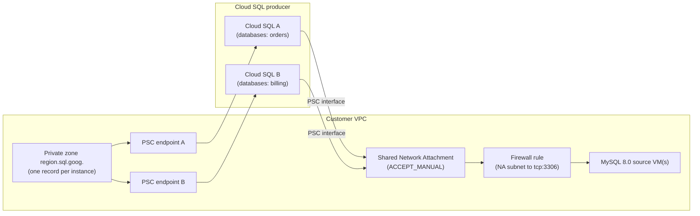

# Example: Several Migrations Sharing One Network Attachment

**English** | [简体中文](README.zh-CN.md)

This example runs several Database Migration Service (DMS) continuous migrations from MySQL 8.0 on Compute Engine to Cloud SQL for MySQL in one Terraform stack. DMS supports **one migration job per destination instance**, so each entry in `migrations` creates its own Cloud SQL instance, PSC endpoint, DNS record, connection profiles and job. The entries share:

- **One Network Attachment** (`ACCEPT_MANUAL`; the accept list is the set of Cloud SQL tenant projects of the instances) in a dedicated subnet. Each instance takes one IP address in that subnet.
- **One firewall rule** from the Network Attachment subnet to the source VMs (`source_target_tags` or `source_target_service_accounts`).
- **One private DNS zone** for `<region>.sql.goog.` (a VPC can bind only one zone for that name), with one A record per instance. Set `existing_dns_zone_name` if the VPC already has one.

To split one source server across instances, give each entry a different `databases` list (selective migration, the equivalent of `gcloud ... --databases-filter`).



## Usage

Complete the [Prerequisites](../../README.md#3-prerequisites) and the source preparation (`make preflight`) first.

```bash
cd examples/multi-database
cp terraform.tfvars.example terraform.tfvars   # edit project, network, subnets and migrations
export TF_VAR_source_passwords='{"orders-db-cdc":"REPLACE_ME","billing-db-cdc":"REPLACE_ME"}'
export TF_VAR_cloudsql_root_passwords='{"orders-db-cdc":"REPLACE_ME","billing-db-cdc":"REPLACE_ME"}'
terraform init
terraform plan -out=tfplan
terraform apply tfplan

# Per job (IDs are the keys of migrations):
make verify-job PROJECT_ID=my-gcp-project-01 JOB_ID=orders-db-cdc
make start-job  PROJECT_ID=my-gcp-project-01 JOB_ID=orders-db-cdc
make lag        PROJECT_ID=my-gcp-project-01 JOB_ID=orders-db-cdc CLOUDSQL_INSTANCE=cloudsql-orders-01
make promote-job PROJECT_ID=my-gcp-project-01 JOB_ID=orders-db-cdc CLOUDSQL_INSTANCE=cloudsql-orders-01
```

`terraform output psc_endpoint_dns_names` lists the DNS name that applications use for each instance after promotion. After **all** jobs are promoted, set `migration_enabled = false` and apply: Terraform detaches the shared Network Attachment from every instance (each instance restarts), then deletes it, the firewall rule, the jobs and the profiles. Cloud SQL, the PSC endpoints and DNS stay. See [runbook section 10.2](../../docs/gce_mysql80_to_cloudsql_dms_migration_runbook.md#102-production-after-cutover).

## Notes

- **Order inside one apply:** instances → Network Attachment (accept list from the instances' `psc_service_attachment_link`) → attach to each instance (`modules/cloudsql-psc-outbound`) → profiles and jobs → demote. The attach step is a separate module so that the shared Network Attachment can depend on every instance without a dependency cycle.
- **Subnet size:** each attached instance uses one IP address in `network_attachment_subnet`; a `/28` gives 11 usable addresses.
- **Selective migration:** `databases` works with the DMS-managed dump. Grants, users and DEFINERs still follow runbook section 5 for each instance.
- **Don't apply during CDC:** after demotion, a full apply fails on the demoted replicas until they're promoted (runbook section 6). Promote or retire all jobs of the stack before the next full apply.
