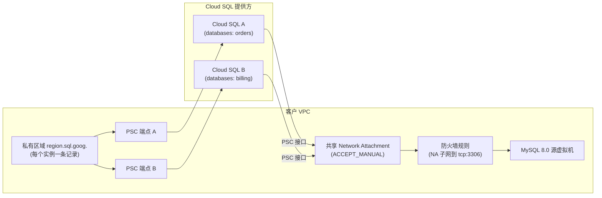

# 示例：多个迁移共享一个 Network Attachment

[English](README.md) | **简体中文**

本示例在一个 Terraform 栈中运行多个 Database Migration Service (DMS) 持续迁移，从 Compute Engine 上的 MySQL 8.0 迁移到 Cloud SQL for MySQL。DMS 支持**每个目标实例一个迁移作业**，因此 `migrations` 中的每个条目都会创建各自的 Cloud SQL 实例、PSC 端点、DNS 记录、连接配置文件和作业。这些条目共享：

- **一个 Network Attachment**（`ACCEPT_MANUAL`；接受列表为这些实例的 Cloud SQL 租户项目集合），位于专用子网中。每个实例占用该子网中的一个 IP 地址。
- **一条防火墙规则**，允许从 Network Attachment 子网访问源虚拟机（`source_target_tags` 或 `source_target_service_accounts`）。
- **一个私有 DNS 区域**，用于 `<region>.sql.goog.`（一个 VPC 只能为该名称绑定一个区域），每个实例一条 A 记录。如果 VPC 中已有该区域，请设置 `existing_dns_zone_name`。

如需将一个源服务器拆分到多个实例，请为每个条目设置不同的 `databases` 列表（选择性迁移，相当于 `gcloud ... --databases-filter`）。



## 用法

请先完成[前提条件](../../README.zh-CN.md#3-前提条件)和源端准备工作（`make preflight`）。

```bash
cd examples/multi-database
cp terraform.tfvars.example terraform.tfvars   # edit project, network, subnets and migrations
export TF_VAR_source_passwords='{"orders-db-cdc":"REPLACE_ME","billing-db-cdc":"REPLACE_ME"}'
export TF_VAR_cloudsql_root_passwords='{"orders-db-cdc":"REPLACE_ME","billing-db-cdc":"REPLACE_ME"}'
terraform init
terraform plan -out=tfplan
terraform apply tfplan

# Per job (IDs are the keys of migrations):
make verify-job PROJECT_ID=my-gcp-project-01 JOB_ID=orders-db-cdc
make start-job  PROJECT_ID=my-gcp-project-01 JOB_ID=orders-db-cdc
make lag        PROJECT_ID=my-gcp-project-01 JOB_ID=orders-db-cdc CLOUDSQL_INSTANCE=cloudsql-orders-01
make promote-job PROJECT_ID=my-gcp-project-01 JOB_ID=orders-db-cdc CLOUDSQL_INSTANCE=cloudsql-orders-01
```

`terraform output psc_endpoint_dns_names` 会列出提升后应用连接每个实例所使用的 DNS 名称。**所有**作业都提升之后，请设置 `migration_enabled = false` 并执行 apply：Terraform 会将共享的 Network Attachment 从每个实例分离（每个实例都会重启），然后删除该 Network Attachment、防火墙规则、作业和连接配置文件。Cloud SQL、PSC 端点和 DNS 会保留。请参阅[运维手册第 10.2 节](../../docs/gce_mysql80_to_cloudsql_dms_migration_runbook.zh-CN.md#102-切换后的生产环境)。

## 注意事项

- **单次 apply 中的顺序：** 实例 → Network Attachment（接受列表取自各实例的 `psc_service_attachment_link`）→ 挂接到每个实例（`modules/cloudsql-psc-outbound`）→ 连接配置文件和作业 → 降级。挂接步骤是一个独立模块，这样共享的 Network Attachment 可以依赖所有实例，而不会形成依赖循环。
- **子网大小：** 每个已挂接的实例在 `network_attachment_subnet` 中占用一个 IP 地址；`/28` 提供 11 个可用地址。
- **选择性迁移：** `databases` 适用于由 DMS 管理的转储。每个实例的授权、用户和 DEFINER 仍按运维手册第 5 节处理。
- **不要在 CDC 期间执行 apply：** 降级之后，在已降级的副本提升之前，完整 apply 会在这些副本上失败（运维手册第 6 节）。在下一次完整 apply 之前，请提升或下线该栈中的所有作业。
