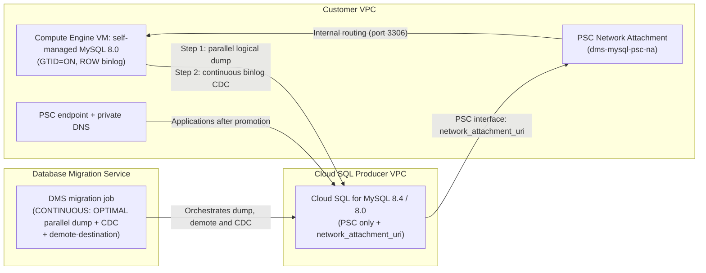

# Scenario 1: Live Migration from Self-Managed MySQL 8.0 on Compute Engine + Continuous CDC

**English** | [简体中文](README.zh-CN.md)

## Overview

This root Terraform template deploys an end-to-end **Live Initial Dump + Continuous Change Data Capture (CDC)** pipeline using **Database Migration Service (DMS)** to migrate self-managed **MySQL 8.0 on Compute Engine** to **Cloud SQL for MySQL (`MYSQL_8_4` default or `MYSQL_8_0`)** with a short cutover window. Default region: `europe-west2`.

### Key Architectural Highlights

- **Target Version Flexibility (`MYSQL_8_4` or `MYSQL_8_0`)**: Defaults to `MYSQL_8_4` (Enterprise Plus with Data Cache) while supporting `MYSQL_8_0`.
- **Private Service Connect (PSC) Default**: Creates a Compute Engine **Network Attachment** and attaches it to the PSC-only Cloud SQL instance (PSC interface, `psc_config.network_attachment_uri`) so that DMS reaches the source in your VPC. Private Services Access (`PSA`) is optional.
- **Application Access After Promotion**: Creates a **PSC consumer endpoint** (internal IP + forwarding rule) and a **private Cloud DNS record** for the instance DNS name (`create_psc_endpoint = true`).
- **No Passwords on the Command Line**: The DMS connection profiles and the migration job are native Terraform resources. The Cloud SQL root password is set on `root@'%'` with the write-only `password_wo` argument of `google_sql_user` and is not stored in state.
- **DMS-Managed Initial Load (`dump_parallel_level = "OPTIMAL"`)**: DMS runs a parallel logical dump from the live source and then switches to continuous GTID binlog replication (`type = "CONTINUOUS"`). `OPTIMAL` is the DMS recommendation; `MAX` adds load on the source.

---

## Architecture Flow



---

## Usage Instructions

Complete the [Prerequisites](../../README.md#3-prerequisites) and the source preparation in [runbook section 2](../../docs/gce_mysql80_to_cloudsql_dms_migration_runbook.md) first (`make preflight` must report no FAIL). The order is: **apply → users, grants, DEFINERs and flags (runbook section 5) → verify → start**.

### 1. Configure Variables

Copy `terraform.tfvars.example` to `terraform.tfvars` and populate your environment values. Pass passwords as environment variables instead of writing them to disk:

```bash
cp terraform.tfvars.example terraform.tfvars
export TF_VAR_cloudsql_root_password='REPLACE_ME'
export TF_VAR_source_gce_mysql_password='REPLACE_ME_MAX_32_CHARS'
```

### 2. Initialize and Validate

```bash
terraform init
terraform validate
```

### 3. Plan and Apply

```bash
terraform plan -out=tfplan
terraform apply tfplan
```

### 4. Verify & Start the DMS Migration Job

After Terraform creates the connection profiles and the migration job and demotes the destination, and after runbook section 5. Don't run `terraform apply` between `start` and `promote`: DMS changes the destination's backup and recovery settings (runbook section 6).

```bash
# Verify pre-flight connectivity and MySQL 8.0 replication configuration
gcloud database-migration migration-jobs verify gce-live-mysql80-cdc \
  --region=europe-west2

# Start the live initial dump + continuous CDC replication
gcloud database-migration migration-jobs start gce-live-mysql80-cdc \
  --region=europe-west2
```

### 5. Cutover / Promotion

Monitor replication lag with `make lag` (`max_replica_sec_lag`, with a fallback to the destination's `replica_lag` when `CLOUDSQL_INSTANCE` is set) or in Cloud Monitoring. When the lag is near `0` during the cutover window, stop writes on the source MySQL 8.0 instance, complete the Go / No-Go checklist and rollback decision (runbook section 8), and promote the Cloud SQL destination:

```bash
gcloud database-migration migration-jobs promote gce-live-mysql80-cdc \
  --region=europe-west2
```

Then point applications to the `psc_endpoint_dns_name` Terraform output, and run `terraform plan`/`apply` (runbook section 9.1). For teardown and decommission, see runbook section 10.
