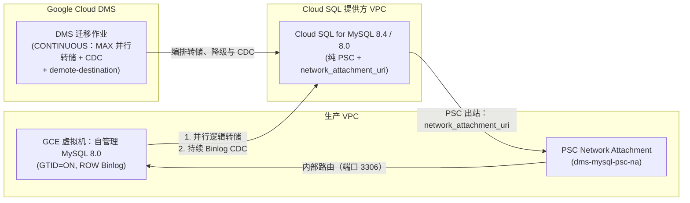

# 场景 1：从自管理 GCE MySQL 8.0 在线迁移 + 持续 CDC

[English](README.md) | **简体中文**

## 概览

此根 Terraform 模板借助 **Google Cloud Database Migration Service (DMS)** 部署端到端的 **在线初始转储 + 持续变更数据捕获（CDC）** 流水线，以近零停机的方式将自管理的 **Compute Engine (GCE) 上的 MySQL 8.0** 迁移至 **Cloud SQL for MySQL（默认 `MYSQL_8_4` LTS 或 `MYSQL_8_0`）**。

### 关键架构亮点

- **灵活的目标版本（`MYSQL_8_4` 或 `MYSQL_8_0`）**：默认使用 `MYSQL_8_4`（Enterprise Plus，并启用本地 SSD Data Cache），同时支持 `MYSQL_8_0`。Cloud DMS 不支持从 MySQL 8.0 直接跨主版本迁移至 9.7；如未来需要 9.x，请在提升后执行升级（`8.0 -> 8.4 -> 9.x`）。
- **默认使用 Private Service Connect (PSC)**：通过预配 Compute Engine **Network Attachment**（`google_compute_network_attachment`）并绑定 Cloud SQL 的 **PSC 出站**（`psc_config.network_attachment_uri`），配合自动化的 `demote-destination`，规避 VPC 对等互连的传递性限制；同时也支持传统的 Private Services Access (`PSA`)。
- **高吞吐初始加载（`dump_parallel_level = "MAX"`）**：直接从在线运行的 GCE MySQL 8.0 实例执行由 DMS 管理的多线程逻辑转储，并自动转入基于 GTID 的持续 Binlog 复制（`type = "CONTINUOUS"`）。

---

## 架构流程



---

## 使用说明

### 1. 配置变量

将 `terraform.tfvars.example` 复制为 `terraform.tfvars`，并填写您的环境参数值：

```bash
cp terraform.tfvars.example terraform.tfvars
```

### 2. 初始化与验证

```bash
terraform init
terraform validate
```

### 3. 规划与应用

```bash
terraform plan -out=tfplan
terraform apply tfplan
```

### 4. 验证并启动 DMS 迁移作业

Terraform 预配好连接配置文件和迁移作业后：

```bash
# Verify pre-flight connectivity and MySQL 8.0 replication configuration
gcloud database-migration migration-jobs verify gce-live-mysql80-cdc \
  --region=asia-southeast1

# Start the live initial dump + continuous CDC replication
gcloud database-migration migration-jobs start gce-live-mysql80-cdc \
  --region=asia-southeast1
```

### 5. 切换 / 提升

在切换窗口内，当 `replication_lag` 降至 `0 seconds` 时，停止 GCE MySQL 8.0 实例上的写入，并提升 Cloud SQL 目标实例：

```bash
gcloud database-migration migration-jobs promote gce-live-mysql80-cdc \
  --region=asia-southeast1
```
