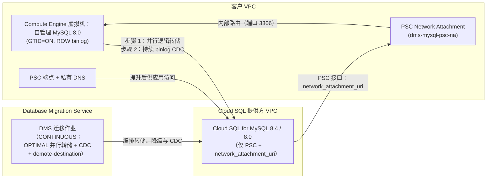

# 场景 1：从 Compute Engine 上的自管理 MySQL 8.0 在线迁移 + 持续 CDC

[English](README.md) | **简体中文**

## 概览

此根 Terraform 模板使用 **Database Migration Service (DMS)** 部署端到端的 **在线初始转储 + 持续变更数据捕获（CDC）** 流水线，将 **Compute Engine 上的自管理 MySQL 8.0** 迁移至 **Cloud SQL for MySQL（默认 `MYSQL_8_4`，或 `MYSQL_8_0`）**，切换窗口较短。默认区域：`europe-west2`。

### 关键架构要点

- **灵活的目标版本（`MYSQL_8_4` 或 `MYSQL_8_0`）**：默认使用 `MYSQL_8_4`（启用 Data Cache 的 Enterprise Plus），同时支持 `MYSQL_8_0`。
- **默认使用 Private Service Connect (PSC)**：创建 Compute Engine **Network Attachment**，并将其挂接到仅使用 PSC 的 Cloud SQL 实例（PSC 接口，`psc_config.network_attachment_uri`），使 DMS 能够访问您 VPC 中的源端。Private Services Access（`PSA`）为可选项。
- **提升后的应用访问**：为实例 DNS 名称创建 **PSC 使用方端点**（内部 IP + 转发规则）和 **私有 Cloud DNS 记录**（`create_psc_endpoint = true`）。
- **命令行中不出现密码**：DMS 连接配置文件和迁移作业均为原生 Terraform 资源。Cloud SQL root 密码使用只写参数 `root_password_wo`，不会存储在状态中。
- **由 DMS 管理的初始加载（`dump_parallel_level = "OPTIMAL"`）**：DMS 从在线源端执行并行逻辑转储，然后切换为基于 GTID 的持续 binlog 复制（`type = "CONTINUOUS"`）。`OPTIMAL` 是 DMS 的推荐值；`MAX` 会增加源端负载。

---

## 架构流程



---

## 使用说明

请先完成[前提条件](../../README.zh-CN.md#3-前提条件)以及[运维手册第 2 节](../../docs/gce_mysql80_to_cloudsql_dms_migration_runbook.zh-CN.md)中的源端准备工作。

### 1. 配置变量

将 `terraform.tfvars.example` 复制为 `terraform.tfvars` 并填写您的环境值。请通过环境变量传递密码，而不要将其写入磁盘：

```bash
cp terraform.tfvars.example terraform.tfvars
export TF_VAR_cloudsql_root_password='REPLACE_ME'
export TF_VAR_source_gce_mysql_password='REPLACE_ME_MAX_32_CHARS'
```

### 2. 初始化并验证

```bash
terraform init
terraform validate
```

### 3. 规划并应用

```bash
terraform plan -out=tfplan
terraform apply tfplan
```

### 4. 验证并启动 DMS 迁移作业

在 Terraform 创建连接配置文件和迁移作业并完成目标实例降级之后：

```bash
# Verify pre-flight connectivity and MySQL 8.0 replication configuration
gcloud database-migration migration-jobs verify gce-live-mysql80-cdc \
  --region=europe-west2

# Start the live initial dump + continuous CDC replication
gcloud database-migration migration-jobs start gce-live-mysql80-cdc \
  --region=europe-west2
```

### 5. 切换 / 提升

在 Cloud Monitoring 中监控 `datamigration.googleapis.com/migration_job/max_replica_sec_lag`。在切换窗口内，当复制延迟接近 `0` 时，停止源 MySQL 8.0 实例上的写入，并提升 Cloud SQL 目标实例：

```bash
gcloud database-migration migration-jobs promote gce-live-mysql80-cdc \
  --region=europe-west2
```

然后将应用指向 Terraform 输出 `psc_endpoint_dns_name`。
