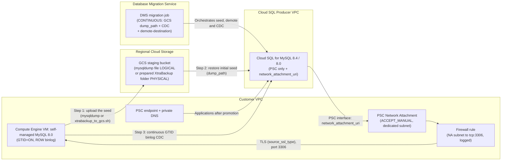

# Scenario 2: Migration from a Backup in GCS (mysqldump / Percona XtraBackup) + Continuous CDC

**English** | [简体中文](README.zh-CN.md)

## Overview

This root Terraform template deploys a **Backup-Seeded Continuous Change Data Capture (CDC)** migration pipeline using **Database Migration Service (DMS)** for large or load-sensitive **self-managed MySQL 8.0 on Compute Engine** workloads migrating to **Cloud SQL for MySQL (`MYSQL_8_4` default or `MYSQL_8_0`)**. Default region: `europe-west2`.

### Why Use Scenario 2 (Backup in GCS + CDC)?

- **You Control the Initial Seed**: Instead of a DMS-managed dump, you create a **`mysqldump` file (`LOGICAL`, default)** or a **prepared Percona XtraBackup (`PHYSICAL`)** on your own schedule and upload it to a regional **Cloud Storage (GCS)** staging bucket.
- **Seed + Automatic GTID CDC Resumption**: DMS restores the seed from `dump_path`, reads the GTID position recorded in the backup, and then replicates ongoing **binlog CDC** changes from the live source until cutover.
- **Automatic Bucket IAM**: The DMS service agent and the Cloud SQL instance service account get `roles/storage.objectViewer` + `roles/storage.legacyBucketReader`; `backup_writer_members` get `roles/storage.objectCreator` + `roles/storage.objectViewer`. You don't type the service agent email. In `DMS_MANAGED_CLOUDSQL` mode, DMS creates the instance after apply, so grant its service account both reader roles yourself before `verify`: `gcloud storage buckets add-iam-policy-binding gs://BUCKET --member=serviceAccount:INSTANCE_SA --role=roles/storage.objectViewer` (repeat with `roles/storage.legacyBucketReader`).
- **Locked-Down Replication Path**: `ACCEPT_MANUAL` Network Attachment (Cloud SQL tenant project only, derived in the same apply), a logged firewall rule from the Network Attachment subnet to the source port, TLS to the source (`source_ssl_type = "REQUIRED"`) and `cloudsql_ssl_mode = "ENCRYPTED_ONLY"`. See [docs/security_hardening.md](../../docs/security_hardening.md).
- **Bucket Retention and CMEK**: Seed objects are deleted after `staging_bucket_retention_days`, and noncurrent versions after `staging_bucket_noncurrent_version_retention_days`. Set `staging_bucket_kms_key_name` for CMEK.
- **Strict Terraform Schema Compliance (`dump_path` vs. `dump_flags`)**: Enforces the Google Terraform Provider requirement that `dump_path` and `dump_flags` are mutually exclusive on `google_database_migration_service_migration_job`.

### Support Matrix

| `dump_type` | Seed in GCS (`backup_gcs_path`) | Target `MYSQL_8_0` | Target `MYSQL_8_4` |
| :--- | :--- | :--- | :--- |
| `LOGICAL` (default) | One mysqldump file, for example `mysqldump/mysql80-dump.sql.gz` | Supported | Supported |
| `PHYSICAL` | Dedicated folder with a prepared XtraBackup, for example `xtrabackup/mysql80-full` | Supported | **Not supported by DMS** (Terraform validation fails) |

---

## Architecture Flow



---

## Usage Instructions

Complete the [Prerequisites](../../README.md#3-prerequisites) (including `gcloud beta services identity create --service=datamigration.googleapis.com`) and the source preparation in [runbook section 2](../../docs/gce_mysql80_to_cloudsql_dms_migration_runbook.md) first (`make preflight` must report no FAIL). The order is: **apply with `create_migration_job = false` → produce the seed → apply again (creates the job) → users, grants, DEFINERs and flags (runbook section 5) → verify → start**. Scenario 2 needs two applies because DMS rejects job creation with "The supplied dump file doesn't exist" until the seed is at `dump_path`.

### 1. Configure Variables

Copy `terraform.tfvars.example` to `terraform.tfvars` and set the project, network, `network_attachment_subnet`, `source_target_tags` (or `source_target_service_accounts`), `dump_type` and `backup_gcs_path`. Pass passwords as environment variables (for example from Secret Manager), and keep state in a remote backend ([`backend.tf.example`](backend.tf.example)):

```bash
cp terraform.tfvars.example terraform.tfvars
cp backend.tf.example backend.tf   # edit the bucket and KMS key
export TF_VAR_cloudsql_root_password="$(gcloud secrets versions access latest --secret=cloudsql-root-password)"
export TF_VAR_source_gce_mysql_password="$(gcloud secrets versions access latest --secret=dms-source-password)"
```

### 2. Initialize, Validate, and Apply Infrastructure

```bash
terraform init
terraform validate
# Phase 1: everything except the migration job (DMS checks dump_path when the job is created)
terraform plan -var create_migration_job=false -out=tfplan
terraform apply tfplan

# The single seed location configured on the migration job
terraform output -raw configured_dump_path
```

### 3. Produce the Seed at `configured_dump_path`

**`LOGICAL` (default):** on the source VM, stream a mysqldump file to the exact path (full command and flags: [runbook section 4, Option B](../../docs/gce_mysql80_to_cloudsql_dms_migration_runbook.md)):

```bash
export DUMP_PATH="gs://my-dms-staging-bucket/mysqldump/mysql80-dump.sql.gz"   # = configured_dump_path
mysqldump --defaults-extra-file="${HOME}/.mysqldump.cnf" --host=127.0.0.1 \
  --databases app_db1 app_db2 --hex-blob --no-autocommit --default-character-set=utf8mb4 \
  --single-transaction --routines --triggers --events --set-gtid-purged=ON \
  | gzip -c | gcloud storage cp - "${DUMP_PATH}"
```

**`PHYSICAL` (`MYSQL_8_0` target only):** on the source VM, run [`scripts/xtrabackup_to_gcs.sh`](scripts/xtrabackup_to_gcs.sh). It backs up, prepares and uploads the files into the dedicated folder:

```bash
export GCS_BACKUP_FOLDER="gs://my-dms-staging-bucket/xtrabackup/mysql80-full"   # = configured_dump_path
export XTRABACKUP_USER="xtrabackup"   # the script prompts for the password
sudo -E ./scripts/xtrabackup_to_gcs.sh
```

### 4. Verify & Start the DMS Backup + CDC Migration Job

Create the job with a second apply once the seed is complete, then complete runbook section 5. Don't run `terraform apply` between `start` and `promote`: DMS changes the destination's backup and recovery settings (runbook section 6).

```bash
# Phase 2 (after the seed is complete): create the migration job and demote the destination
terraform plan -out=tfplan
terraform apply tfplan

# Verify connection profiles, GCS permissions, and GTID replication topology
gcloud database-migration migration-jobs verify gcs-bkp-mysql80-cdc \
  --region=europe-west2

# Start the migration job (restores from GCS dump_path, then enters continuous CDC)
gcloud database-migration migration-jobs start gcs-bkp-mysql80-cdc \
  --region=europe-west2
```

### 5. Cutover / Promotion

Monitor replication lag with `make lag` (`max_replica_sec_lag`, with a fallback to the destination's `replica_lag` when `CLOUDSQL_INSTANCE` is set) or in Cloud Monitoring. When the lag is near `0` during the scheduled maintenance window, stop application writes to the source MySQL 8.0, complete the Go / No-Go checklist and rollback decision (runbook section 8), and promote Cloud SQL:

```bash
gcloud database-migration migration-jobs promote gcs-bkp-mysql80-cdc \
  --region=europe-west2
```

Then point applications to the `psc_endpoint_dns_name` Terraform output, and run `terraform plan`/`apply` (runbook section 9.1). Delete the seed once you no longer need it for a re-run (`gcloud storage rm "$(terraform output -raw configured_dump_path)"`, add `--recursive` for a `PHYSICAL` folder); the lifecycle rule removes the noncurrent version later. For teardown and decommission (delete the staging bucket last), see runbook section 10.

### 6. Retire the Migration Objects

After promotion, set `migration_enabled = false` and apply. Terraform deletes the DMS job, the connection profiles, the demote step, the Network Attachment and the source firewall rule; Cloud SQL, the PSC endpoint and DNS stay. Detaching the Network Attachment **restarts the instance**, so run it in a maintenance window (runbook section 10.2).

```bash
terraform plan -var migration_enabled=false -out=tfplan   # Review: Cloud SQL, endpoint and DNS are not destroyed
terraform apply tfplan
```
