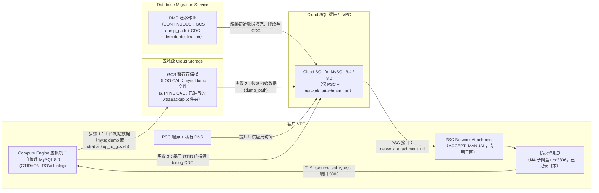

# 场景 2：基于 GCS 中的备份迁移（mysqldump / Percona XtraBackup）+ 持续 CDC

[English](README.md) | **简体中文**

## 概览

此根 Terraform 模板使用 **Database Migration Service (DMS)** 部署 **基于备份填充的持续变更数据捕获（CDC）** 迁移流水线，适用于将大型或对负载敏感的 **Compute Engine 上的自管理 MySQL 8.0** 工作负载迁移至 **Cloud SQL for MySQL（默认 `MYSQL_8_4`，或 `MYSQL_8_0`）**。默认区域：`europe-west2`。

### 为什么选择场景 2（GCS 中的备份 + CDC）？

- **由您控制初始数据**：不使用由 DMS 管理的转储，而是按您自己的时间安排生成 **`mysqldump` 文件（`LOGICAL`，默认）** 或 **已准备的 Percona XtraBackup（`PHYSICAL`）**，并上传到区域级 **Cloud Storage (GCS)** 暂存存储桶。
- **初始数据填充 + 自动恢复 GTID CDC**：DMS 从 `dump_path` 恢复初始数据，读取备份中记录的 GTID 位置，然后从在线源端持续复制 **binlog CDC** 变更，直至切换。
- **自动配置存储桶 IAM**：DMS 服务代理和 Cloud SQL 实例服务账号获得 `roles/storage.objectViewer` + `roles/storage.legacyBucketReader`；`backup_writer_members` 获得 `roles/storage.objectCreator` + `roles/storage.objectViewer`。无需手动输入服务代理的电子邮件地址。 在 `DMS_MANAGED_CLOUDSQL` 模式下，实例由 DMS 在 apply 之后创建，因此请在 `verify` 之前自行为其服务账号授予这两个读取角色：`gcloud storage buckets add-iam-policy-binding gs://BUCKET --member=serviceAccount:INSTANCE_SA --role=roles/storage.objectViewer`（再使用 `roles/storage.legacyBucketReader` 重复执行一次）。
- **收紧的复制路径**：`ACCEPT_MANUAL` Network Attachment（仅接受 Cloud SQL 租户项目，在同一次 apply 中推导得出）、一条从 Network Attachment 子网到源端端口且已记录日志的防火墙规则、到源端的 TLS（`source_ssl_type = "REQUIRED"`）以及 `cloudsql_ssl_mode = "ENCRYPTED_ONLY"`。请参阅 [docs/security_hardening.zh-CN.md](../../docs/security_hardening.zh-CN.md)。
- **存储桶保留期与 CMEK**：初始数据对象会在 `staging_bucket_retention_days` 天后删除，非当前版本会在 `staging_bucket_noncurrent_version_retention_days` 天后删除。如需使用 CMEK，请设置 `staging_bucket_kms_key_name`。
- **严格遵循 Terraform Schema（`dump_path` 与 `dump_flags`）**：遵循 Google Terraform Provider 的要求，即在 `google_database_migration_service_migration_job` 上 `dump_path` 与 `dump_flags` 互斥。

### 支持矩阵

| `dump_type` | GCS 中的初始数据（`backup_gcs_path`） | 目标 `MYSQL_8_0` | 目标 `MYSQL_8_4` |
| :--- | :--- | :--- | :--- |
| `LOGICAL`（默认） | 单个 mysqldump 文件，例如 `mysqldump/mysql80-dump.sql.gz` | 支持 | 支持 |
| `PHYSICAL` | 存放已准备 XtraBackup 的专用文件夹，例如 `xtrabackup/mysql80-full` | 支持 | **DMS 不支持**（Terraform 验证会失败） |

---

## 架构流程



---

## 使用说明

请先完成[前提条件](../../README.zh-CN.md#3-前提条件)（包括 `gcloud beta services identity create --service=datamigration.googleapis.com`）以及[运维手册第 2 节](../../docs/gce_mysql80_to_cloudsql_dms_migration_runbook.zh-CN.md)中的源端准备工作（`make preflight` 不得报告任何 FAIL）。顺序为：**使用 `create_migration_job = false` 执行 apply → 生成初始数据 → 再次 apply（创建作业）→ 用户、授权、DEFINER 与参数（运维手册第 5 节）→ verify → start**。场景 2 需要执行两次 apply，因为在初始数据写入 `dump_path` 之前，DMS 会以 "The supplied dump file doesn't exist" 拒绝创建作业。

### 1. 配置变量

将 `terraform.tfvars.example` 复制为 `terraform.tfvars`，并设置项目、网络、`network_attachment_subnet`、`source_target_tags`（或 `source_target_service_accounts`）、`dump_type` 和 `backup_gcs_path`。请通过环境变量传递密码（例如从 Secret Manager 读取），并将状态保存在远程后端中（[`backend.tf.example`](backend.tf.example)）：

```bash
cp terraform.tfvars.example terraform.tfvars
cp backend.tf.example backend.tf   # edit the bucket and KMS key
export TF_VAR_cloudsql_root_password="$(gcloud secrets versions access latest --secret=cloudsql-root-password)"
export TF_VAR_source_gce_mysql_password="$(gcloud secrets versions access latest --secret=dms-source-password)"
```

### 2. 初始化、验证并应用基础设施

```bash
terraform init
terraform validate
# Phase 1: everything except the migration job (DMS checks dump_path when the job is created)
terraform plan -var create_migration_job=false -out=tfplan
terraform apply tfplan

# The single seed location configured on the migration job
terraform output -raw configured_dump_path
```

### 3. 将初始数据生成到 `configured_dump_path`

**`LOGICAL`（默认）：** 在源虚拟机上，将 mysqldump 文件流式传输到该路径（完整命令与参数：[运维手册第 4 节方案 B](../../docs/gce_mysql80_to_cloudsql_dms_migration_runbook.zh-CN.md)）：

```bash
export DUMP_PATH="gs://my-dms-staging-bucket/mysqldump/mysql80-dump.sql.gz"   # = configured_dump_path
mysqldump --defaults-extra-file="${HOME}/.mysqldump.cnf" --host=127.0.0.1 \
  --databases app_db1 app_db2 --hex-blob --no-autocommit --default-character-set=utf8mb4 \
  --single-transaction --routines --triggers --events --set-gtid-purged=ON \
  | gzip -c | gcloud storage cp - "${DUMP_PATH}"
```

**`PHYSICAL`（仅限 `MYSQL_8_0` 目标）：** 在源虚拟机上运行 [`scripts/xtrabackup_to_gcs.sh`](scripts/xtrabackup_to_gcs.sh)。该脚本会执行备份、准备，并将文件上传到专用文件夹：

```bash
export GCS_BACKUP_FOLDER="gs://my-dms-staging-bucket/xtrabackup/mysql80-full"   # = configured_dump_path
export XTRABACKUP_USER="xtrabackup"   # the script prompts for the password
sudo -E ./scripts/xtrabackup_to_gcs.sh
```

### 4. 验证并启动 DMS 备份 + CDC 迁移作业

初始数据完整写入后，通过第二次 apply 创建作业，然后完成运维手册第 5 节。在 `start` 与 `promote` 之间不要运行 `terraform apply`：DMS 会更改目标实例的备份与恢复设置（运维手册第 6 节）。

```bash
# Phase 2 (after the seed is complete): create the migration job and demote the destination
terraform plan -out=tfplan
terraform apply tfplan

# Verify connection profiles, GCS permissions, and GTID replication topology
gcloud database-migration migration-jobs verify gcs-bkp-mysql80-cdc \
  --region=europe-west2

# Start the migration job (restores from GCS dump_path, then enters continuous CDC)
gcloud database-migration migration-jobs start gcs-bkp-mysql80-cdc \
  --region=europe-west2
```

### 5. 切换 / 提升

使用 `make lag`（`max_replica_sec_lag`；设置了 `CLOUDSQL_INSTANCE` 时会回退到目标实例的 `replica_lag`）或在 Cloud Monitoring 中监控复制延迟。在计划的维护窗口内，当复制延迟接近 `0` 时，停止应用对源 MySQL 8.0 的写入，完成 Go / No-Go 检查清单和回退决策（运维手册第 8 节），然后提升 Cloud SQL：

```bash
gcloud database-migration migration-jobs promote gcs-bkp-mysql80-cdc \
  --region=europe-west2
```

然后将应用指向 Terraform 输出 `psc_endpoint_dns_name`，并运行 `terraform plan`/`apply`（运维手册第 9.1 节）。当不再需要初始数据用于重新运行时，请将其删除（`gcloud storage rm "$(terraform output -raw configured_dump_path)"`，对于 `PHYSICAL` 文件夹请添加 `--recursive`）；生命周期规则稍后会移除非当前版本。如需清理与下线（最后删除暂存存储桶），请参阅运维手册第 10 节。

### 6. 下线迁移对象

提升之后，设置 `migration_enabled = false` 并执行 apply。Terraform 会删除 DMS 作业、连接配置文件、降级步骤、Network Attachment 和源端防火墙规则；Cloud SQL、PSC 端点和 DNS 会保留。分离 Network Attachment 会**重启实例**，因此请在维护窗口内执行（运维手册第 10.2 节）。

```bash
terraform plan -var migration_enabled=false -out=tfplan   # Review: Cloud SQL, endpoint and DNS are not destroyed
terraform apply tfplan
```
